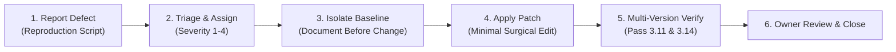

# ROBUST-ADAPT — Alpha Defect Register

**Document ID:** DEFREG-PHASE17-ALPHA-001<br>
**Version:** 0.1.0-alpha.0<br>
**Baseline Commit:** `c7123e98b24ad6b36719253263f8b03f5a09b63f` (`c7123e9`)<br>
**Branch:** `master`<br>
**Date:** November 2026<br>
**Status:** ACTIVE REGISTER<br>

---

## 1. Defect Severity & Classification Scheme

Every discovered issue in the ROBUST-ADAPT project is classified according to the following strict severity taxonomy:

| Severity Level | Definition | Release Policy |
| :--- | :--- | :--- |
| **Blocker (Severity 1)** | Unhandled crash, fatal import failure, memory corruption, mathematical invalidity in core algorithms, or complete failure on supported platforms. | **Zero Tolerance.** Must be remediated before any internal or external release. |
| **High (Severity 2)** | Major capability broken, cross-platform regression, significant performance regression (>2x expected latency), or unresolved legal/trademark risk. | **Release Blocking.** Requires resolution or explicit written waiver from the project owner. |
| **Medium (Severity 3)** | Edge-case non-finite handling failure, minor precision deviation, non-critical warning noise, or sub-optimal performance. | May be deferred to Beta if documented with a reproducible issue tracker. |
| **Low (Severity 4)** | Documentation typos, cosmetic formatting, or minor code cleanliness issues without functional impact. | Remediated during standard development cycles. |

---

## 2. Active Defect Inventory

### Defect DEF-ALPHA-001: Missing `Any` Import in `robust_adapt.rla.losses`

* **Defect ID:** `DEF-ALPHA-001`
* **Severity:** **Severity 2 (High / Platform Release Blocker)**
* **Component:** `robust_adapt.rla.losses` (Line 252)
* **Date Opened:** 2026-11-09
* **Status:** **RESOLVED & VERIFIED** (Remediated in Phase 17.1; verified on Python 3.11.9 & 3.14.3)
* **Date Closed:** 2026-11-09
* **Remediation Report:** `ROBUST_ADAPT_DEF_ALPHA_001_REMEDIATION_REPORT.md`
* **Affected Versions:** Python 3.10, 3.11, 3.12, 3.13 (Resolved)
* **Unaffected Versions:** Python 3.14 (due to PEP 649 lazy annotation evaluation)

#### Description & Symptoms
When importing `robust_adapt` (or `adaptive_ml`) in an environment running Python 3.10 through 3.13, execution aborts with a fatal `NameError`:
```
Traceback (most recent call last):
  File "<string>", line 1, in <module>
  File "C:\...\site-packages\robust_adapt\__init__.py", line 22, in <module>
    from robust_adapt.rla.label_correction import (
  File "C:\...\site-packages\robust_adapt\rla\label_correction.py", line 19, in <module>
    from robust_adapt.rla.losses import GeneralizedCrossEntropyLoss, SymmetricCrossEntropyLoss
  File "C:\...\site-packages\robust_adapt\rla\losses.py", line 252, in <module>
    class ReliabilityWeightedLoss:
  File "C:\...\site-packages\robust_adapt\rla\losses.py", line 269, in ReliabilityWeightedLoss
    def __init__(self, base_loss: Any, min_reliability: float = 0.0) -> None:
NameError: name 'Any' is not defined. Did you mean: 'any'?
```

#### Root Cause Analysis
In `robust_adapt/rla/losses.py`, line 6 specified:
```python
from typing import Optional, Tuple
```
`Any` was omitted from the `typing` import. Python 3.14 introduced PEP 649, deferring type annotation evaluation until explicitly inspected via `annotationlib`. However, Python 3.10–3.13 evaluate type annotations eagerly at class definition time, triggering the fatal `NameError`.

#### Impact & Blast Radius
Because `robust_adapt/__init__.py` imports `robust_adapt.rla.label_correction`, which imports `robust_adapt.rla.losses`, this defect cascaded across the entire canonical and compatibility namespace on Python 3.10–3.13.

#### Applied Remediation
Updated line 6 of `robust_adapt/rla/losses.py`:
```python
-from typing import Optional, Tuple
+from typing import Any, Optional, Tuple
```

#### Verification Evidence
1. `import robust_adapt` and `import adaptive_ml` succeed without error under Python 3.11.9.
2. Full pytest unit suite (257 tests), integration suite (46 tests), example suite (19 scripts), and SDK suite (4 tests) passed cleanly under Python 3.11.9.
3. Re-built wheel (`CA8E89A578ED076C700116812306C2929BFF5CB05204F0B7208C90BD4376FCD6`) installed cleanly in Python 3.11 isolated virtual environment outside repo.
4. Python 3.14.3 regression validation passed with zero failures (257 unit tests, 49 integration tests, 13 defect tests).


---

### Defect DEF-004 (AUDIT-DEF-004): Trademark Clearance for "ROBUST-ADAPT"

* **Defect ID:** `DEF-004` (`AUDIT-DEF-004`)
* **Severity:** **Severity 2 (High / Legal Clearance Blocker)**
* **Component:** Legal & Project Identity
* **Date Opened:** 2026-11-06
* **Status:** **OPEN / PENDING OUTSIDE COUNSEL REVIEW**
* **Affected Artifacts:** External branding, public package naming, release distribution

#### Description & Symptoms
Project rebranded from `adaptive_ml` to `robust_adapt` / `robust-adapt`. Prior to public release or external distribution, formal trademark search and clearance must be executed to ensure non-infringement on existing marks in scientific computing, machine learning, and optimization software.

#### Root Cause Analysis
Corporate intellectual property governance requires formal clearance before any public release, external repository publication, or commercial deployment.

#### Remediation Plan
Engage qualified intellectual property legal counsel to conduct a formal trademark clearance search in International Class 009 (Computer software for machine learning) and Class 042 (Software as a service for AI/ML).

#### Acceptance Criteria
1. Written legal opinion from outside IP counsel confirming trademark availability without confusing similarity.
2. Formal sign-off by legal and repository owner recorded in project governance docs.

---

## 3. Resolved Historical Defects (Pre-Phase 17)

### Defect DEF-PRE-001: Staged-Diff Whitespace and Formatting Irregularities

* **Defect ID:** `DEF-PRE-001`
* **Severity:** Severity 4 (Low)
* **Date Opened:** 2026-11-06
* **Date Closed:** 2026-11-06
* **Status:** **RESOLVED**
* **Resolution:** Cleaned trailing spaces in 401 Markdown files, converted Markdown two-space breaks to `<br>` elements in metadata blocks, and trimmed redundant EOF blank lines in 82 files. Passed `git diff --check` and `git diff --cached --check` prior to migration commit `c7123e9`.

---

## 4. Defect Remediation Workflow



1. **Reproduction Standard:** No defect is marked resolved without an automated executable test demonstrating the failure before the fix and the pass after the fix.
2. **Commit Policy:** Defect fixes must not be combined with architectural or research logic modifications. Each remediation must be an atomic, documented change.
3. **Immutability Constraint:** Under Phase 17 rules, `DEF-ALPHA-001` remains in `OPEN` status until the repository owner reviews the validation findings and authorizes the repair commit.
