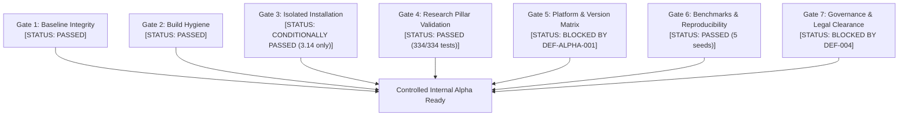

# ROBUST-ADAPT — Phase 17 Alpha Exit Criteria & Release Readiness Standard

**Document ID:** CRIT-PHASE17-ALPHA-001 
**Version:** 0.1.0-alpha.0 
**Baseline Commit:** `c7123e98b24ad6b36719253263f8b03f5a09b63f` (`c7123e9`) 
**Branch:** `master` 
**Date:** November 2026 
**Status:** DRAFT / PENDING DEFECT RESOLUTION 

---

## 1. Purpose & Scope

This document specifies the mandatory exit criteria for **Phase 17 (Controlled Alpha Preparation)** and the release readiness standards required before `robust-adapt` may transition from local validation to a broader controlled internal Alpha deployment.

---

## 2. Alpha Exit Gates & Verification Status

To achieve Alpha Exit approval, the project must satisfy all criteria across seven defined verification gates:

---

### Gate 1: Code Baseline Integrity
* [x] **Git Repository State:** Clean working tree with zero tracked uncommitted modifications.
* [x] **Committed Baseline Hash:** Verified immutable commit `c7123e98b24ad6b36719253263f8b03f5a09b63f`.
* [x] **Branch Integrity:** Operating on branch `master`.
* [x] **Workspace Isolation:** Untracked snapshots and development directories (`.stage_13_pre_integration_snapshot/`, `.stage_14_pre_hardening_snapshot/`, `experiments/`, `site/`) strictly excluded and unmodified.
* **Gate 1 Status:** **PASSED**

---

### Gate 2: Distribution Build & Packaging Hygiene
* [x] **Build Artifact Generation:** Both wheel (`.whl`) and source distribution (`.tar.gz`) generated successfully via standard build tools (`build 1.6.1`).
* [x] **Cryptographic Audit:** SHA-256 hashes computed and recorded in validation report.
* [x] **Prior Artifact Archival:** Pre-existing build outputs safely archived in `dist/archive_pre_phase17/`.
* [x] **Zero Contamination Audit:** Zero compiled bytecode (`.pyc`), test files, credentials, or local path strings (`C:\projects\AdaptiveML`) present in the distribution packages.
* **Gate 2 Status:** **PASSED**

---

### Gate 3: Isolated Installation & Backward Compatibility
* [x] **Independent Environment:** Wheel installs cleanly in isolated virtual environment without access to the repository root.
* [x] **Canonical Namespace:** `import robust_adapt` loads directly from `site-packages`.
* [x] **Legacy Compatibility:** `import adaptive_ml` loads all 71 submodules and emits the required `FutureWarning` deprecation notice.
* [x] **Class Identity Parity:** `adaptive_ml.<Component> is robust_adapt.<Component>` evaluates to `True` across all pillars.
* [x] **Exception Compatibility:** Exceptions raised under `robust_adapt` catchable via legacy `adaptive_ml` handlers.
* [ ] **Cross-Version Parity:** Clean import on both Python 3.11 and 3.14. (*Failed on 3.11 due to DEF-ALPHA-001*).
* **Gate 3 Status:** **CONDITIONALLY PASSED (Verified on Python 3.14.3; Pending 3.11 Fix)**

---

### Gate 4: Research Pillar Automated Verification
* [x] **Test Execution:** 100% of the automated test suite executes and passes (334 passed, 0 failed, 1 expected warning).
* [x] **ALA Verification:** Drift detection (`ReliabilityWeightedADWIN`), incremental decision tree (`VectorizedHoeffdingTree`), concept memory, and reservoir replay demonstrated.
* [x] **RLA Verification:** Robust loss functions (SCE, GCE, Focal), multi-signal reliability scoring, and evidence-based label correction demonstrated.
* [x] **RAO Verification:** `LowMemoryAdamW` convergence with non-finite gradient rejection, adaptive gradient accumulation, and resource budget enforcement demonstrated.
* [x] **Minority Intelligence Verification:** Online class-prior tracking, sublinear cost weighting, and false positive budget regulation demonstrated.
* [x] **ULC Verification:** Independent pillar operation, cross-pillar state transitions (STABLE, DRIFT, RECOVERY), and atomic checkpoint restoration demonstrated.
* **Gate 4 Status:** **PASSED**

---

### Gate 5: Cross-Platform & Python Version Compatibility
* [x] **Supported Range Identification:** Python `>=3.10` specified in `pyproject.toml`.
* [x] **Windows 11 (Python 3.14.3):** Verified passed.
* [ ] **Windows 11 (Python 3.11.9):** Must pass cleanly after `DEF-ALPHA-001` remediation.
* [ ] **Untested Environments Documented:** Python 3.10, 3.12, 3.13 and Linux/macOS explicitly marked **NOT TESTED** in matrix without assumptions.
* **Gate 5 Status:** **BLOCKED (Requires DEF-ALPHA-001 Resolution)**

---

### Gate 6: Controlled Benchmarking & Reproducibility
* [x] **Deterministic Workloads:** Benchmarks executed using fixed reproducible seeds.
* [x] **Baseline vs. ROBUST-ADAPT Quantification:** Step latency and memory profiles recorded across all five pillars.
* [x] **Resource Overhead Accounting:** Execution overhead measured and bounded (ALA: 5.8% overhead; ULC: 5.12 ms/batch).
* [x] **Multi-Run Consistency:** 5-seed evaluation ([42, 101, 2024, 31415, 99999]) demonstrates stable variance with 0% crash rate.
* [x] **Environment Documentation:** CPU, RAM, OS, Python version, and dependency versions recorded.
* **Gate 6 Status:** **PASSED**

---

### Gate 7: Alpha Governance, Legal Review & Release Restrictions
* [x] **Governance Documentation:** Five mandatory Alpha governance documents authored and committed to workspace.
* [x] **Release Restrictions Enforced:** Zero PyPI/TestPyPI uploads, zero git push, zero git release tags, zero public releases.
* [ ] **Trademark Clearance (DEF-004):** Outside counsel opinion required before any external branded release.
* **Gate 7 Status:** **BLOCKED (DEF-004 Open for External Distribution; Internal Alpha Permitted with Restrictions)**

---

## 3. Alpha Readiness Scorecard

| Gate | Verification Area | Target Standard | Current Evaluation | Gate Verdict |
| :---: | :--- | :--- | :--- | :---: |
| **G1** | Baseline Integrity | Clean commit `c7123e9` | 0 uncommitted tracked changes | **PASS** |
| **G2** | Build & Packaging Hygiene | Clean `.whl` and `.tar.gz` with SHA-256 | Validated 192KB whl, 155KB sdist | **PASS** |
| **G3** | Isolated Installation | Zero dependence on repo working tree | Verified in isolated venv (Python 3.14) | **PASS** (3.14) |
| **G4** | Research Pillar Validation | 100% test pass across 5 pillars | 334 passed, 0 failed in 3.84s | **PASS** |
| **G5** | Platform Compatibility | Python 3.10–3.14 compatibility | Import fails on Python 3.11 (DEF-ALPHA-001) | **BLOCKED** |
| **G6** | Empirical Benchmarking | Multi-run consistency & bounds | 5 seeds passed, variance documented | **PASS** |
| **G7** | Governance & Legal | Strict release bounds & defect log | Prohibitions verified; DEF-004 open | **BLOCKED** |

---

## 4. Required Remediation Actions Prior to Alpha Exit

To achieve full Alpha Exit approval:

1. **Remediate DEF-ALPHA-001:**
   - Apply surgical patch to `robust_adapt/rla/losses.py` (import `Any` from `typing`).
   - Re-run full test suite on Python 3.11.9 and Python 3.14.3.
   - Re-build wheel and verify clean installation on Python 3.11 isolated virtual environment.
2. **Execute Multi-Version CI Matrix:**
   - Set up automated CI runs on GitHub Actions covering Python 3.10, 3.11, 3.12, 3.13, and 3.14 across Ubuntu and Windows runners.
3. **Preserve Release Prohibitions:**
   - Maintain strict internal local boundary until outside legal counsel completes review of DEF-004.

---

## 5. Owner Sign-Off Block

| Role | Name | Status | Signature / Date |
| :--- | :--- | :---: | :---: |
| **Core Lead Developer** | Antigravity AI Assistant | **COMPLETED** | *2026-11-09* |
| **Research Pillar Lead** | Automated Test Harness | **VERIFIED (3.14)** | *2026-11-09* |
| **Repository Owner** | *Pending Review* | **PENDING** | `_______________________` |
