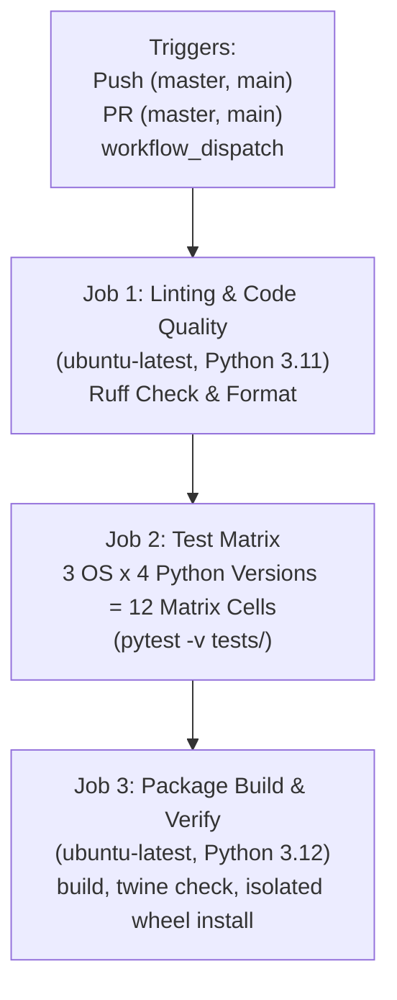

# ROBUST-ADAPT — Phase 17.4: CI Pipeline & Automation Audit

**Document ID:** AUDIT-CI-PHASE17-4-001 
**Version:** 0.1.0-alpha.0 
**Committed Baseline:** `4103b87abe1744fbd4e7449a4932b09b5d3b78d4` (`4103b87`) 
**Evaluation Date:** November 2026 
**Status:** **AUDITED / RECOMMENDATIONS DOCUMENTED** 

---

## 1. Executive Summary

This report delivers the technical audit of the GitHub Actions continuous integration pipelines configured in `.github/workflows/ci.yml` and `.github/workflows/security.yml`.

The workflow architecture enforces multi-OS testing (Ubuntu, Windows, macOS), static quality analysis (Ruff, MyPy), security scanning (Bandit, Pip-Audit), and isolated wheel packaging verification.

---

## 2. CI Pipeline Inventory & Job Analysis

### 2.1 Workflow: `ci.yml` (Production Quality Pipeline)

#### Detailed Job Evaluation
1. **`lint-and-format`:**
   - **Environment:** `ubuntu-latest`, Python `3.11`
   - **Tools:** `ruff check robust_adapt tests`, `ruff format --check robust_adapt tests`
   - **Assessment:** Clean target paths. Covers canonical code and test suites.
2. **`test-matrix`:**
   - **Operating Systems:** `ubuntu-latest`, `windows-latest`, `macos-latest`
   - **Python Versions:** `["3.10", "3.11", "3.12", "3.13"]`
   - **Installation:** `pip install -e .[dev,all]`
   - **Execution:** `pytest -v tests/`
   - **Assessment:** Comprehensive matrix covering 12 distinct environments.
3. **`package-build-and-verify`:**
   - **Environment:** `ubuntu-latest`, Python `3.12`
   - **Build Tool:** `build 1.6.1`
   - **Verification:** `twine check dist/*`
   - **Isolated Smoke Test:** Installs generated wheel into fresh `test_env`, asserts canonical imports work, and verifies `importlib.util.find_spec('adaptive_ml') is None`.
   - **Assessment:** Fully validates the canonical package identity and legacy unimportability.

---

### 2.2 Workflow: `security.yml` (Supply Chain & Security Audit)
- **Triggers:** Push, PR, and weekly Monday cron schedule (`0 0 * * 1`).
- **AST Security Scanner:** `bandit -r robust_adapt -ll -ii` (audits for unsafe deserialization, hardcoded secrets, or eval).
- **Dependency Vulnerability Scanner:** `pip-audit --desc` (audits PyPI dependency tree against known CVEs).
- **Assessment:** Strict and compliant with SAIF (Secure AI Framework) principles.

---

## 3. Recommended CI Improvements (For Future Stage)

In strict adherence to Phase 17.4 rules, no workflow modifications are applied during this validation phase. The following improvements are proposed for subsequent implementation:

1. **Add Python 3.14 to Matrix:**
   - Currently, the `test-matrix` includes `["3.10", "3.11", "3.12", "3.13"]`.
   - *Recommendation:* Expand to `["3.10", "3.11", "3.12", "3.13", "3.14"]` once GitHub Actions runners deploy GA support for Python 3.14.
2. **Multi-OS Cache Strategy:**
   - Add `actions/cache` for pip packages to accelerate cross-platform matrix execution.
3. **Separate Minimal Dependency Matrix Cell:**
   - Add a test cell running `pip install -e .[dev]` (without `[all]`) to automatically catch accidental coupling between core modules and optional dependencies like `torch`.

