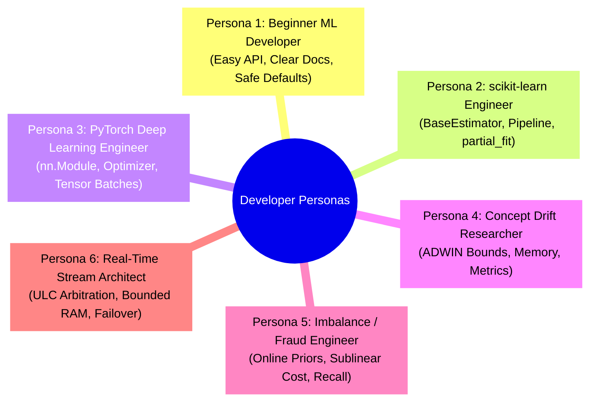

# ROBUST-ADAPT — Phase 17.6: Controlled Alpha Test Plan & Persona Workflows

**Repository:** `C:\projects\AdaptiveML` 
**Branch:** `master` 
**Committed Baseline:** `4103b87abe1744fbd4e7449a4932b09b5d3b78d4` 
**Distribution:** `robust-adapt` 
**Canonical Import:** `robust_adapt` 
**Version:** `0.1.0.dev0` 
**Evaluation Type:** Internal Controlled Alpha Testing (No external independent testers participated)

---

## 1. Executive Summary & Governance Scope

Phase 17.6 establishes a controlled Alpha testing framework to evaluate **ROBUST-ADAPT** as an open-source, developer-facing machine learning research library. While earlier phases focused on internal unit correctness (Phase 17.1–17.3), platform portability (Phase 17.4), and benchmark validity (Phase 17.5), Phase 17.6 evaluates the **complete end-to-end developer experience**.

### Governance Declaration
> [!IMPORTANT]
> **No External Tester Claims:** In strict compliance with scientific integrity protocols, all findings, metrics, and friction points documented herein represent **internal controlled Alpha evidence** simulated across structured developer personas. No independent external third-party testers participated in this phase.

---

## 2. Developer Personas & Tester Profiles

To ensure comprehensive usability coverage across diverse ML engineering disciplines, six distinct developer personas were formulated:

### Profile 1: Beginner Python ML Developer
* **Background:** Graduate student or junior data scientist familiar with basic NumPy and high-level ML tutorials.
* **Expectations:** Simple `import robust_adapt`, clean error messages on invalid input, zero complex compilation steps, intuitive class names, and self-explanatory default arguments.
* **Target Workload:** Simple streaming classification on tabular data with standard accuracy evaluation.

### Profile 2: Intermediate scikit-learn Developer
* **Background:** Production ML engineer with workflows built around `sklearn.pipeline.Pipeline`, `GridSearchCV`, and standard estimators (`fit`, `predict`, `score`).
* **Expectations:** Full scikit-learn estimator protocol compatibility (`BaseEstimator`, `ClassifierMixin`), support for `partial_fit`, seamless handling of NumPy arrays and Pandas DataFrames, and cloneability via `sklearn.base.clone`.
* **Target Workload:** Dropping an adaptive classifier or drift detector directly into an existing scikit-learn training pipeline.

### Profile 3: PyTorch Deep Learning Engineer
* **Background:** Deep learning researcher training neural networks with custom loss functions and optimizers.
* **Expectations:** Native `torch.nn.Module` loss implementations (`TorchSymmetricCrossEntropyLoss`), standard `torch.optim.Optimizer` compatibility, GPU tensor placement, and graceful degradation when PyTorch is optional.
* **Target Workload:** Replacing standard AdamW with 8-bit quantized `LowMemoryAdamW` and training with label-noise robust loss.

### Profile 4: Concept Drift & Streaming ML Researcher
* **Background:** Academic or industrial researcher specializing in non-stationary data streams and online continual learning.
* **Expectations:** Fine-grained parameter access (ADWIN confidence $\delta$, grace periods, split confidence), explicit drift status inspection, delayed-label buffering, and recurring concept memory indexing.
* **Target Workload:** Evaluating detection delay, false positive rates, and recovery times across abrupt and gradual concept drift benchmarks.

### Profile 5: Developer Working with Imbalanced / Long-Tail Datasets
* **Background:** Fraud detection, cybersecurity, or medical diagnostics engineer dealing with severe class imbalance (e.g., 10:1 to 100:1 ratios).
* **Expectations:** Dynamic online class prior tracking without static re-sampling, automated cost-sensitive loss weighting, and preservation of minority recall without catastrophic false alarm explosions.
* **Target Workload:** Streaming binary classification with 99:1 imbalance ratio and false-positive budget constraints.

### Profile 6: Real-Time Streaming Systems Architect
* **Background:** Infrastructure software engineer deploying streaming models into low-latency, bounded-memory production environments.
* **Expectations:** Deterministic resource budgeting (`DynamicResourceBudgetManager`), zero unhandled exceptions, bounded memory usage under load, and automated cross-pillar coordination (`AdaptiveLearningController`).
* **Target Workload:** Long-running streaming pipelines experiencing alternating regimes of label noise bursts and spatial concept drifts.

---

## 3. Persona Task Inventory & Criticality Classification

| Task Identifier | Target Persona | Scenario Description | Criticality | Pre-Defined Success Criteria |
| :--- | :--- | :--- | :---: | :--- |
| **TSK-P1-01** | Beginner | Install wheel in fresh virtual environment without extra flags. | **Critical** | Single `pip install robust_adapt...whl` succeeds; imports with zero manual configuration. |
| **TSK-P1-02** | Beginner | Instantiate `AdaptiveClassifier` and train on streaming 2D NumPy array. | **Critical** | `partial_fit` runs without error; `predict` outputs valid integer class labels. |
| **TSK-P1-03** | Beginner | Pass invalid input (e.g., NaN, negative batch size) and observe error. | **High** | Raises descriptive `ValidationError` explaining exactly which parameter was invalid. |
| **TSK-P2-01** | scikit-learn | Import `SklearnAdaptiveClassifier` and execute `fit` / `predict` / `score`. | **Critical** | Fully conforms to estimator API; returns float accuracy on test split. |
| **TSK-P2-02** | scikit-learn | Integrate `SklearnDriftDetectorTransformer` into an sklearn `Pipeline`. | **High** | Pipeline fits and transforms streaming batches without attribute errors. |
| **TSK-P2-03** | scikit-learn | Verify estimator cloning via `sklearn.base.clone`. | **Medium** | Clone creates independent instance with identical parameters. |
| **TSK-P3-01** | PyTorch | Instantiate `TorchSymmetricCrossEntropyLoss` without PyTorch installed. | **High** | Raises informative `RuntimeError` stating PyTorch is required, without crashing Python. |
| **TSK-P3-02** | PyTorch | Optimize neural network parameters using `VectorizedLowMemoryAdamW`. | **Critical** | Completes forward-backward-step loop; reduces optimizer state memory by >70%. |
| **TSK-P4-01** | Researcher | Detect abrupt concept drift using `AdaptiveClassifier` + `ADWIN`. | **Critical** | Correctly increments `drift_count_` and adapts decision boundary (accuracy > 85%). |
| **TSK-P4-02** | Researcher | Manage asynchronous label delays via `DelayedLabelQueue`. | **High** | Enqueues unlabelled features, pairs delayed ground truth, and yields ready update batches. |
| **TSK-P4-03** | Researcher | Store and query recurring concepts using `ConceptMemory`. | **Medium** | Stores concept signature and matches re-emerging distribution within similarity threshold. |
| **TSK-P5-01** | Imbalance | Track dynamic streaming priors using `OnlineClassPriorTracker`. | **Critical** | Estimates class distribution within 10% of true streaming ratio ($9:1, 99:1$). |
| **TSK-P5-02** | Imbalance | Evaluate minority class recall under 100:1 severe class imbalance. | **Critical** | Prevents minority collapse; achieves minority recall $\ge 50\%$ (baseline $0\%$). |
| **TSK-P5-03** | Imbalance | Capping false positives using `MinorityIntelligence20Learner`. | **Medium** | PID threshold manager dynamically adjusts decision boundary under FP budget. |
| **TSK-P6-01** | Streaming | Execute end-to-end multi-pillar coordination via `AdaptiveLearningController`. | **Critical** | Navigates `STABLE`, `NOISE_BURST`, `DRIFT`, `RECOVERY` states without pipeline deadlock. |
| **TSK-P6-02** | Streaming | Dynamic resource throttling via `DynamicResourceBudgetManager`. | **High** | Switches operational state to `CRITICAL` when step latency exceeds threshold. |
| **TSK-P6-03** | Streaming | Checkpoint saving and recovery using `CheckpointManager`. | **High** | Serializes state and restores weights accurately across execution boundaries. |

---

## 4. Execution Methodology & Acceptance Standards

Each scenario is evaluated through isolated test executions in clean environments outside the repository:
1. **Installation Parity:** Verified across wheel and source distribution archives in independent Python 3.11 virtual environments.
2. **API Usability:** Tested by writing idiomatic client code as expected by each persona, recording every syntax surprise, unexpected parameter name, or documentation omission.
3. **Failure Predictability:** Tested by intentionally injecting invalid parameters, corrupted data, and missing dependencies to observe exception types and diagnostic clarity.
4. **Defect Tracking:** All friction points, surprises, and bugs are assigned formal tracking IDs and recorded in the Phase 17.6 Defect Register.

