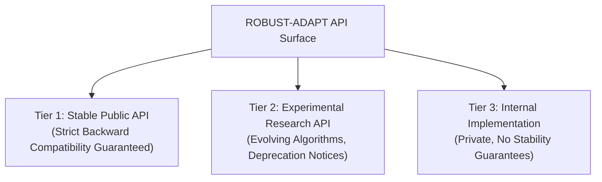

# ROBUST-ADAPT — Phase 17.7: Public API Compatibility & Evolution Policy

**Repository:** `C:\projects\AdaptiveML`<br>
**Branch:** `master`<br>
**Committed Baseline:** `4103b87abe1744fbd4e7449a4932b09b5d3b78d4`<br>
**Distribution:** `robust-adapt`<br>
**Canonical Package:** `robust_adapt`<br>
**Version:** `0.1.0.dev0`<br>
**Policy Status:** Official Public API Governance Specification

---

## 1. Executive Summary & Purpose

This document establishes the official **Public API Compatibility Policy** for **ROBUST-ADAPT**. As a library bridging research innovation and production streaming machine learning, ROBUST-ADAPT defines explicit boundaries regarding which interfaces are stable, which are experimental, how deprecations are managed, and how future versions evolve.

---

## 2. API Surface Classification

ROBUST-ADAPT categorizes all exposed code symbols into three distinct stability tiers:



### 2.1 Tier 1: Stable Public API
Interfaces exported directly in top-level `robust_adapt.__all__` and canonical subpackages:
* **Core Estimators:** `AdaptiveClassifier`, `VectorizedHoeffdingTree`, `SklearnAdaptiveClassifier`.
* **Drift Detectors:** `ReliabilityWeightedADWIN` (aliased as `ADWIN`), `CUSUMDetector`, `PageHinkleyDetector`.
* **Robust Losses:** `SymmetricCrossEntropyLoss`, `GeneralizedCrossEntropyLoss`, `FocalLoss`, `ReliabilityWeightedLoss`.
* **Optimization & Resource Managers:** `LowMemoryAdamW`, `BlockQuantizer`, `AdaptiveGradientAccumulator`, `DynamicResourceBudgetManager`.
* **Controllers & Orchestration:** `AdaptiveLearningController`, `ControllerDirective`, `ControllerState`.
* **Minority Intelligence:** `OnlineClassPriorTracker`, `compute_sublinear_cost_weights`.
* **State Management:** `CheckpointManager`, `save_state`, `load_state`.

> [!NOTE]
> Tier 1 APIs follow strict backward compatibility. Existing keyword arguments, positional orders, and return types will not be removed or altered without a formal two-minor-version deprecation cycle.

### 2.2 Tier 2: Experimental Research API
Interfaces actively being explored for future production inclusion:
* Advanced controller variants: `UnifiedLearningControllerV4_1`, `UnifiedLearningControllerV5`.
* Complex taxonomy classifiers: `NoiseTaxonomyClassifier`, `DriftClassifier`.
* Experimental research metrics and heuristics.

> [!TIP]
> Tier 2 interfaces may undergo signature refinement across minor versions (`0.x.0`). All breaking changes will be disclosed in release notes with clear upgrade paths.

### 2.3 Tier 3: Internal Implementation Details
Modules, functions, and variables prefixed with an underscore (`_`) or located in private subpackages:
* Example: `robust_adapt.core._constants`, private helper classes in `backends/`.
* No compatibility guarantees. Subject to refactoring at any time.

---

## 3. Compatibility Rules & Evolution Mechanics

### 3.1 Constructor Compatibility
* **Positional Parameters:** Positional parameters in Tier 1 estimators will never be reordered or removed in minor releases.
* **New Parameters:** All new parameters added to Tier 1 constructors must be keyword-optional with backward-compatible defaults.
* **Parameter Aliasing:** When an intuitive parameter name replaces an older name (e.g., `max_delay` replacing `max_wait_time` in `DelayedLabelQueue`), the legacy parameter will remain accepted indefinitely or until a major version bump.

### 3.2 Method Signatures & Return Values
* Methods will never reduce their return value tuple arity. If additional metadata is exposed, it will be added as dictionary fields, dataclass attributes, or optional tuple extensions.
* Array-accepting methods will continue to support automatic coercion from NumPy arrays, Pandas DataFrames, and Python lists.

### 3.3 Deprecation Policy
1. When an API is scheduled for retirement, it will first emit a Python standard `FutureWarning` detailing:
   * The deprecated symbol name.
   * The recommended replacement.
   * The target release for removal (minimum 2 minor releases ahead).
2. Code example of standard deprecation warning:
   ```python
   warnings.warn(
       "The 'max_wait_time' parameter is deprecated and will be removed in"
       " v0.3.0. Please use 'max_delay' instead.",
       category=FutureWarning,
       stacklevel=2,
   )
```

### 3.4 Versioning Policy
* **Pre-Release Stage (`0.1.0.dev0` to `0.1.0`):** Rapid stabilization, defect remediation, and public interface finalization.
* **Minor Versions (`0.x.0`):** New features, additive API enhancements, experimental research modules.
* **Patch Versions (`0.x.y`):** Bug fixes, performance optimizations, documentation updates with zero API changes.
* **Major Version (`1.0.0`):** Guaranteed long-term API stability and enterprise production readiness.

---

## 4. Optional Dependency Integration Contracts

ROBUST-ADAPT maintains a strict **decoupled core** architecture. Third-party frameworks must adhere to explicit integration contracts:

| Optional Framework | Extra Target | Integration Contract | Failure Semantics |
| :--- | :--- | :--- | :--- |
| **PyTorch** | `robust-adapt[torch]` | Exports `TorchSymmetricCrossEntropyLoss` and `VectorizedLowMemoryAdamW`. | If PyTorch is uninstalled, importing classes succeeds, but instantiation raises `RuntimeError` directing user to `pip install 'robust-adapt[torch]'`. |
| **scikit-learn** | `robust-adapt[sklearn]` | Exports `SklearnAdaptiveClassifier`, `SklearnDriftDetectorTransformer`, `SklearnReliabilityFilter`. | Fallback dummy classes prevent import failure; instantiation directs user to install scikit-learn. |
| **Safetensors** | `robust-adapt[safetensors]` | Provides zero-copy zero-pickle binary weight serialization. | If missing, `save_state`/`load_state` raises `SerializationError` directing user to `pip install 'robust-adapt[safetensors]'`. |

---

## 5. State Serialization & Checkpoint Compatibility

1. **State Dictionary Immutability:** State dictionaries produced by `state_dict()` use standardized NumPy float arrays (`float32` or `float64`) and primitive JSON-serializable types.
2. **Backward-Compatible Loading:** `load_state_dict()` will accept legacy checkpoint dictionaries containing subsets of modern parameters, applying documented default values for newly added state variables.
3. **Safe Storage Formats:** By default, binary state is stored using `.safetensors` to prevent arbitrary code execution vulnerabilities associated with standard Python `pickle`.

