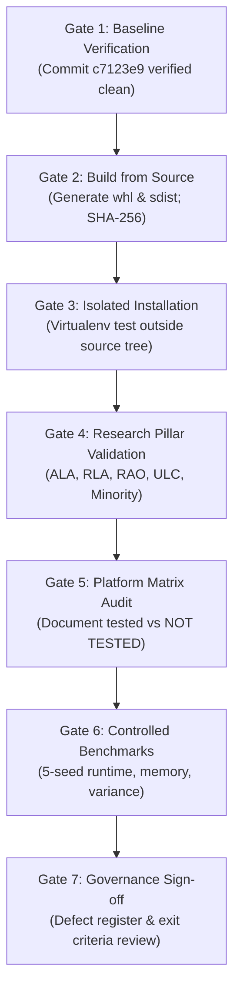

# ROBUST-ADAPT — Phase 17: Controlled Alpha Preparation Plan

**Document ID:** PLAN-PHASE17-ALPHA-001 
**Version:** 0.1.0-alpha.0 
**Baseline Commit:** `c7123e98b24ad6b36719253263f8b03f5a09b63f` (`c7123e9`) 
**Branch:** `master` 
**Date:** November 2026 
**Status:** ACTIVE / CONTROLLED INTERNAL ALPHA PREPARATION 
**Classification:** STRICTLY INTERNAL / PROPRIETARY 

---

## 1. Executive Summary & Objective

Phase 17 initiates the controlled internal Alpha preparation for the **ROBUST-ADAPT** scientific machine learning library following the successful local identity migration from legacy `adaptive_ml`.

### Core Identifiers
* **Canonical Package:** `robust_adapt`
* **Distribution Name:** `robust-adapt` (`0.1.0.dev0`)
* **Legacy Compatibility Namespace:** `adaptive_ml` (71 forwarding shims emitting `FutureWarning`)
* **Target Milestone:** Controlled Internal Alpha Build

### Primary Objectives
1. **Committed Baseline Verification:** Ensure complete immutability of the migration commit (`c7123e9`) and enforce strict isolation of untracked workspace artifacts.
2. **Deterministic Build Pipeline:** Generate fresh, cryptographically auditable wheel (`.whl`) and source distribution (`.tar.gz`) packages, archiving all pre-existing artifacts.
3. **Isolated Installation Validation:** Validate installation in fresh virtual environments strictly outside the source repository tree, certifying canonical and backward-compatibility entry points.
4. **Independent Research Pillar Validation:** Execute rigorous automated validation of all five core scientific pillars:
   - Adaptive Learning Algorithms (ALA)
   - Robust Learning Algorithms (RLA)
   - Resource-Aware Optimization (RAO)
   - Unified Learning Controller (ULC)
   - Adaptive Minority Intelligence
5. **Cross-Platform Compatibility Assessment:** Evaluate execution across supported Python versions (3.10 through 3.14) and operating systems, separating verified empirical evidence from unverified assumptions.
6. **Reproducible Benchmarking:** Profile latency, memory footprint, resource overhead, and repeated-run consistency using fixed random seeds.
7. **Alpha Governance Framework:** Formally document defect tracking, verification matrices, exit criteria, and legal compliance.

---

## 2. Governance, Boundaries & Strict Release Prohibitions

This phase is strictly confined to internal local verification. The following operations are strictly **PROHIBITED**:

* ❌ **NO PyPI Upload:** `twine upload` targeting public PyPI is forbidden.
* ❌ **NO TestPyPI Upload:** Publication to test indexes is forbidden.
* ❌ **NO Git Remote Operations:** `git push` to origin or upstream remotes is forbidden.
* ❌ **NO Release Tags:** Creation of git tags (`git tag v0.1.0*`) is forbidden.
* ❌ **NO GitHub Release:** Draft or published GitHub releases are forbidden.
* ❌ **NO Public Announcements:** No blog posts, social media, or public PRs.
* ❌ **NO External Branded Distribution:** Artifacts must not leave internal environments.
* ❌ **NO Premature Trademark Claims:** Trademark Clearance Defect `DEF-004` (`AUDIT-DEF-004`) remains **OPEN** pending formal outside counsel opinion.

---

## 3. Milestone Execution Gates & Workflow

The Phase 17 Alpha preparation proceeds across seven sequential verification gates:

### Gate 1: Committed Baseline Verification
* Confirm HEAD commit matches `c7123e98b24ad6b36719253263f8b03f5a09b63f`.
* Verify zero tracked working-tree modifications.
* Ensure preserved isolation for excluded directories (`.stage_13_pre_integration_snapshot/`, `.stage_14_pre_hardening_snapshot/`, `experiments/`, `site/`).

### Gate 2: Build & Packaging Hygiene
* Archive prior distribution artifacts to `dist/archive_pre_phase17/`.
* Invoke `python -m build --wheel --sdist` under Python 3.14.3.
* Audit package contents for zero temporary files, `.pyc`, build caches, local paths, or secrets.
* Compute and record SHA-256 checksums.

### Gate 3: Isolated Installation Testing
* Instantiate isolated virtual environment in a temporary path (`%TEMP%\venv_alpha_test_py314`).
* Install wheel using standard `pip install`.
* Execute execution tests outside the repository tree (`cwd != repo_dir`).
* Verify:
  - Canonical `import robust_adapt` loads from `site-packages`.
  - Legacy `import adaptive_ml` issues `FutureWarning` with correct deprecation message.
  - Class identity parity (`adaptive_ml.X is robust_adapt.X`).
  - Exception catchability across namespaces.
  - Representative algorithmic instantiation and partial fitting.

### Gate 4: Research Pillar Validation
* Execute all 334 automated unit and integration tests across:
  - ALA: Concept drift detection (`ReliabilityWeightedADWIN`), incremental decision trees (`VectorizedHoeffdingTree`), streaming classifier (`AdaptiveClassifier`), concept memory (`RecurringConceptMemory`), reservoir replay (`ClassBalancedReservoirReplay`).
  - RLA: Robust losses (`SymmetricCrossEntropyLoss`, `GeneralizedCrossEntropyLoss`, `FocalLoss`), multi-signal reliability engine (`MultiSignalReliabilityEngine`), density-aware margin scorer (`DensityAwareMarginScorer`), label correction (`EvidenceBasedLabelCorrector`).
  - RAO: Low-memory optimizer (`LowMemoryAdamW`), adaptive accumulator (`AdaptiveGradientAccumulator`), dynamic resource budget manager (`DynamicResourceBudgetManager`).
  - Minority Intelligence: Online prior tracking (`OnlineClassPriorTracker`), adaptive decision thresholds (`AdaptiveThresholdManager`, `DynamicFPBudgetThresholdManager`, `compute_sublinear_cost_weights`).
  - ULC: Cross-pillar controller (`AdaptiveLearningController`, `UnifiedLearningControllerV4_1`, `UnifiedLearningControllerV5`), directives, state persistence (`CheckpointManager`).

### Gate 5: Platform Compatibility Matrix
* Review `pyproject.toml` declared Python version support (`>=3.10`).
* Evaluate local runtime availability:
  - Python 3.14.3 on Windows 11 (AMD64): **TESTED — PASSED**.
  - Python 3.11.9 on Windows 11 (AMD64): **TESTED — FAILED** (`DEF-ALPHA-001`).
* Audit untested environments:
  - Python 3.10, 3.12, 3.13 on Windows 11: **NOT TESTED** (inferred blocked by `DEF-ALPHA-001`).
  - Linux (all versions): **NOT TESTED** (no host/container locally available).
  - macOS (all versions): **NOT TESTED** (no host locally available).

### Gate 6: Controlled Performance & Reproducibility Benchmarks
* Benchmark baseline vs ROBUST-ADAPT algorithms under controlled synthetic workloads.
* Measure step latency (ms), memory footprint (KB/MB via `tracemalloc`), and resource overhead ratio.
* Execute 5 deterministic seed runs ([42, 101, 2024, 31415, 99999]) to quantify variance (mean, std dev, min, max).
* Document underlying hardware and test constraints.

### Gate 7: Alpha Governance Sign-off
* Produce the complete set of Phase 17 Alpha governance deliverables:
  1. `ROBUST_ADAPT_PHASE_17_ALPHA_PLAN.md` (this plan)
  2. `ROBUST_ADAPT_ALPHA_TEST_MATRIX.md`
  3. `ROBUST_ADAPT_ALPHA_VALIDATION_REPORT.md`
  4. `ROBUST_ADAPT_ALPHA_DEFECT_REGISTER.md`
  5. `ROBUST_ADAPT_ALPHA_EXIT_CRITERIA.md`
* Present all findings to the repository owner for formal review prior to initiating any code remediations.

---

## 4. Telemetry and Privacy Guarantees

* Zero external network telemetry is included in `robust_adapt` or `adaptive_ml`.
* Process memory telemetry (`get_process_memory_bytes`, `MemoryBudgetTracker`) queries local operating system APIs (`psutil` or Windows `K32GetProcessMemoryInfo`) and never transmits data externally.
* No user data, runtime metrics, or environment fingerprints are collected or transmitted.
