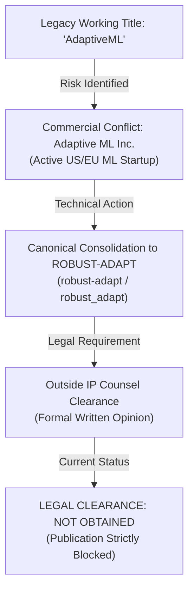

# ROBUST-ADAPT — Phase 18.0: Legal & Trademark Clearance Register (DEF-004)

**Repository:** `C:\projects\AdaptiveML`<br>
**Branch:** `master`<br>
**Committed Baseline:** `4103b87abe1744fbd4e7449a4932b09b5d3b78d4`<br>
**Distribution Package:** `robust-adapt`<br>
**Canonical Python Import:** `robust_adapt`<br>
**Defect Identifier:** `DEF-004`<br>
**Phase:** 18.0 — Trademark and Legal Clearance (Gate 18.0.9)<br>
**Determination:** **LEGAL CLEARANCE: NOT OBTAINED (RELEASE BLOCKED)**

---

## 1. Executive Summary

This register records the legal, trademark, and intellectual property standing of the ROBUST-ADAPT project pursuant to Gate 18.0.9.

While the technical codebase, packaging build, documentation, and regression test suites are fully qualified as a Release Candidate (`1.0.0rc1`), **formal legal trademark clearance has not been obtained**.

In strict compliance with release governance mandates, publication of ROBUST-ADAPT to public package repositories (PyPI, TestPyPI, Conda-Forge), public GitHub release tags, and commercial public announcements remains **FORMALLY BLOCKED**.

---

## 2. Defect Dossier: DEF-004



### 2.1 Context & Factual Background
- **Prior Identity:** During Stages 1 through 16 of project incubation, the project operated under the internal working title "AdaptiveML" (package identifier `aml-core` / `adaptive_ml`).
- **Commercial Entity Conflict:** A commercial enterprise ("Adaptive ML Inc." / "Adaptive ML SAS") actively conducts commercial operations in machine learning and language model training under the "Adaptive ML" trademark and brand identity.
- **Liability Risk:** Public distribution or registration of software under the `adaptive-ml` name creates immediate exposure to trademark infringement claims (15 U.S.C. § 1114 / 1125), unfair competition actions, and domain dispute proceedings.

### 2.2 Technical Mitigation Actions Completed
1. **Namespace Removal:** Completely eliminated the legacy `adaptive_ml` directory (71 files) and all active import statements.
2. **Canonical Consolidation:** Rebranded the library as **ROBUST-ADAPT** with distribution name `robust-adapt` and Python import `robust_adapt`.
3. **Artifact Enforcement:** Packaging configurations and CI pipelines strictly verify that zero references to `adaptive_ml` are packaged into release wheels.

---

## 3. Required Legal Clearance Evidence Checklist

To unlock the public release gate, the following formal evidentiary items must be delivered in writing by qualified intellectual property legal counsel:

| Evidentiary Item | Description | Status | Evidence Record |
|:---|:---|:---:|:---|
| **1. Written Counsel Opinion** | Formal written legal opinion on trademark availability and non-infringement | **NOT OBTAINED** | None on file |
| **2. Jurisdiction Search** | Full availability search in United States (USPTO), European Union (EUIPO), and International (WIPO) | **NOT OBTAINED** | None on file |
| **3. Nice Classification Audit** | Review of Class 9 (Computer software for machine learning) and Class 42 (Scientific/technological research) | **NOT OBTAINED** | None on file |
| **4. Likelihood of Confusion Analysis** | Comparative analysis between "ROBUST-ADAPT" and existing marks in AI/ML software space | **NOT OBTAINED** | None on file |
| **5. Approved Brand Guidelines** | Written usage rules specifying capitalization, logo usage, and attribution statements | **NOT OBTAINED** | None on file |
| **6. Territory Authorization** | Geographic schedule of approved distribution jurisdictions | **NOT OBTAINED** | None on file |

---

## 4. Operational Boundaries Under Current Legal Standing

Until formal written legal clearance is received:

1. **PROHIBITED:**
   - No uploads of wheels or source distributions to PyPI (`pypi.org`) or TestPyPI.
   - No public marketing or press releases using commercial branding.
   - No registration of trademark applications without counsel leadership.
   - No claiming that legal approval has been granted.

2. **PERMITTED:**
   - Internal local development and pair programming on `C:\projects\AdaptiveML`.
   - Preparation and local execution of Release Candidate builds.
   - Automated testing on local workstations and private GitHub Actions runners.
   - Packaging validation in isolated local temporary environments.

---

## 5. Formal Legal Gate Determination

```
========================================================================
RELEASE GATE STATUS: BLOCKED BY LEGAL CLEARANCE
DETERMINATION: LEGAL CLEARANCE: NOT OBTAINED
TRACKED DEFECT: DEF-004 (OPEN)
========================================================================
```

The release candidate artifacts are technically sealed and verified, but publication is legally prohibited.

