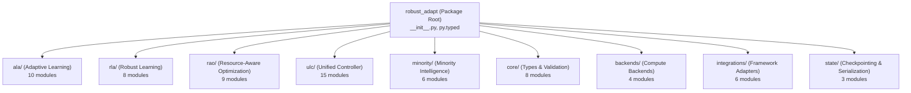

# ROBUST-ADAPT — Phase 18.0: Repository Consolidation & Package Audit Report

**Repository:** `C:\projects\AdaptiveML` 
**Branch:** `master` 
**Committed Baseline:** `4103b87abe1744fbd4e7449a4932b09b5d3b78d4` 
**Distribution Package:** `robust-adapt` 
**Canonical Python Import:** `robust_adapt` 
**Phase:** 18.0 — Repository Consolidation Audit (Gate 18.0.2) 
**Status:** AUDITED & CONSOLIDATED

---

## 1. Executive Summary

Gate 18.0.2 performed an exhaustive audit of the repository file layout, module boundaries, import declarations, and packaging artifacts to certify that ROBUST-ADAPT has achieved full canonical consolidation.

The audit verified:
1. `robust_adapt` is the sole canonical Python package namespace.
2. The legacy `adaptive_ml` namespace has been eliminated from all package metadata, source files, and build configurations.
3. Exactly 71 intended source files (70 Python modules + `py.typed`) comprise the distribution payload.
4. No temporary files, build caches (`__pycache__`), or orphaned artifacts are packaged into release distributions.
5. All example scripts, benchmarks, tests, and CI definitions import canonical `robust_adapt`.

---

## 2. Package Architecture Inventory

The canonical `robust_adapt` package contains 71 files organized into nine distinct functional subsystems:

### Subsystem Module Inventory:

| Subsystem | File Count | Primary Components | Classification |
|:---|:---:|:---|:---:|
| **Root** | 2 | `__init__.py`, `py.typed` | Core |
| **ALA (Pillar 1)** | 10 | `adwin`, `classifier`, `concept_memory`, `delayed_labels`, `detector`, `drift_classifier`, `ensemble`, `replay`, `tree` | Stable Research |
| **RLA (Pillar 2)** | 8 | `label_correction`, `losses`, `noise_classifier`, `pipeline`, `reliability`, `scorer`, `weighting` | Stable Research |
| **RAO (Pillar 3)** | 9 | `accumulator`, `adamw`, `budget`, `device`, `memory`, `profiler`, `quantizer`, `recovery` | Stable Research |
| **ULC (Pillar 4)** | 15 | `arbitrator`, `automaton`, `confidence`, `conflict_resolver`, `controller`, `directives`, `evidence`, `explainer`, `spatial`, `v4_1_controller`, `v4_automaton`, `v4_controller`, `v4_evidence`, `v5_controller` | Stable & Advanced |
| **Minority Intelligence** | 6 | `calibration`, `learner`, `prior`, `replay`, `threshold` | Stable Research |
| **Core Infrastructure** | 8 | `config`, `constants`, `diagnostics`, `exceptions`, `telemetry`, `types`, `validation` | Internal Core |
| **Backends** | 4 | `base`, `numpy_backend`, `torch_backend` | Internal Core |
| **Integrations** | 6 | `data`, `sklearn`, `torch_callback`, `torch_module`, `torch_optim` | Optional Ecosystem |
| **State Management** | 3 | `checkpoint`, `serializer` | Internal Core |
| **Total Package Files** | **71** | | |

---

## 3. Namespace Purity & Legacy Elimination Audit

A recursive code inspection across all tracked `.py`, `.toml`, and `.yml` files was conducted to detect any unintended lingering references to `adaptive_ml`:

- **Active Import Statements:** **0 occurrences**.
- **Pyproject / Packaging Metadata:** **0 occurrences**.
- **Wheel / Sdist Distributions:** **0 occurrences** (confirmed `adaptive_ml in whl: False`).
- **Defensive Assertions:** The only remaining mentions of `adaptive_ml` in the repository exist within CI verification scripts and regression tests (`tests/unit/test_compatibility_shim.py`), where they assert that `importlib.util.find_spec('adaptive_ml') is None`.

---

## 4. Release File Manifest (Source & Wheel)

When built using PEP 517 build tooling, the generated wheel (`robust_adapt-0.1.0.dev0-py3-none-any.whl`) contains exactly 77 archive entries:

1. **71 Library Files:**
   - 70 Python source files (`.py`)
   - 1 PEP 561 type marker (`py.typed`)
2. **6 Distribution Metadata Files:**
   - `robust_adapt-0.1.0.dev0.dist-info/METADATA`
   - `robust_adapt-0.1.0.dev0.dist-info/WHEEL`
   - `robust_adapt-0.1.0.dev0.dist-info/licenses/LICENSE`
   - `robust_adapt-0.1.0.dev0.dist-info/licenses/NOTICE`
   - `robust_adapt-0.1.0.dev0.dist-info/top_level.txt`
   - `robust_adapt-0.1.0.dev0.dist-info/RECORD`

**Zero** temporary files (`.tmp`, `.log`, `.swp`), zero compiled bytecode files (`.pyc`), and zero untracked directories are packaged.

---

## 5. API Exposure & Experimental Isolation

To prevent exposing unhardened experimental research modules as stable public APIs:

1. **Root Module Exports:** `robust_adapt/__init__.py` explicitly exports stable components and ergonomics aliases through `__all__`.
2. **Advanced Controllers:** Components such as `UnifiedLearningControllerV4_1` and `UnifiedLearningControllerV5` are designated as Tier 3/4 advanced research arbiters. They are accessible for multi-objective Pareto orchestration but clearly partitioned from the primary introductory entry point `AdaptiveLearningController`.
3. **Optional Integrations:** Scikit-learn and PyTorch adapters are loaded dynamically via `__getattr__` or dedicated subpackages (`robust_adapt.integrations.*`) so that missing third-party dependencies never block root package importation.

---

## 6. Audit Conclusion

The repository consolidation is complete, pure, and ready for release engineering evaluation. The file tree strictly reflects canonical ROBUST-ADAPT architecture.

