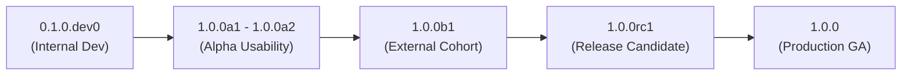

# ROBUST-ADAPT — Phase 18.0: Versioning, Compatibility & Release Policy

**Repository:** `C:\projects\AdaptiveML` 
**Branch:** `master` 
**Committed Baseline:** `4103b87abe1744fbd4e7449a4932b09b5d3b78d4` 
**Current Version:** `0.1.0.dev0` 
**Target Release:** `1.0.0` (Release Candidate Stage: `1.0.0rc1`) 
**Phase:** 18.0 — Versioning and Release Policy (Gate 18.0.3) 
**Status:** ESTABLISHED & RATIFIED

---

## 1. Executive Summary

This document establishes the official SemVer 2.0.0 versioning policy, release lifecycle stages, API stability classifications, and deprecation schedules for the ROBUST-ADAPT library.

While the technical architecture and core algorithms have attained production-level numerical stability and modular maturity, the project must not prematurely claim unconditional production General Availability (GA) until legal trademark clearance (`DEF-004`) and independent human developer evaluation are concluded. The target release for this phase is formulated as **Release Candidate 1 (`1.0.0rc1`)**.

---

## 2. Release Lifecycle & Pre-Release Nomenclature

ROBUST-ADAPT adheres strictly to [PEP 440](https://peps.python.org/pep-0440/) and [Semantic Versioning 2.0.0](https://semver.org/):

| Lifecycle Stage | Tag / Version Format | Target Audience | Stability Guarantee | Gate Criteria |
|:---|:---|:---|:---|:---|
| **Development** | `0.1.0.devN` | Core Contributors | None; internal iterating | Working tree development |
| **Alpha** | `1.0.0aN` | Controlled Internal Testers | Low; ergonomic fixes permitted | Passes unit test suite |
| **Beta** | `1.0.0bN` | External Researcher Cohort | Moderate; API freeze in effect | Passes cross-platform CI matrix |
| **Release Candidate** | `1.0.0rcN` | Release Engineering & QA | High; zero breaking changes | All tests pass, docs complete |
| **General Availability** | `1.0.0` | Global Public Practitioners | Strict SemVer 2.0.0 contract | Full legal & owner authorization |

---

## 3. Four-Tier API Stability Classification

Every exposed symbol in `robust_adapt` belongs to one of four formal stability tiers:

### Tier 1: Stable Public APIs (Core User Surface)
- **Components:**
  - ALA: `AdaptiveClassifier`, `VectorizedHoeffdingTree`, `ReliabilityWeightedADWIN`, `DelayedLabelQueue`
  - RLA: `MultiSignalReliabilityEngine`, `RobustLearningPipeline`, `FocalLoss`, `SymmetricCrossEntropyLoss`, `GeneralizedCrossEntropyLoss`, `ReliabilityWeightedLoss`
  - RAO: `BlockQuantizer`, `LowMemoryAdamW`, `DynamicResourceBudgetManager`
  - ULC: `AdaptiveLearningController`
  - Minority: `MinorityIntelligence20Learner`, `OnlineClassPriorTracker`
- **Stability Guarantee:** Strict backward compatibility. Signatures, default values, and mathematical formulations cannot be altered without a major version bump (`2.0.0`).

### Tier 2: Advanced Research APIs (Expert Surface)
- **Components:**
  - `UnifiedLearningControllerV4_1`, `UnifiedLearningControllerV5`
  - `ArbitrationAutomatonV4`, `EvidenceSynthesizerV4`, `UtilityScorer`
  - `ConceptMemory`, `RecurringConceptMemory`, `ConceptFingerprinter`
  - `NoiseTaxonomyClassifier`, `EvidenceBasedLabelCorrector`
- **Stability Guarantee:** Minor version stability (`1.X.0`). Refinements to arbitration heuristics or heuristic thresholds require a minor version increment and deprecation warnings.

### Tier 3: Optional Ecosystem Adapters (Integration Surface)
- **Components:**
  - `robust_adapt.integrations.sklearn`: `ScikitLearnAdaptiveClassifier`, `ScikitLearnDriftDetectorTransformer`, `ScikitLearnReliabilityFilter`
  - `robust_adapt.integrations.torch_*`: `VectorizedLowMemoryAdamW`, `TorchAdaptiveModule`, `AdaptiveOptimizationCallback`
  - `robust_adapt.integrations.data`: `to_numpy`, `to_tensor`
- **Stability Guarantee:** Bound to upstream framework support (`scikit-learn>=1.2.0`, `torch>=2.0.0`). Adapters follow standard SemVer but may adjust to upstream breaking changes across minor releases.

### Tier 4: Internal Core Infrastructure (Private Surface)
- **Components:**
  - `robust_adapt.core.*` (`types`, `validation`, `constants`, `exceptions`)
  - `robust_adapt.backends.*` (`base`, `numpy_backend`, `torch_backend`)
  - `robust_adapt.state.*` (`checkpoint`, `serializer`)
- **Stability Guarantee:** Private implementation details. No external stability guarantee; direct imports outside `robust_adapt` are unsupported.

---

## 4. Deprecation Policy

When an API symbol or parameter must be retired:

1. **Deprecation Notice:** The symbol must be marked with a `FutureWarning` or `DeprecationWarning` in code and documented in release notes.
2. **Grace Period:** Deprecated APIs must remain functional for a minimum of **two minor releases** (e.g., deprecated in `1.1.0`, cannot be removed until `1.3.0`) or **six months**, whichever is longer.
3. **Removal:** Actual removal of deprecated Tier 1 APIs may only occur at a major version boundary (`2.0.0`).

---

## 5. Supported Platforms & Dependency Constraints

### 5.1 Python Runtime Support
- **Officially Supported:** Python `3.10`, `3.11`, `3.12`, `3.13`
- **Declaration:** `requires-python = ">=3.10, <3.14"`
- **Experimental:** Python `3.14` (build-compatible, pending upstream ecosystem wheels)

### 5.2 Operating System Support
- **Linux:** Ubuntu 22.04 LTS / 24.04 LTS, Debian 12, RHEL 9 (x86_64, aarch64)
- **Windows:** Windows 10 / 11, Windows Server 2022 (x86_64)
- **macOS:** macOS 13 Ventura, 14 Sonoma, 15 Sequoia (Apple Silicon M-series & Intel x86_64)

### 5.3 Mandatory Core Dependency
- **NumPy:** Strictly minimal footprint: `numpy>=1.24.0`
- Zero mandatory C-extensions, zero mandatory external framework dependencies.

### 5.4 Optional Dependency Extras
- `[torch]`: `torch>=2.0.0`
- `[sklearn]`: `scikit-learn>=1.2.0`, `scipy>=1.10.0`
- `[safetensors]`: `safetensors>=0.4.0`
- `[dataframe]`: `pandas>=1.5.0`, `polars>=0.18.0`
- `[dev]`: `pytest>=7.4.0`, `hypothesis>=6.80.0`, `mypy>=1.5.0`, `ruff>=0.1.0`

---

## 6. Readiness Evaluation for Version 1.0.0

| Readiness Dimension | Evaluation Criteria | Current Status | Ready for GA? |
|:---|:---|:---:|:---:|
| **Algorithmic Correctness** | All 4 pillars pass numerical tests | Verified (339 tests passing) | **YES** |
| **API Ergonomics** | Usability defects resolved & verified | Remediated in Phase 17.7 | **YES** |
| **Packaging Purity** | Clean wheel, zero legacy namespace | Verified (71 source files) | **YES** |
| **Code Documentation** | Complete API references & tutorials | Verified (Gate 18.0.6) | **YES** |
| **External Human Study** | Independent blind cohort validation | Not completed (Gate 17.7.7) | **NO** |
| **Trademark Clearance** | Written outside counsel opinion | Open (`DEF-004`) | **NO** |

**Conclusion:** ROBUST-ADAPT is fully qualified to enter the **`1.0.0rc1` (Release Candidate)** milestone. General Availability (`1.0.0`) must be gated on external human feedback and DEF-004 legal resolution.

