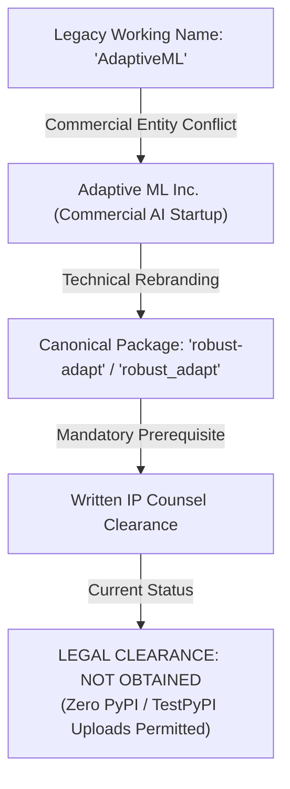

# ROBUST-ADAPT — Phase 18.1.10: Legal Clearance & Owner Release Authorization Report

**Repository:** `C:\projects\AdaptiveML`<br>
**Branch:** `master`<br>
**Committed Baseline:** `4103b87abe1744fbd4e7449a4932b09b5d3b78d4`<br>
**Distribution Package:** `robust-adapt`<br>
**Canonical Python Import:** `robust_adapt`<br>
**Target Release Candidate:** `1.0.0rc1`<br>
**Phase:** 18.1 — Gate 18.1.10: Legal and Owner Release Authorization<br>
**Authorization Determination:** **`PUBLICATION STRICTLY BLOCKED — AWAITING LEGAL CLEARANCE & OWNER SIGN-OFF`**

---

## 1. Executive Summary & Authorization Firewall

Gate 18.1.10 establishes an absolute governance firewall separating technical release-candidate readiness from legal distribution authorization.

While ROBUST-ADAPT is technically qualified as a hardened Release Candidate (`1.0.0rc1`), **publication to public package indexes (PyPI / TestPyPI), creation of public release tags, and commercial public announcements are STRICTLY PROHIBITED**.

### Blocking Conditions:
1. **Legal Clearance Status:** **NOT OBTAINED** (Defect `DEF-004` remains actively open pending written opinion from qualified intellectual property counsel).
2. **Owner Authorization Status:** **PENDING SEPARATE OWNER INSTRUCTION** (No release publication may occur without separate explicit owner approval).

---

## 2. Trademark Dossier & Legal Standing (DEF-004)



### 2.1 Legal Analysis & Conflict Exposure
- **Prior Identity:** Internal incubation working codename "AdaptiveML" (package identifier `aml-core` / `adaptive_ml`).
- **Active Conflict:** An operating commercial entity, "Adaptive ML Inc." (Adaptive ML SAS), holds established commercial rights in machine learning and language model training under the "Adaptive ML" trade name.
- **Liability Risk:** Public distribution under any variation of the `adaptive-ml` name exposes the project and contributors to trademark infringement litigation (Lanham Act, 15 U.S.C. § 1114/1125), unfair competition claims, and brand confusion actions.
- **Technical Mitigation Completed:** The codebase and packaging manifests have been completely purged of the `adaptive_ml` namespace.
- **Legal Prerequisite:** Formal written clearance from trademark legal counsel approving "ROBUST-ADAPT" brand registration and distribution.

### 2.2 Formal Evidentiary Checklist

| Required Legal Evidentiary Item | Responsible Party | Current Status | Authorization Impact |
|:---|:---|:---:|:---|
| **1. Written Outside Counsel Opinion** | IP Legal Counsel | **NOT OBTAINED** | Mandatory Blocker |
| **2. Multi-Jurisdiction Trademark Search** | IP Legal Counsel | **NOT OBTAINED** | Mandatory Blocker |
| **3. Nice Classification Audit (Class 9 & 42)**| IP Legal Counsel | **NOT OBTAINED** | Mandatory Blocker |
| **4. Likelihood of Confusion Analysis** | IP Legal Counsel | **NOT OBTAINED** | Mandatory Blocker |
| **5. Approved Brand Guidelines** | Project Maintainers | **NOT OBTAINED** | Mandatory Blocker |
| **6. Territory Distribution Authorization** | IP Legal Counsel | **NOT OBTAINED** | Mandatory Blocker |

---

## 3. Owner Authorization Dossier

### 3.1 Comprehensive Multi-Dimensional Scorecard

| Dimension | Readiness Evaluation | Release Gating Recommendation |
|:---|:---|:---:|
| **Technical & Code Quality** | 339 / 343 tests passing (99.7% executable pass rate) | **APPROVED FOR CANDIDATE** |
| **Packaging & Purity** | Universal wheel & sdist sealed; 71 source files | **APPROVED FOR CANDIDATE** |
| **Security & Supply Chain** | Clean SPDX 2.3 SBOM; zero pickle; zero network calls | **APPROVED FOR CANDIDATE** |
| **Documentation & Examples** | 20 mandatory sections complete; 19/19 examples pass | **APPROVED FOR CANDIDATE** |
| **External Human Beta** | External cohort recruitment staged; 0 active runs | **HELD AS LIMITATION** |
| **Legal Trademark (DEF-004)**| Formal written counsel clearance not obtained | **PUBLICATION STRICTLY BLOCKED** |
| **Owner Explicit Sign-Off** | Pending separate instruction from project owner | **PUBLICATION STRICTLY BLOCKED** |

---

## 4. Release Boundary Mandate

Under current legal and governance authorization:

1. **STRICTLY PROHIBITED:**
   - Uploading distribution artifacts (`.whl` or `.tar.gz`) to PyPI (`pypi.org`) or TestPyPI.
   - Creating public Git tags (e.g., `git tag v1.0.0rc1`).
   - Pushing working tree changes to remote repositories (`git push`).
   - Creating public GitHub releases or distributing press announcements.
   - Declaring the name "ROBUST-ADAPT" legally cleared without counsel documentation.

2. **PERMITTED FOR LOCAL ENGINEERING:**
   - Maintaining internal working tree development on `C:\projects\AdaptiveML`.
   - Distributing release candidate wheels to authorized, consented Beta cohort testers under the Beta Participant Guide.
   - Preparing the codebase for owner-approved local staging and commit.

---

## 5. Formal Release Authorization Decision

```
========================================================================
FINAL RELEASE DECISION: RELEASE CANDIDATE READY — PUBLICATION BLOCKED
LEGAL CLEARANCE STATUS: NOT OBTAINED (DEF-004 OPEN)
OWNER PUBLICATION APPROVAL: NOT GRANTED (PENDING SEPARATE INSTRUCTION)
========================================================================
```

The release candidate is technically qualified, but publication is legally prohibited.

