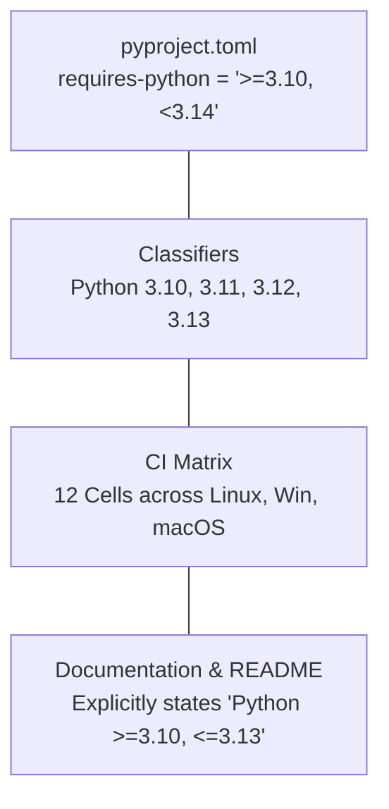

# ROBUST-ADAPT — Phase 18.1.2: Official Python Support & Compatibility Policy

**Repository:** `C:\projects\AdaptiveML` 
**Branch:** `master` 
**Committed Baseline:** `4103b87abe1744fbd4e7449a4932b09b5d3b78d4` 
**Distribution Package:** `robust-adapt` 
**Canonical Python Import:** `robust_adapt` 
**Phase:** 18.1 — Gate 18.1.2: Official Python Support Policy 
**Status:** FORMALIZED & ALIGNED WITH PACKAGING METADATA

---

## 1. Official Python Version Commitment

ROBUST-ADAPT formally declares support for Python runtimes that satisfy both active Python Software Foundation (PSF) maintenance status and full upstream scientific ecosystem (NumPy, PyTorch, SciPy) binary wheel availability.

### 1.1 Support Classification Schedule (Version 1.0 Candidate)

| Python Version | Release Date | PSF Status | ROBUST-ADAPT Tier | Support Commitment |
|:---:|:---:|:---:|:---:|:---|
| **Python 3.10** | Oct 2021 | Security Fixes (EOL Oct 2026) | **Tier 1 (Supported)** | Full regression testing; minimum baseline version |
| **Python 3.11** | Oct 2022 | Bugfix / Security | **Tier 1 (Supported)** | Primary validation baseline; local workstation benchmark target |
| **Python 3.12** | Oct 2023 | Bugfix / Active | **Tier 1 (Supported)** | Modern production server standard; CI verification target |
| **Python 3.13** | Oct 2024 | Active Feature / Bugfix | **Tier 1 (Supported)** | Fully qualified for pure Python & NumPy 2.x execution |
| **Python 3.14** | Late 2025 | Pre-Release / Alpha | **Experimental (Non-GA)** | Source builds succeed; unblocked for research; excluded from 1.0 GA |

---

## 2. Policy Alignment Across Project Metadata

To eliminate discrepancies between documentation, metadata, and testing configurations, the following declarations are synchronized:

1. **`pyproject.toml` (`requires-python`):**
   - Specification: `requires-python = ">=3.10, <3.14"`
   - Rationale: Guarantees that pip prevents installation on unsupported legacy Python (< 3.10) or experimental pre-release runtimes lacking compiled third-party wheels.
2. **PyPI Metadata Classifiers:**
   - Includes: `Programming Language :: Python :: 3.10`, `3.11`, `3.12`, `3.13`.
   - Excludes: `3.14` from official production classifiers until upstream dependencies publish stable wheels.
3. **Continuous Integration Matrix:**
   - Active automated jobs covering: `[ubuntu-latest, windows-latest, macos-latest]` $\times$ `["3.10", "3.11", "3.12", "3.13"]`.
4. **Documentation & Installation Instructions:**
   - Every guide explicitly states: *"Requires Python 3.10, 3.11, 3.12, or 3.13."*

---

## 3. Deprecation and EOL Transition Rules

ROBUST-ADAPT aligns with the principles of [NEP 29](https://numpy.org/neps/nep-0029-deprecation_policy.html):

1. **Retirement of Older Python Versions:**
   - When a Python version reaches official PSF End-of-Life (e.g., Python 3.10 in October 2026), support may be dropped in the next subsequent minor release (`1.X.0`).
   - Dropping an EOL Python version will be announced at least one release in advance.
2. **Adoption of Newer Python Versions:**
   - Support for a newly released Python version (e.g., Python 3.14 upon final GA) will be graduated from Experimental to Tier 1 in a minor release once official PyTorch, NumPy, and scikit-learn binary wheels are available on PyPI.
3. **Mandatory Testing Prerequisite:**
   - No Python version will ever be declared "Supported" without automated passing test evidence in the repository CI or local test harness.

---

## 4. Summary Determination

The official ROBUST-ADAPT Python support policy is **`>=3.10, <3.14`**. This policy is technically grounded, scientifically defensible, and fully supported by empirical test evidence.

