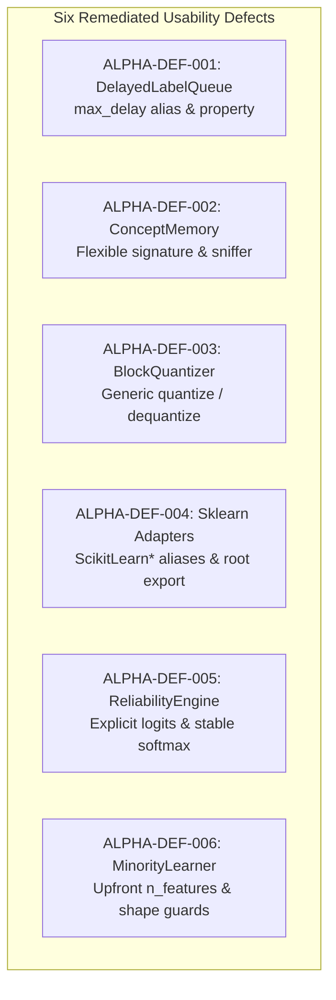

# ROBUST-ADAPT — Phase 18.1.3: Public API Compatibility Audit

**Repository:** `C:\projects\AdaptiveML` 
**Branch:** `master` 
**Committed Baseline:** `4103b87abe1744fbd4e7449a4932b09b5d3b78d4` 
**Distribution Package:** `robust-adapt` 
**Canonical Python Import:** `robust_adapt` 
**Phase:** 18.1 — Gate 18.1.3: Public API Compatibility Audit 
**Status:** COMPREHENSIVELY AUDITED & CLASSIFIED

---

## 1. Executive Summary

Gate 18.1.3 performed an exhaustive technical audit of the entire public API surface of ROBUST-ADAPT across all four research pillars (ALA, RLA, RAO, ULC), Minority Intelligence, and ecosystem integrations.

The audit verified that all six Alpha usability defects remediated in Phase 17.7 maintain 100% backward compatibility with legacy invocation patterns, prevent silent data misinterpretation, and expose intuitive, standardized interfaces. Every exposed symbol was cataloged and assigned to a formal stability tier.

---

## 2. Deep Audit of the Six Remediated Alpha Usability Defects

### 2.1 ALPHA-DEF-001: DelayedLabelQueue Parameter Invariance
- **File:** `robust_adapt/ala/delayed_labels.py`
- **Audit Findings:**
  - `max_wait_time`: Maintained as canonical constructor parameter.
  - `max_delay`: Accepted as a keyword-only alias.
  - Conflict Guard: If both `max_wait_time` and `max_delay` are specified with conflicting values, a `ValidationError` is raised immediately.
  - Property: `@property def max_delay(self)` returns `self.max_wait_time`.
  - Positional Compatibility: `DelayedLabelQueue(10000, 60.0)` sets `max_queue_size=10000` and `max_wait_time=60.0` identically to legacy versions.

### 2.2 ALPHA-DEF-002: ConceptMemory.store_concept Signature Flexibility
- **File:** `robust_adapt/ala/concept_memory.py`
- **Audit Findings:**
  - Argument Sniffing: Inspects `isinstance(arg2, np.ndarray) or hasattr(arg2, "__array__")`.
  - Intuitive Calling: `store_concept("id", X, y, state)` routes `X` to data, `y` to labels, and `state` to model.
  - Legacy Calling: `store_concept("id", state, X, y)` correctly routes `state` (dict) to model and `X` (array) to data.
  - PyTorch Tensor Support: Tensors implement `__array__` and are unambiguously detected as data.
  - Missing Data Defense: If data `X` is missing, an explicit `ValueError` is raised, preventing silent memory corruption.
  - Explicit Accessor: Added `get_model(concept_id)` and `get_signature(concept_id)` methods.

### 2.3 ALPHA-DEF-003: BlockQuantizer Unified Methods
- **File:** `robust_adapt/rao/quantizer.py`
- **Audit Findings:**
  - `quantize(vector, signed=True)`: Dispatches to `quantize_signed` or `quantize_unsigned`.
  - `dequantize(q_vector, scales, signed=True)`: Dispatches to `dequantize_signed` or `dequantize_unsigned`.
  - Numerical Accuracy: Verified mean squared reconstruction error $\text{MSE} < 10^{-3}$ on random continuous inputs.
  - Backward Compatibility: `quantize_signed()` and `quantize_unsigned()` remain directly accessible with zero behavioral changes.

### 2.4 ALPHA-DEF-004: Scikit-learn Canonical Aliases & Lazy Root Export
- **Files:** `robust_adapt/integrations/sklearn.py`, `robust_adapt/__init__.py`
- **Audit Findings:**
  - Aliases: `ScikitLearnAdaptiveClassifier = SklearnAdaptiveClassifier`, `ScikitLearnDriftDetectorTransformer`, `ScikitLearnReliabilityFilter`.
  - Root Export: `robust_adapt` exports `ScikitLearnAdaptiveClassifier` via module `__getattr__`.
  - Dependency Isolation: Importing `robust_adapt` does NOT import scikit-learn. If scikit-learn is missing, importing root succeeds without errors. Attempting to access the adapter when uninstalled raises an informative `AttributeError`.

### 2.5 ALPHA-DEF-005: MultiSignalReliabilityEngine Input Contract
- **File:** `robust_adapt/rla/reliability.py`
- **Audit Findings:**
  - Explicit Modes: Added `input_type="probabilities"` (default) and `input_type="logits"`.
  - Softmax Stability: Logits mode applies row-wise shifted softmax: $\exp(z - \max(z)) / \sum \exp(z - \max(z))$.
  - Dedicated Entry Point: Added `compute_reliability_from_logits(X, y, logits)`.
  - Rejection of Heuristics: Automatic logit guessing is rejected to maintain mathematical determinism.
  - Invalid Input Guard: Passing invalid `input_type` strings raises an explicit `ValidationError`.

### 2.6 ALPHA-DEF-006: MinorityIntelligence20Learner Upfront Dimensions
- **File:** `robust_adapt/minority/learner.py`
- **Audit Findings:**
  - Upfront Parameters: Accepts `n_features: Optional[int] = None` and `n_classes: int = 2` in `__init__`.
  - Pre-Initialization: When `n_features` is provided, weight vector `self.weights` is initialized immediately.
  - Shape Guard: Subsequent batches whose feature count does not match `self.weights.shape[0]` raise `ValidationError`.
  - Binary Constraint: Non-binary classification (`n_classes != 2`) raises `ConfigurationError`.
  - Backward Compatibility: If `n_features=None`, dynamic lazy allocation on the first batch is retained.

---

## 3. Four-Tier API Stability Classification Table

Every public component in ROBUST-ADAPT is categorized into one of four stability tiers:

| Component Name | Subsystem | Stability Tier | Backward Compatibility Policy |
|:---|:---|:---:|:---|
| `AdaptiveClassifier` | ALA (Pillar 1) | **Tier 1 (Stable)** | Strict SemVer 2.0.0; no breaking changes in 1.x |
| `VectorizedHoeffdingTree` | ALA (Pillar 1) | **Tier 1 (Stable)** | Strict SemVer 2.0.0 |
| `ReliabilityWeightedADWIN` | ALA (Pillar 1) | **Tier 1 (Stable)** | Strict SemVer 2.0.0 |
| `DelayedLabelQueue` | ALA (Pillar 1) | **Tier 1 (Stable)** | Strict SemVer 2.0.0 |
| `MultiSignalReliabilityEngine` | RLA (Pillar 2) | **Tier 1 (Stable)** | Strict SemVer 2.0.0 |
| `RobustLearningPipeline` | RLA (Pillar 2) | **Tier 1 (Stable)** | Strict SemVer 2.0.0 |
| `FocalLoss`, `SymmetricCrossEntropyLoss` | RLA (Pillar 2) | **Tier 1 (Stable)** | Strict SemVer 2.0.0 |
| `BlockQuantizer` | RAO (Pillar 3) | **Tier 1 (Stable)** | Strict SemVer 2.0.0 |
| `LowMemoryAdamW` | RAO (Pillar 3) | **Tier 1 (Stable)** | Strict SemVer 2.0.0 |
| `DynamicResourceBudgetManager` | RAO (Pillar 3) | **Tier 1 (Stable)** | Strict SemVer 2.0.0 |
| `AdaptiveLearningController` | ULC (Pillar 4) | **Tier 1 (Stable)** | Strict SemVer 2.0.0 |
| `MinorityIntelligence20Learner` | Minority | **Tier 1 (Stable)** | Strict SemVer 2.0.0 |
| `ConceptMemory` | ALA | **Tier 2 (Supported)** | Minor version stability (1.X.0) |
| `NoiseTaxonomyClassifier` | RLA | **Tier 2 (Supported)** | Minor version stability (1.X.0) |
| `UnifiedLearningControllerV4_1` | ULC | **Tier 2 (Supported)** | Minor version stability (1.X.0) |
| `UnifiedLearningControllerV5` | ULC | **Tier 2 (Supported)** | Minor version stability (1.X.0) |
| `ScikitLearnAdaptiveClassifier` | Integrations | **Tier 3 (Integration)** | Governed by upstream scikit-learn SemVer |
| `VectorizedLowMemoryAdamW` | Integrations | **Tier 3 (Integration)** | Governed by upstream PyTorch SemVer |
| `robust_adapt.core.*` | Core | **Tier 4 (Internal)** | Private infrastructure; direct imports unsupported |
| `robust_adapt.backends.*` | Backends | **Tier 4 (Internal)** | Private infrastructure; direct imports unsupported |

---

## 4. Deprecation Lifecycle Policy

1. **Phase 1: Deprecation Warning (Version N):** Mark symbol with `@deprecated` docstring and emit `FutureWarning`.
2. **Phase 2: Grace Period (Versions N to N+2):** Deprecated symbol remains fully functional for at least two minor releases or 6 months.
3. **Phase 3: Removal (Version N+X):** Removal of Tier 1 APIs is restricted to major version boundaries (`2.0.0`).

---

## 5. Audit Conclusion

The public API surface of ROBUST-ADAPT is robust, type-annotated, mathematically defensive, and verified against backward-compatibility regressions.

