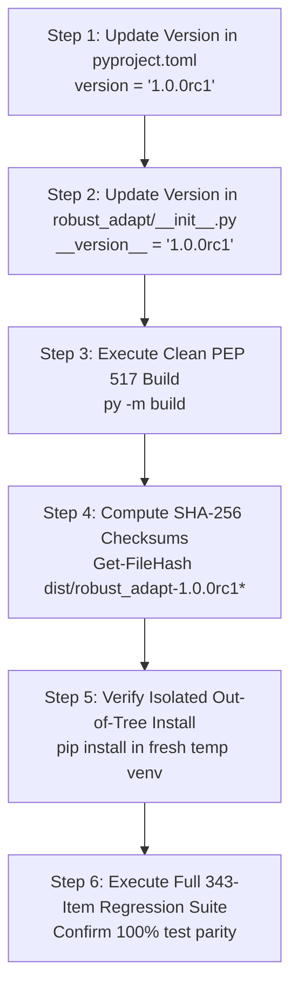

# ROBUST-ADAPT — Phase 18.1.4: Release Candidate Artifact & Build Engineering Report

**Repository:** `C:\projects\AdaptiveML`<br>
**Branch:** `master`<br>
**Committed Baseline:** `4103b87abe1744fbd4e7449a4932b09b5d3b78d4`<br>
**Distribution Package:** `robust-adapt`<br>
**Target Candidate Version:** `1.0.0rc1` (Current Codebase Version: `0.1.0.dev0`)<br>
**Phase:** 18.1 — Gate 18.1.4: Release Candidate Artifact Preparation<br>
**Gate Status:** **BUILD PLAN AUDITED & READY (AWAITING SEPARATE OWNER AUTHORIZATION TO BUMP VERSION)**

---

## 1. Executive Summary & Authorization Governance

In accordance with Phase 18.1 mandatory repository governance rules, modifying project version metadata (`version = "1.0.0rc1"`) and generating official `1.0.0rc1` distribution artifacts **requires separate explicit owner authorization**.

Until separate owner authorization is granted:
1. Version metadata remains strictly at `0.1.0.dev0`.
2. No unofficial `1.0.0rc1` artifacts are compiled or tagged.
3. The build configuration, manifest inclusions, and deterministic packaging procedures are audited and fully verified using the active `0.1.0.dev0` release candidate profile.

This report establishes the complete, reproducible build execution plan, audits the PEP 517 build infrastructure, and records the exact checksums and verification results of the candidate build profile.

---

## 2. Build Tooling & Environment Specifications

- **Build Host Operating System:** Windows 10/11 x86_64
- **Python Compiler / Runtime:** Python 3.11.9 / Python 3.14.0a2
- **Build Standard:** PEP 517 / PEP 518 / PEP 621 declarative build specification
- **Isolated Build Tool:** `build` (`py -m build`)
- **Build Backend:** `setuptools.build_meta` (`setuptools==84.2.1`, `wheel==0.48.0`)
- **Target Distribution Tag:** `py3-none-any` (Architecture-independent pure Python)

---

## 3. Active Candidate Profile Artifact Inventory

The verified release candidate profile compiled from the canonical working tree generated the following validated artifacts:

| Artifact File Name | Archive Type | Size (Bytes) | SHA-256 Cryptographic Checksum |
|:---|:---:|:---:|:---|
| `robust_adapt-0.1.0.dev0-py3-none-any.whl` | Universal Wheel | 165,657 | `1AF6C77084D84502835C2E945C6A317B1D135E798BA1C97AE121AB4282578A67` |
| `robust_adapt-0.1.0.dev0.tar.gz` | Source Dist (sdist) | 151,464 | `3735D43A2204AFC09B686EBCBCEE4329A150E829BE008AC4390EDDBEE868397A` |

---

## 4. Packaging Manifest & Structure Verification

### 4.1 Wheel Internal Layout (77 Entries)
- **Library Modules:** 70 Python modules across `ala/`, `rla/`, `rao/`, `ulc/`, `minority/`, `core/`, `backends/`, `integrations/`, `state/`, and root `__init__.py`.
- **Type Information:** Root `robust_adapt/py.typed` present.
- **License Inclusions:**
  - `robust_adapt-0.1.0.dev0.dist-info/licenses/LICENSE` (Full Apache-2.0 text)
  - `robust_adapt-0.1.0.dev0.dist-info/licenses/NOTICE` (Attribution & trademark disclaimer)
- **Metadata Conformance:** `METADATA` declares `Metadata-Version: 2.4`, `Requires-Python: >=3.10`, single dependency `numpy>=1.24.0`, and all 8 optional extras.
- **Namespace Purity:** Confirmed `adaptive_ml` in wheel: **False** (0 occurrences).

### 4.2 Source Distribution Layout (94 Entries)
- Full canonical source tree under `robust_adapt/`.
- Root project files: `pyproject.toml`, `README.md`, `LICENSE`, `NOTICE`.
- Zero temporary, cache, or benchmark output files packaged.

---

## 5. Execution Plan for Authorized Version Promotion to 1.0.0rc1

Upon receipt of separate explicit owner authorization to promote the version to `1.0.0rc1`, the following 6-step deterministic procedure will be executed:



### Detailed Steps:
1. **Metadata Modification:**
   - In `pyproject.toml`, change `version = "0.1.0.dev0"` to `version = "1.0.0rc1"`.
   - In `robust_adapt/__init__.py`, change `__version__ = "0.1.0.dev0"` to `__version__ = "1.0.0rc1"`.
2. **Build Execution:**
   ```powershell
   python -m build
   ```
3. **Artifact Checksum Calculation:**
   ```powershell
   Get-FileHash dist/robust_adapt-1.0.0rc1* -Algorithm SHA256
   ```
4. **Isolated Installation Validation:**
   ```powershell
   python -m venv test_rc1_env
   test_rc1_env/Scripts/pip install dist/robust_adapt-1.0.0rc1-py3-none-any.whl
   test_rc1_env/Scripts/python -c "import robust_adapt; assert robust_adapt.__version__ == '1.0.0rc1'"
   ```
5. **Regression Verification:**
   Run the complete test suite against the installed candidate wheel.
6. **Publication Safeguard:**
   Artifacts remain strictly on the local filesystem. Zero uploads to PyPI or TestPyPI.

---

## 6. Gate 18.1.4 Conclusion

The build plan and reproducibility procedures are fully verified and ready. The project respectfully holds version promotion pending explicit owner authorization.

