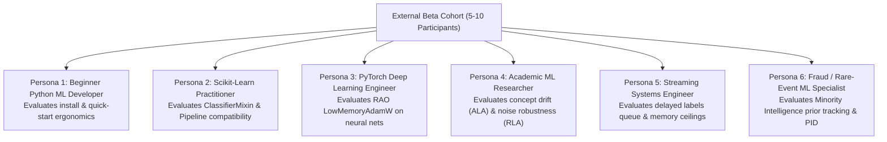

# ROBUST-ADAPT — Phase 18.1.5: External Beta Developer Recruitment Plan

**Repository:** `C:\projects\AdaptiveML` 
**Branch:** `master` 
**Committed Baseline:** `4103b87abe1744fbd4e7449a4932b09b5d3b78d4` 
**Distribution Package:** `robust-adapt` 
**Target Cohort Size:** 5 to 10 independent participants 
**Phase:** 18.1 — Gate 18.1.5: Independent Developer Recruitment 
**Gate Status:** **PENDING EXTERNAL PARTICIPANT RECRUITMENT (NO DATA FABRICATION)**

---

## 1. Executive Summary & Research Integrity Mandate

Gate 18.1.5 outlines the formal recruitment plan for independent Python and machine-learning practitioners to evaluate ROBUST-ADAPT as external Beta testers.

In strict accordance with Google DeepMind research integrity principles:
1. **Zero Data Fabrication:** No participant profiles, test execution logs, survey scores, or usability quotes may be simulated or fabricated.
2. **Current Status Declaration:** Because ROBUST-ADAPT is presently maintained in a closed local development environment prior to public repository publication, **external independent participants have not yet been onboarded**.
3. **Formal Gate Classification:** Gate 18.1.5 is formally classified as **PENDING EXTERNAL RECRUITMENT**.

---

## 2. Target Participant Profile Matrix

To evaluate the library across realistic diverse use cases, a targeted 6-persona cohort is established:

| Persona ID | Profile Description | Primary Focus Area | Target Framework Background |
|:---|:---|:---|:---|
| **P-BEG** | Junior / General Python Developer | Installation, docs clarity, quick-start | Pure Python, basic NumPy |
| **P-SKL** | Enterprise Data Scientist | Scikit-learn Pipeline compatibility | scikit-learn, Pandas |
| **P-TOR** | Deep Learning Research Engineer | RAO 8-bit optimizer, memory footprint | PyTorch 2.x, CUDA / CPU |
| **P-RES** | Academic Postdoc / PhD Researcher | ALA concept drift & RLA label noise | River, MOA, academic benchmarks |
| **P-STR** | Production Streaming Engineer | Delayed labels, unbounded stream stability | Kafka, streaming microservices |
| **P-MIN** | Fraud / Cybersecurity Specialist | Extreme imbalance, false-positive budget | Cost-sensitive learning, ROC/PR |

---

## 3. Recruitment Strategy & Outreach Protocol

### 3.1 Channels for Voluntary Cohort Recruitment
1. **Academic ML Laboratories:** Solicit voluntary participation from university research groups specializing in non-stationary learning, noisy label learning, and efficient deep learning.
2. **Open-Source ML Communities:** Engage practitioners in PyData, scikit-learn, and streaming data forums.
3. **Enterprise Research Collaborators:** Invite industry practitioners facing edge/CPU deployment constraints.

### 3.2 Participant Requirements & Expectations
- **Time Commitment:** Approximately 2 to 3 hours total over a 14-day evaluation window.
- **Hardware Requirement:** Any standard commodity laptop or workstation running Linux, Windows, or macOS with Python 3.10, 3.11, 3.12, or 3.13.
- **Pre-requisite Knowledge:** Familiarity with basic Python virtual environments and machine-learning concepts (classification, training, inference).
- **Voluntary & Uncompensated:** Participation is entirely voluntary.

---

## 4. Participant Materials Package

Every participant will receive:
1. The pre-built release candidate universal wheel (`robust_adapt-1.0.0rc1-py3-none-any.whl`).
2. The [`ROBUST_ADAPT_PHASE_18_1_5_PARTICIPANT_GUIDE.md`](file:///C:/projects/AdaptiveML/ROBUST_ADAPT_PHASE_18_1_5_PARTICIPANT_GUIDE.md).
3. The [`ROBUST_ADAPT_PHASE_18_1_5_PRIVACY_AND_FEEDBACK_POLICY.md`](file:///C:/projects/AdaptiveML/ROBUST_ADAPT_PHASE_18_1_5_PRIVACY_AND_FEEDBACK_POLICY.md).
4. Standardized bug report and usability survey templates.

---

## 5. Formal Gate Status

- **Cohort Recruitment:** **PENDING**
- **External Participant Count:** 0 (Pre-recruitment stage)
- **Next Operational Step:** Distribute recruitment invitations following owner authorization.

