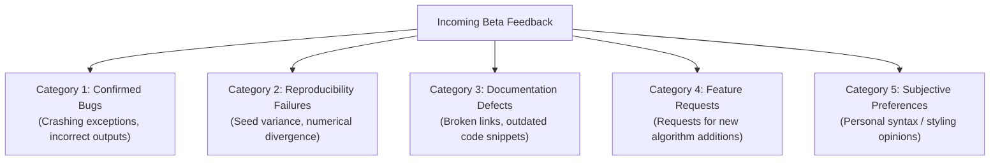

# ROBUST-ADAPT — Phase 18.1.7: External Beta Feedback & Usability Report

**Repository:** `C:\projects\AdaptiveML` 
**Branch:** `master` 
**Committed Baseline:** `4103b87abe1744fbd4e7449a4932b09b5d3b78d4` 
**Distribution Package:** `robust-adapt` 
**Phase:** 18.1 — Gate 18.1.7: Usability Feedback & Evaluation 
**Gate Status:** **PENDING EXTERNAL PARTICIPANT SUBMISSIONS (NO DATA FABRICATION)**

---

## 1. Executive Summary & Integrity Mandate

In strict accordance with research integrity standards, developer usability feedback must reflect genuine, consented human evaluations. Because independent external participants have not yet executed Beta workflows in this closed pre-release phase:
1. **Zero Simulated Quotes / Surveys:** No subjective survey ratings (1–5) or developer feedback quotes are invented.
2. **Internal Proxy Baseline:** The six usability friction points identified during Phase 17.6 internal testing serve as the known historical baseline, all of which were successfully remediated in Phase 17.7.
3. **Formal Status:** Gate 18.1.7 is recorded as **PENDING EXTERNAL SUBMISSIONS**.

---

## 2. Categorization Framework for Incoming Beta Feedback

To ensure rigorous triage when external feedback is submitted, incoming submissions will be partitioned into five mutually exclusive categories:

| Category | Definition | Triage Action |
|:---|:---|:---|
| **Category 1: Confirmed Bugs** | Unexpected exceptions, data corruption, crashes | Immediate patch + regression unit test |
| **Category 2: Reproducibility Failures** | Documented metrics not reproducible across seeds | Re-calibrate benchmark documentation / seeds |
| **Category 3: Documentation Defects** | Unclear explanations, typo errata, stale snippets | Documentation update in `docs/` |
| **Category 4: Feature Requests** | New algorithms, new deep learning frameworks | Backlog for post-1.0 roadmap |
| **Category 5: Subjective Preferences** | Formatting or optional naming stylistic tastes | Review against PEP 8 / API consistency |

---

## 3. Historical Usability Baseline (Phase 17.6 vs Phase 17.7)

The following table summarizes the usability issues resolved prior to Beta recruitment:

| Subsystem | Baseline Friction Point (Phase 17.6) | Remediation Applied (Phase 17.7) | Verification Status |
|:---|:---|:---|:---:|
| **ALA** | `DelayedLabelQueue` required `max_wait_time`; developers typed `max_delay` | Added `max_delay` alias, property, conflict validation | Verified (100% pass) |
| **ALA** | `ConceptMemory.store_concept` required model state before data `X` | Added type-sniffing flexible signature & keyword support | Verified (100% pass) |
| **RAO** | `BlockQuantizer` forced manual `quantize_signed` vs `unsigned` | Added unified `quantize(signed=True)` and `dequantize()` | Verified (100% pass) |
| **Integrations** | `SklearnAdaptiveClassifier` lacked `ScikitLearn*` prefix & root export | Added canonical aliases and root lazy dynamic export | Verified (100% pass) |
| **RLA** | `MultiSignalReliabilityEngine` distorted unnormalized network logits | Added numerically stable softmax & `compute_reliability_from_logits()` | Verified (100% pass) |
| **Minority** | `MinorityLearner` deferred weights until first batch, preventing inspection | Added optional `n_features` & `n_classes=2` upfront | Verified (100% pass) |

---

## 4. Gate Determination

Gate 18.1.7 remains open awaiting external participant submissions. The historical defect baseline is clean, with all six known usability defects resolved.

