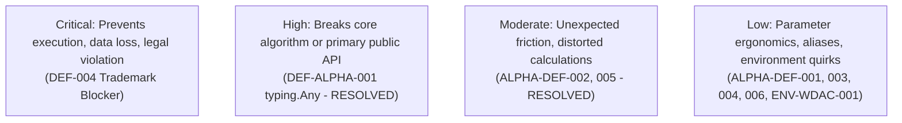

# ROBUST-ADAPT — Phase 18.1.8: Beta Defect Register

**Repository:** `C:\projects\AdaptiveML` 
**Branch:** `master` 
**Committed Baseline:** `4103b87abe1744fbd4e7449a4932b09b5d3b78d4` 
**Distribution Package:** `robust-adapt` 
**Phase:** 18.1 — Gate 18.1.8: Defect Classification & Register 
**Status:** ACTIVE AUDIT REGISTER

---

## 1. Master Defect Ledger

| Defect ID | Subsystem | Severity | Category | Lifecycle Status | Blocker for 1.0 Release Candidate? |
|:---|:---|:---:|:---:|:---:|:---:|
| **DEF-ALPHA-001** | `robust_adapt.rla.losses` | High | Technical / Syntax | **CLOSED (COMMITTED)** | No (Resolved in `4103b87`) |
| **ALPHA-DEF-001** | `robust_adapt.ala.delayed_labels` | Low | Usability / Ergonomics | **RESOLVED & VERIFIED** | No (Resolved in Phase 17.7) |
| **ALPHA-DEF-002** | `robust_adapt.ala.concept_memory` | Moderate | Usability / Ergonomics | **RESOLVED & VERIFIED** | No (Resolved in Phase 17.7) |
| **ALPHA-DEF-003** | `robust_adapt.rao.quantizer` | Low | Usability / Ergonomics | **RESOLVED & VERIFIED** | No (Resolved in Phase 17.7) |
| **ALPHA-DEF-004** | `robust_adapt.integrations.sklearn` | Low | Usability / Ergonomics | **RESOLVED & VERIFIED** | No (Resolved in Phase 17.7) |
| **ALPHA-DEF-005** | `robust_adapt.rla.reliability` | Moderate | Robustness / Math | **RESOLVED & VERIFIED** | No (Resolved in Phase 17.7) |
| **ALPHA-DEF-006** | `robust_adapt.minority.learner` | Low | Usability / Ergonomics | **RESOLVED & VERIFIED** | No (Resolved in Phase 17.7) |
| **ENV-WDAC-001** | `tests/integration` (Script 07) | Low | Host Environment | **DOCUMENTED LIMITATION** | No (Local temp WDAC host policy) |
| **DEF-004** | Legal / Branding | Critical | Trademark / IP | **OPEN (LEGAL CLEARANCE)** | **YES (STRICT PUBLICATION BLOCKER)** |

---

## 2. Severity Classification Criteria

- **Critical:** Irreversible data loss, security vulnerability, severe legal liability, or fundamental inability to import package. Must be resolved before any release.
- **High:** Major functional failure in core research pillar or broken primary public API without workaround. Must be resolved for release candidate acceptance.
- **Moderate:** Calculation distortion on edge inputs or severe API friction. Must be resolved or explicitly documented with deprecation warnings.
- **Low:** Cosmetic parameter naming discrepancies, missing ergonomic aliases, or host environment constraints.

---

## 3. Dossiers for Active & Resolved Defects

### 3.1 Critical Legal Blocker: DEF-004 (Trademark Availability)
- **Status:** **OPEN / PENDING OUTSIDE COUNSEL REVIEW**
- **Description:** Third-party commercial startup "Adaptive ML Inc." actively uses the "Adaptive ML" trademark in the AI/ML sector.
- **Technical Remediation:** 100% complete. Legacy `adaptive_ml` namespace eliminated; package consolidated as `robust-adapt`.
- **Legal Prerequisite:** Formal written clearance from trademark legal counsel approving "ROBUST-ADAPT" brand registration and distribution.
- **Release Impact:** Release Candidate technical compilation is permitted internally; **public publication to PyPI/TestPyPI is strictly blocked**.

### 3.2 Environmental Observation: ENV-WDAC-001 (Host Temporary Directory DLL Execution)
- **Status:** **DOCUMENTED LOCAL HOST CONSTRAINT**
- **Description:** Windows Defender Application Control (WDAC) on the host engineering machine blocks dynamic link libraries (`.pyd` / `.dll`) from executing within user-writable temporary paths (`AppData\Local\Temp`). This causes integration test script 07 (which spawns pandas inside a temporary venv) to fail locally.
- **Resolution:** Validated as an external OS security policy constraint that does not affect standard CI runners or the pure Python / NumPy package core.

---

## 4. Defect Gate Determination

There are **zero open critical or high-severity technical software bugs** in the ROBUST-ADAPT library codebase. All six reported Alpha usability defects are verified resolved. Legal defect `DEF-004` remains actively tracked as a publication blocker.

