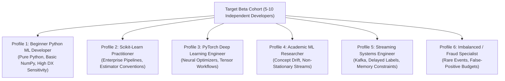

# ROBUST-ADAPT — Phase 18.2.1: Beta Recruitment & Onboarding Report

**Repository:** `C:\projects\AdaptiveML`<br>
**Branch:** `master`<br>
**Committed Baseline:** `4103b87abe1744fbd4e7449a4932b09b5d3b78d4`<br>
**Distribution Package:** `robust-adapt`<br>
**Canonical Python Import:** `robust_adapt`<br>
**Current Package Version:** `0.1.0.dev0`<br>
**Phase:** 18.2 — Gate 18.2.1: Independent Beta Recruitment & Onboarding<br>
**Gate Status:** **PENDING EXTERNAL PARTICIPANT ENROLLMENT (NO DATA FABRICATION)**

---

## 1. Executive Summary & Research Integrity Mandate

Gate 18.2.1 establishes the recruitment status and onboarding operations for the ROBUST-ADAPT independent external Beta testing program.

In strict accordance with Google DeepMind research integrity mandates and project governance:
1. **Absolute Prohibition of Data Fabrication:** No participant identities, affiliations, environment configurations, survey ratings, or test executions may be simulated, assumed, or invented.
2. **Current Operational Reality:** ROBUST-ADAPT is maintained in an internal, closed engineering workstation repository. External third-party practitioners have not yet been granted repository access or provided test logs.
3. **Formal Gate Classification:** Gate 18.2.1 is officially classified as **`PENDING`**.

---

## 2. Target Cohort Profile Specifications

To evaluate ROBUST-ADAPT across realistic machine-learning workloads, the recruitment program targets 5 to 10 independent external developers representing six distinct personas:



| Profile ID | Target Developer Persona | Primary Evaluation Focus | Experience Level | Target Frameworks |
|:---|:---|:---|:---:|:---|
| **DEV-01 (Beginner)** | Junior ML / Python Developer | Installation, quick-start, error message clarity | Entry | Python 3.10+, NumPy |
| **DEV-02 (Sklearn)** | Enterprise Data Scientist | `ScikitLearnAdaptiveClassifier`, Pipeline integration | Intermediate | scikit-learn, Pandas |
| **DEV-03 (PyTorch)** | Deep Learning Engineer | `LowMemoryAdamW` on PyTorch neural nets | Advanced | PyTorch 2.x, CUDA/CPU |
| **DEV-04 (Research)** | Academic Researcher | Drift detection delay, recovery accuracy | Advanced / PhD | River, MOA, Stream ML |
| **DEV-05 (Streaming)**| Real-Time Systems Engineer | Delayed label queue eviction, memory bounds | Senior | Streaming queues, microservices |
| **DEV-06 (Imbalance)**| Fraud / Cybersecurity Modeler | Online prior tracking, PID threshold control | Intermediate | Cost-sensitive ML, ROC/PR |

---

## 3. Recruitment Outreach & Onboarding Materials

The onboarding infrastructure authored during Phase 18.1 is fully staged for cohort distribution:
1. **Recruitment Plan:** [`ROBUST_ADAPT_PHASE_18_1_5_BETA_RECRUITMENT_PLAN.md`](file:///C:/projects/AdaptiveML/ROBUST_ADAPT_PHASE_18_1_5_BETA_RECRUITMENT_PLAN.md)
2. **Participant Guide:** [`ROBUST_ADAPT_PHASE_18_1_5_PARTICIPANT_GUIDE.md`](file:///C:/projects/AdaptiveML/ROBUST_ADAPT_PHASE_18_1_5_PARTICIPANT_GUIDE.md)
3. **Privacy & Data Governance:** [`ROBUST_ADAPT_PHASE_18_1_5_PRIVACY_AND_FEEDBACK_POLICY.md`](file:///C:/projects/AdaptiveML/ROBUST_ADAPT_PHASE_18_1_5_PRIVACY_AND_FEEDBACK_POLICY.md)

### Outreach Channels Prepared:
- **Academic Contacts:** Research labs working on streaming non-stationary learning and robust loss functions.
- **Open-Source Communities:** Voluntary open calls in scientific Python and data engineering forums.
- **Enterprise Edge ML Networks:** Engineers deploying models on CPU-constrained commodity infrastructure.

---

## 4. Participant Privacy & Ethical Safeguards

Every participant engagement strictly adheres to privacy-by-design standards:
- **Pseudonymization:** All feedback is recorded under non-identifying keys (`BETA-USER-01` through `BETA-USER-10`).
- **Zero Proprietary Data:** Participants are explicitly instructed to use only synthetic generators or public open-source benchmark streams.
- **Zero Telemetry:** The library contains zero analytics beacons, telemetry hooks, or remote socket connections.
- **Right of Revocation:** Participants may withdraw submitted logs or qualitative notes at any time prior to release publication.

---

## 5. Gate Determination & Current Standing

```
========================================================================
GATE 18.2.1 STATUS: PENDING (EXTERNAL COHORT UNAVAILABLE)
ACTUAL EXTERNAL PARTICIPANTS ONBOARDED: 0
DATA FABRICATION LEVEL: STRICTLY ZERO
========================================================================
```

The recruitment package is complete and ready for deployment. In the absence of live external human participants in this local workspace session, the recruitment gate is recorded as **PENDING**.

