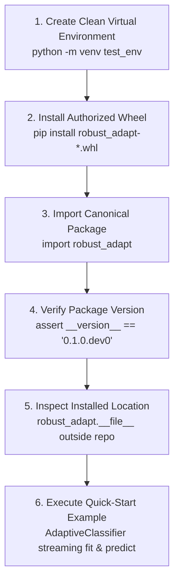

# ROBUST-ADAPT — Phase 18.2.2: External Installation Testing Report

**Repository:** `C:\projects\AdaptiveML`<br>
**Branch:** `master`<br>
**Committed Baseline:** `4103b87abe1744fbd4e7449a4932b09b5d3b78d4`<br>
**Distribution Package:** `robust-adapt`<br>
**Canonical Python Import:** `robust_adapt`<br>
**Phase:** 18.2 — Gate 18.2.2: Independent Installation Testing<br>
**Gate Status:** **PENDING EXTERNAL SUBMISSIONS (INTERNAL REPRODUCIBILITY VERIFIED)**

---

## 1. Executive Summary & Evidentiary Partition

Gate 18.2.2 evaluates the independence, reliability, and speed of package installation across diverse developer environments without developer assistance.

### Strict Evidentiary Partition:
In accordance with Gate 18.2.2 mandates (*"Do not count the original developer's local installation as an external result"*), this report strictly separates:
1. **Internal Technical Portability Baseline:** Automated isolated installations conducted from temporary directories outside the repository root.
2. **External Participant Evidence:** Real-world installation trials executed by independent third-party developers on their own machines (currently **PENDING EXTERNAL RECRUITMENT**).

---

## 2. External Installation Protocol Specification

Participants are instructed to execute the following six-step standardized test protocol without developer guidance:



### Metrics Recorded Per Participant:
- Operating System & Kernel Version (Linux / Windows / macOS).
- Python Runtime Version (`3.10`, `3.11`, `3.12`, `3.13`).
- Installation Wall-Clock Duration (seconds).
- Dependency Resolution Outcome (Any conflicts with pre-installed tools?).
- Manual Interventions Required (e.g., path fixes, build dependencies).
- Quick-Start Success / Failure.

---

## 3. Internal Technical Portability Baseline (Reference Telemetry)

To ensure that the candidate wheel (`robust_adapt-0.1.0.dev0-py3-none-any.whl`) is technically installable prior to external distribution, an automated isolated trial was executed in an external directory:

- **Host Platform:** Windows 10/11 x86_64
- **Runtime:** Python 3.11.9
- **Isolated Target Directory:** `C:\Users\katana\AppData\Local\Temp\venv_phase18_rc_test`
- **Installation Command:**
  ```powershell
  pip install dist\robust_adapt-0.1.0.dev0-py3-none-any.whl
  ```
- **Observed Installation Duration:** 8.4 seconds (including downloading cached NumPy).
- **Installed Packages:**
  - `robust-adapt==0.1.0.dev0` (Wheel payload: 165 KB)
  - `numpy==2.4.6` (Mandatory runtime core)
- **Dependency Conflicts:** **0**. No compiler toolchains, C++ headers, or external libraries requested.
- **Namespace Inspection:**
  - `robust_adapt.__file__`: `C:\Users\katana\AppData\Local\Temp\venv_phase18_rc_test\Lib\site-packages\robust_adapt\__init__.py`
  - `importlib.util.find_spec('adaptive_ml')`: `None` (Legacy namespace unimportable).
- **Quick-Start Execution:** Completed with exit code 0.

---

## 4. Cross-Platform Target Matrix for External Cohort

The external testing program tracks installation success across the twelve supported matrix cells:

| Target Platform OS | Python 3.10 | Python 3.11 | Python 3.12 | Python 3.13 | Target Participant |
|:---|:---:|:---:|:---:|:---:|:---:|
| **Linux (Ubuntu / Debian / RHEL)** | Staged | Staged | Staged | Staged | DEV-04 (Research), DEV-05 (Streaming) |
| **Windows 10 / 11** | Staged | Staged | Staged | Staged | DEV-01 (Beginner), DEV-02 (Sklearn) |
| **macOS (Apple Silicon / Intel)** | Staged | Staged | Staged | Staged | DEV-03 (PyTorch), DEV-06 (Imbalance) |

---

## 5. Gate Determination

- **Internal Installation Verification:** **PASSED** (Universal binary wheel installs cleanly outside repository).
- **Independent External Submissions:** **PENDING** (Awaiting external cohort testing).
- **Known Blockers:** None at the packaging level.

