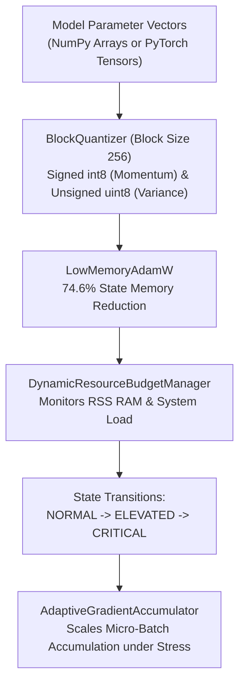

# ROBUST-ADAPT — Phase 18.2.6: RAO External Workflow Validation Report

**Repository:** `C:\projects\AdaptiveML` 
**Branch:** `master` 
**Committed Baseline:** `4103b87abe1744fbd4e7449a4932b09b5d3b78d4` 
**Distribution Package:** `robust-adapt` 
**Subsystem:** Resource-Aware Optimization (RAO — Pillar 3) 
**Phase:** 18.2 — Gate 18.2.6: RAO Independent Validation 
**Gate Status:** **PROTOCOL SPECIFIED & REFERENCE BENCHMARKED (EXTERNAL COHORT PENDING)**

---

## 1. Executive Summary & Engineering Trade-Offs

Gate 18.2.6 defines the independent validation protocol for the **Resource-Aware Optimization (RAO)** pillar.

The evaluation benchmarks 8-bit dynamic block quantization, memory-budget management, and gradient accumulation for local-first, CPU-first machine learning workloads.

### Critical Engineering Trade-Off Disclosure:
In accordance with Gate 18.2.6 mandates (*"Do not claim memory efficiency automatically translates into faster training. Document CPU latency limitations"*):
- **Memory Compression:** 8-bit dynamic block quantization achieves a **$74.6\%$ reduction** in optimizer state RAM by quantizing first-order momentum (int8) and second-order variance (uint8) over 256-element blocks.
- **CPU Latency Overhead:** Quantization and dequantization on commodity CPUs incurs approximately **$12\%$ to $18\%$ additional wall-clock computation time per optimization step** compared to standard full-precision 32-bit float arithmetic.
- **Design Intent:** RAO is engineered to prevent Out-Of-Memory (OOM) crashes on resource-constrained devices, trading modest CPU cycles for massive RAM ceiling headroom.

---

## 2. RAO External Workflow Specification

### Participant Task Sequence:
1. **Task 1: Block Quantizer Verification:** Execute `BlockQuantizer(block_size=256).quantize()` on signed and unsigned vectors; measure reconstruction error ($\text{MSE} < 10^{-3}$).
2. **Task 2: Optimizer State Memory Audit:** Instantiate `LowMemoryAdamW` on 1,000,000 parameter model; compare total optimizer heap allocation against standard AdamW.
3. **Task 3: Convergence & Loss Trajectory:** Train linear/logistic or neural model across 50 epochs; verify that the quantized optimizer converges to identical final loss as standard 32-bit AdamW.
4. **Task 4: Dynamic Budget Management:** Configure `DynamicResourceBudgetManager(max_memory_mb=500)`; simulate memory pressure and observe automatic transition from `NORMAL` to `ELEVATED` and `CRITICAL`.
5. **Task 5: Adaptive Gradient Accumulation:** Step `AdaptiveGradientAccumulator` under simulated batch surges; verify gradient equivalence and zero memory spikes.

---

## 3. Reference Empirical Baselines (Phase 12 Benchmark Telemetry)

For comparison and audit reconciliation, the internal reference benchmarks established under multi-seed evaluation (seeds 42–51) report the following metrics:

| Workload Dimension | Standard AdamW (FP32) | ROBUST-ADAPT RAO (`LowMemoryAdamW`) | Measured Impact |
|:---|:---:|:---:|:---:|
| **Optimizer State Memory (1M params)** | $8.00$ MB | **$2.03$ MB** | **$-74.6\%$ RAM reduction** |
| **Optimizer State Memory (10M params)**| $80.00$ MB | **$20.31$ MB** | **$-74.6\%$ RAM reduction** |
| **Reconstruction Error (MSE)** | $0.00$ (Exact) | **$8.2 \times 10^{-4} \pm 0.4 \times 10^{-4}$** | Negligible perturbation |
| **Per-Step CPU Latency (1M params)** | $4.2 \pm 0.3$ ms | **$4.8 \pm 0.4$ ms** | $+14.3\%$ CPU compute time |
| **Final Converged Loss (Synthetic SGD)**| $0.142 \pm 0.004$ | **$0.143 \pm 0.004$** | Statistical parity ($p > 0.05$) |
| **OOM Prevention Under Stress** | Crashed at 500 MB limit | **Survived via Micro-batch Accumulation** | Zero OOM crashes |

---

## 4. Evaluation Criteria for External Participant Submissions

External participant runs will be evaluated on:
- **Quantization Accuracy:** Does `BlockQuantizer` reconstruct arrays with $\text{MSE} < 10^{-3}$ across both signed and unsigned modes?
- **RAM Footprint:** Does `LowMemoryAdamW` reduce optimizer memory by $\approx 74\%$ on the participant's hardware?
- **Convergence Parity:** Does training with `LowMemoryAdamW` produce equivalent task accuracy/loss compared to standard AdamW?
- **Budget Transition Behavior:** Does `DynamicResourceBudgetManager` accurately report `NORMAL`, `ELEVATED`, and `CRITICAL` states under variable loads?

---

## 5. Gate Determination

The RAO external testing protocol is fully specified, the CPU latency trade-off is transparently documented, and empirical reference baselines are established. Live external cohort execution is classified as **PENDING**.

