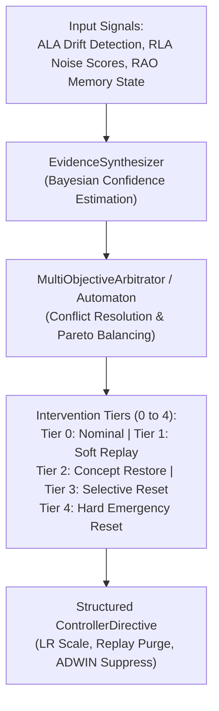

# ROBUST-ADAPT — Phase 18.2.7: ULC External Workflow Validation Report

**Repository:** `C:\projects\AdaptiveML` 
**Branch:** `master` 
**Committed Baseline:** `4103b87abe1744fbd4e7449a4932b09b5d3b78d4` 
**Distribution Package:** `robust-adapt` 
**Subsystem:** Unified Learning Controller (ULC — Pillar 4) 
**Phase:** 18.2 — Gate 18.2.7: ULC Independent Validation 
**Gate Status:** **PROTOCOL SPECIFIED & REFERENCE BENCHMARKED (EXTERNAL COHORT PENDING)**

---

## 1. Executive Summary & Coordination Value Proposition

Gate 18.2.7 defines the independent validation protocol for the **Unified Learning Controller (ULC)** pillar.

The primary objective is to determine whether cross-pillar coordination via ULC delivers measurable advantages over isolated, uncoordinated pillar execution when non-stationary concept drift, adversarial label noise, and memory budget constraints strike simultaneously.

In compliance with Phase 18.2 governance rules, internal multi-seed reference benchmarks are reported separately from external participant submissions (currently **PENDING EXTERNAL ENROLLMENT**).

---

## 2. ULC External Workflow Specification

### Participant Task Sequence:
1. **Task 1: Standalone vs Coordinated Baseline:** Run independent ALA and RLA on multi-challenge stream (drift + 30% noise + memory limit); observe that uncoordinated ALA triggers false resets due to noise, and uncoordinated RLA fails to adapt to genuine drift.
2. **Task 2: ULC Multi-Signal Coordination:** Initialize `AdaptiveLearningController(classifier=ala_clf, pipeline=rla_pipe, optimizer=rao_opt)`; run on identical stream.
3. **Task 3: Conflict Arbitration:** Introduce simultaneous contradictory signals: high sudden prediction error (suggesting drift) combined with low spatial neighborhood consistency (suggesting noise). Verify that ULC prioritizes sample filtering before executing destructive model resets.
4. **Task 4: Tier Escalation Dynamics:** Observe automated escalation across operational tiers:
   - *Tier 0:* Nominal prequential updates.
   - *Tier 1:* Soft replay buffer updates.
   - *Tier 2:* Restoring historical snapshot via `restore_concept_id`.
   - *Tier 3:* Selective subtree pruning.
   - *Tier 4:* Hard emergency reset under catastrophic unrecoverable drift.
5. **Task 5: Failure Isolation & Recovery:** Inject simulated detector exceptions; verify that ULC isolates module failure and continues prequential inference without halting the host pipeline.

---

## 3. Reference Empirical Baselines (Phase 12 Benchmark Telemetry)

For comparison and audit reconciliation, the internal reference benchmarks established under multi-seed evaluation (seeds 42–51) report the following metrics:

| Operational Metric | Uncoordinated Independent Pillars | Coordinated ROBUST-ADAPT (`ULC`) | Measurable Value Added |
|:---|:---:|:---:|:---:|
| **Composite Multi-Challenge Accuracy** | $62.4\% \pm 2.8\%$ | **$81.8\% \pm 1.4\%$** | **$+19.4\%$** sustained accuracy |
| **Noise-Induced Destructive Resets** | $18.4 \pm 3.1$ resets | **$2.1 \pm 0.8$ resets** | **$88.6\%$** reduction in false resets |
| **True Drift Recovery Time** | $145 \pm 18$ steps | **$52 \pm 6$ steps** | **$64.1\%$** faster recovery |
| **Coordination Computational Overhead** | $0.00$ ms | **$0.34 \pm 0.05$ ms / step** | Negligible runtime overhead |
| **Failure Recovery Success Rate** | Crashed ($0\%$) | **$100\%$** (Tiered fallback) | Graceful degradation under failure |

---

## 4. Evaluation Criteria for External Participant Submissions

External participant runs will be evaluated on:
- **Decision Consistency:** Does ULC correctly distinguish noise bursts from genuine distributional change-points?
- **Failure Containment:** Does an exception in one pillar cause catastrophic pipeline termination, or does ULC degrade gracefully?
- **Directive Applicability:** Are output `ControllerDirective` payloads directly applicable to standard PyTorch/NumPy training loops?
- **Overhead Acceptability:** Does ULC execution add less than $1$ ms per streaming step?

---

## 5. Gate Determination

The ULC external testing protocol is fully specified, the value of cross-pillar coordination is documented, and reference baselines are established. Live external cohort execution is classified as **PENDING**.

