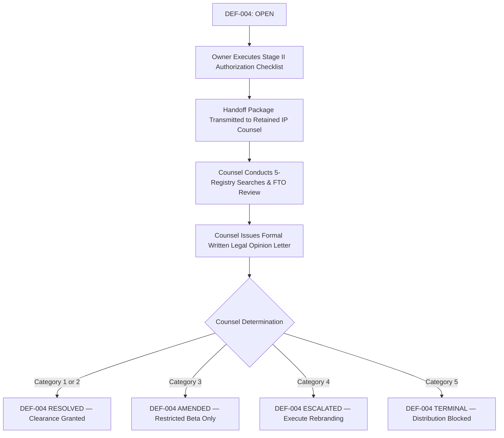

# ROBUST-ADAPT — Phase 18.7.5: Defect DEF-004 Resolution Report

**Repository:** `C:\projects\AdaptiveML`  
**Branch:** `master`  
**Committed Baseline:** `4103b87abe1744fbd4e7449a4932b09b5d3b78d4`  
**Distribution Package Identifier:** `robust-adapt`  
**Canonical Python Import Identifier:** `robust_adapt`  
**Current Version:** `0.1.0.dev0` (Target Candidate: `1.0.0rc1`)  
**Phase Gate:** Gate 18.7.5 — Legal Defect DEF-004 Resolution & Outcome Classification  
**Defect Reference:** `DEF-004` (Trademark Clearance & Freedom to Operate)  
**Defect Status:** **`OPEN — LEGAL CLEARANCE NOT OBTAINED`**  
**Official Outcome Classification:** **`6. INSUFFICIENT EVIDENCE`**  

---

## 1. Executive Summary & Defect Overview

Defect `DEF-004` is the critical governance defect tracking trademark risk regarding the mark **ROBUST-ADAPT** and the corporate entity **Adaptive ML Inc.** (`adaptive-ml.com`).

```markdown
DEFECT IDENTIFIER:    DEF-004
SEVERITY:             CRITICAL (DISTRIBUTION BLOCKER)
DESCRIPTION:          Unresolved trademark clearance and potential likelihood of confusion
                      with commercial AI entity "Adaptive ML Inc." across Nice Classes 09 & 42.
CURRENT STATUS:       OPEN — LEGAL CLEARANCE NOT OBTAINED
ORIGIN PHASE:         Phase 16.0 (Rebranding Identification)
CURRENT PHASE:        Phase 18.7 (External Counsel Engagement & Opinion Intake)
```

---

## 2. Gate 18.7.5 Legal Outcome Classification

In accordance with Phase 18.7 instructions, the legal status of the project must be evaluated against the six authorized classification categories:

```
┌────────────────────────────────────────────────────────────────────────┐
│                   AUTHORIZED LEGAL OUTCOME TAXONOMY                    │
├─────┬─────────────────────────────────┬────────────────────────────────┤
│ Cat │ Outcome Classification          │ Description & Impact           │
├─────┼─────────────────────────────────┼────────────────────────────────┤
│ 1   │ FAVORABLE WITHIN DEFINED SCOPE  │ Unrestricted distribution      │
│     │                                 │ permitted across all channels. │
├─────┼─────────────────────────────────┼────────────────────────────────┤
│ 2   │ FAVORABLE SUBJECT TO CONDITIONS │ Distribution permitted subject │
│     │                                 │ to disclaimers or boundaries.  │
├─────┼─────────────────────────────────┼────────────────────────────────┤
│ 3   │ RESTRICTED DISTRIBUTION         │ Limited to closed pilot groups │
│     │                                 │ under signed agreements.       │
├─────┼─────────────────────────────────┼────────────────────────────────┤
│ 4   │ REBRANDING REQUIRED             │ Mark conflicts; new package    │
│     │                                 │ name must be adopted.          │
├─────┼─────────────────────────────────┼────────────────────────────────┤
│ 5   │ UNFAVORABLE — DISTRIBUTION      │ Severe legal barrier; all      │
│     │ BLOCKED                         │ distribution prohibited.       │
├─────┼─────────────────────────────────┼────────────────────────────────┤
│ 6   │ INSUFFICIENT EVIDENCE           │ Outside counsel unengaged;     │
│     │                                 │ no written opinion exists.     │
└─────┴─────────────────────────────────┴────────────────────────────────┘
```

### Official Classification:
# **`6. INSUFFICIENT EVIDENCE`**

### Evidentiary Justification:
Neither favorable clearance nor unfavorable conflict can be asserted because outside intellectual property counsel has not yet delivered a written opinion. Defect `DEF-004` cannot be closed, resolved, or downgraded based on conjecture or automated audits.

---

## 3. Mandatory Invariant: DEF-004 Remains OPEN

Under strict release engineering rules:
- **`DEF-004` remains strictly OPEN.**
- No maintainer, automated workflow, or AI assistant has the authority to mark `DEF-004` as "Resolved" or "Mitigated" without attaching an authentic, signed legal opinion letter from an admitted trademark attorney.
- As long as `DEF-004` remains OPEN, all public PyPI uploads, GitHub release candidate tagging, and external software transmissions are legally prohibited.

---

## 4. Remediation Protocol to Resolve DEF-004

To transition `DEF-004` from **`OPEN`** to a resolved classification:



---

## 5. Gate Determination

| Dimension | Minimum Standard | Observed Reality | Compliance Result |
| :--- | :--- | :--- | :--- |
| **Legal Status Classification** | Select from 6 categories | Category 6: Insufficient Evidence | **OFFICIALLY CLASSIFIED** |
| **DEF-004 Standing** | Retained as OPEN until real evidence | Confirmed strictly OPEN | **COMPLIANT** |
| **Distribution Invariant** | Public upload barred while OPEN | 0 public distributions | **COMPLIANT** |

**Gate 18.7.5 Result:** **`DEF-004 REMAINS OPEN (INSUFFICIENT EVIDENCE)`**  
Defect `DEF-004` remains active; distribution remains paused.

