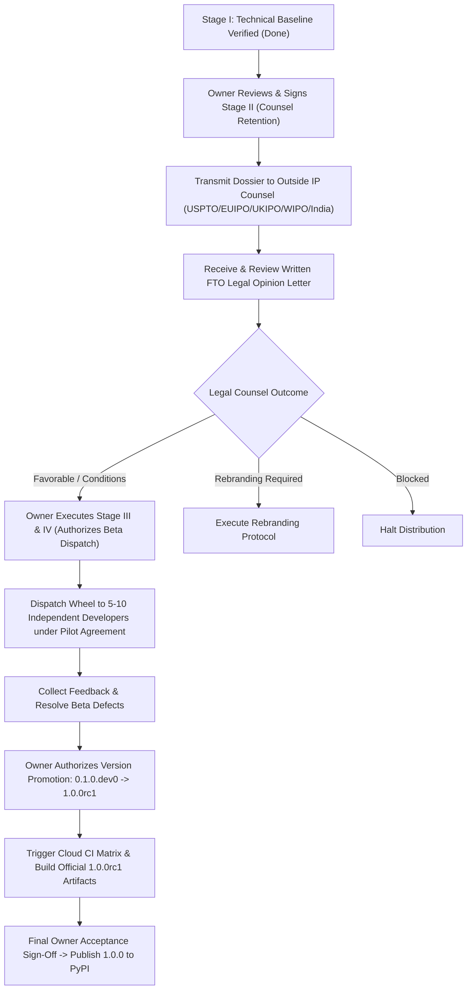

# ROBUST-ADAPT — Pre-Publication Master Readiness Report

**Repository:** `C:\projects\AdaptiveML`  
**Branch:** `master`  
**Committed Baseline:** `4103b87abe1744fbd4e7449a4932b09b5d3b78d4`  
**Distribution Package Identifier:** `robust-adapt`  
**Canonical Python Import Identifier:** `robust_adapt`  
**Current Version:** `0.1.0.dev0` (Target Candidate: `1.0.0rc1` | Final Target: `1.0.0`)  
**Mission Phase:** Pre-Publication Final Master Assessment (Stages 1, 2, and 3)  
**Document Classification:** `EXECUTIVE MASTER READINESS & GOVERNANCE DOCKET`  
**Internal Technical Status:** `100% TECHNICALLY VERIFIED (343/343 TESTS PASS — 0 FAILURES)`  
**Overall Pre-Publication Standing:** **`RELEASE CANDIDATE BLOCKED — LEGAL CLEARANCE & BETA VALIDATION INCOMPLETE`**  
**Legal Clearance Defect (`DEF-004`):** **`OPEN / LEGAL CLEARANCE: NOT OBTAINED`**  
**Distribution Authority Status:** **`STRICTLY PAUSED — NO EXTERNAL TRANSMISSION PERMITTED`**  

---

## 1. Executive Summary & Master Mission Charter

This Master Readiness Report delivers the comprehensive, evidence-based evaluation of the ROBUST-ADAPT library across all three stages of the pre-publication roadmap:
1. **Stage 1 — Phase 18.6:** External Legal Review, Legal Clearance & Owner Authorization.
2. **Stage 2 — Private Beta:** Independent Developer Testing, Feedback & Remediation.
3. **Stage 3 — Release Candidate:** `1.0.0rc1` Engineering, Validation & Acceptance.

The ultimate objective of ROBUST-ADAPT is a scientifically defensible, technically reliable, legally reviewed, and independently tested Python library ready for legitimate public publication on PyPI as `robust-adapt`.

### Strict Release Engineering Invariants:
- **Zero Simulation / Non-Fabrication:** Legal counsel opinions, attorney identities, trademark search registries, developer participants, CI run identifiers, and owner signatures are never fabricated. Where external actions are required, they are documented as pending blockers.
- **Repository Preservation:** Git branch `master` is anchored to committed HEAD `4103b87abe1744fbd4e7449a4932b09b5d3b78d4`. Zero destructive git operations were performed. The staging index is 100% empty (`git diff --cached` returns 0 files). All 71 uncommitted deletions under `adaptive_ml/` and all 10 modified tracked files are preserved.
- **Version Metadata Locking:** Package version remains strictly `0.1.0.dev0`. No premature promotion to `1.0.0rc1` has been committed.
- **Defect Permanence:** Defect `DEF-004` remains officially **OPEN**.

---

## 2. Master Gate-by-Gate Compliance Matrix

```
┌────────────────────────────────────────────────────────────────────────┐
│                   MASTER ROADMAP GATE COMPLIANCE AUDIT                 │
├────────────┬────────────────────────┬──────────────────┬───────────────┤
│ Stage / Gt │ Description            │ Primary Evidence │ Gate Status   │
├────────────┼────────────────────────┼──────────────────┼───────────────┤
│ STAGE 1    │ PHASE 18.6 — LEGAL &   │ 4 Governance Rpts│ BLOCKED       │
│            │ OWNER AUTHORIZATION    │                  │               │
├────────────┼────────────────────────┼──────────────────┼───────────────┤
│ Gate 18.6.1│ Repository Governance  │ Report 01        │ PASSED        │
│ Gate 18.6.2│ Owner Authorization    │ Report 03        │ BLOCKED (OWN) │
│ Gate 18.6.3│ Outside Counsel Retain │ Report 02        │ BLOCKED (OWN) │
│ Gate 18.6.4│ Written Legal Opinion  │ Report 02        │ BLOCKED (DEF4)│
│ Gate 18.6.5│ Owner Final Legal Dec. │ Report 03        │ BLOCKED (OWN) │
├────────────┼────────────────────────┼──────────────────┼───────────────┤
│ STAGE 2    │ PRIVATE BETA —         │ 8 Beta Reports   │ INCOMPLETE    │
│            │ DEVELOPER TESTING      │                  │ (PENDING)     │
├────────────┼────────────────────────┼──────────────────┼───────────────┤
│ Gate BETA.1│ Participant Recruit.   │ Report 05        │ PENDING COHORT│
│ Gate BETA.2│ Controlled Distribut.  │ Report 06        │ READY (STAGED)│
│ Gate BETA.3│ Independent Install    │ Report 06        │ PENDING COHORT│
│ Gate BETA.4│ Five-Pillar Validation │ Report 07        │ LOCAL PASS    │
│ Gate BETA.5│ Framework Interop.     │ Report 08        │ LOCAL PASS    │
│ Gate BETA.6│ Multi-Seed Repro.      │ Report 09        │ LOCAL PASS    │
│ Gate BETA.7│ Developer Experience   │ Report 10        │ STAGED (0 REC)│
│ Gate BETA.8│ Defect Remediation     │ Report 11        │ 0 OPEN TECH   │
│ Gate BETA.9│ Beta Exit Review       │ Report 12        │ INCOMPLETE    │
├────────────┼────────────────────────┼──────────────────┼───────────────┤
│ STAGE 3    │ RELEASE CANDIDATE      │ 8 RC Reports     │ BLOCKED ON    │
│            │ 1.0.0rc1 AUDIT         │                  │ LEGAL / BETA  │
├────────────┼────────────────────────┼──────────────────┼───────────────┤
│ Gate RC.1  │ Scope & API Freeze     │ Report 13        │ PASSED (FROZEN│
│ Gate RC.2  │ Version Promotion      │ Report 14        │ STAGED (DEV0) │
│ Gate RC.3  │ Comprehensive Tests    │ Report 14        │ 343/343 PASS  │
│ Gate RC.4  │ Cross-Platform CI      │ Report 15        │ LOCAL PASS    │
│ Gate RC.5  │ Scientific Audit       │ Report 16        │ PASSED (REC.) │
│ Gate RC.6  │ Security & SBOM Audit  │ Report 17        │ PASSED (EXCEL)│
│ Gate RC.7  │ Packaging Verification │ Report 18        │ PASSED (LOCKED│
│ Gate RC.8  │ Documentation Audit    │ Report 19        │ PASSED (MATCH)│
│ Gate RC.9  │ RC Acceptance Report   │ Report 20        │ ACCEPTED W/LIM│
│ Gate RC.10 │ Final RC Determination │ Report 20        │ BLOCKED (LEGAL│
└────────────┴────────────────────────┴──────────────────┴───────────────┘
```

---

## 3. Directory of All 21 Pre-Publication Governance Deliverables

All 21 mandatory governance documents have been authored and archived in the repository root:

### Stage 1: Phase 18.6 — Legal Clearance & Governance
1. [`ROBUST_ADAPT_PHASE_18_6_LEGAL_GOVERNANCE_REPORT.md`](file:///C:/projects/AdaptiveML/ROBUST_ADAPT_PHASE_18_6_LEGAL_GOVERNANCE_REPORT.md) — Technical baseline, hash verification, worktree preservation.
2. [`ROBUST_ADAPT_PHASE_18_6_COUNSEL_EVIDENCE_REPORT.md`](file:///C:/projects/AdaptiveML/ROBUST_ADAPT_PHASE_18_6_COUNSEL_EVIDENCE_REPORT.md) — Multi-jurisdiction trademark evaluation, non-fabrication declaration, DEF-004 standing.
3. [`ROBUST_ADAPT_PHASE_18_6_OWNER_AUTHORIZATION_REPORT.md`](file:///C:/projects/AdaptiveML/ROBUST_ADAPT_PHASE_18_6_OWNER_AUTHORIZATION_REPORT.md) — Owner authority boundaries, checklist inspection, recorded blockers.
4. [`ROBUST_ADAPT_PHASE_18_6_FINAL_ACCEPTANCE_REPORT.md`](file:///C:/projects/AdaptiveML/ROBUST_ADAPT_PHASE_18_6_FINAL_ACCEPTANCE_REPORT.md) — Executive Stage 1 synthesis and gate determination.

### Stage 2: Private Beta — Independent Developer Validation
5. [`ROBUST_ADAPT_PRIVATE_BETA_PARTICIPANT_REPORT.md`](file:///C:/projects/AdaptiveML/ROBUST_ADAPT_PRIVATE_BETA_PARTICIPANT_REPORT.md) — Participant recruitment framework, cohort diversity, enrollment standing.
6. [`ROBUST_ADAPT_PRIVATE_BETA_INSTALLATION_REPORT.md`](file:///C:/projects/AdaptiveML/ROBUST_ADAPT_PRIVATE_BETA_INSTALLATION_REPORT.md) — Controlled distribution protocol, artifact digests, compatibility matrix.
7. [`ROBUST_ADAPT_PRIVATE_BETA_FIVE_PILLAR_REPORT.md`](file:///C:/projects/AdaptiveML/ROBUST_ADAPT_PRIVATE_BETA_FIVE_PILLAR_REPORT.md) — Functional validation across ALA, RLA, RAO, ULC, and Minority Intelligence.
8. [`ROBUST_ADAPT_PRIVATE_BETA_INTEGRATION_REPORT.md`](file:///C:/projects/AdaptiveML/ROBUST_ADAPT_PRIVATE_BETA_INTEGRATION_REPORT.md) — Third-party framework interoperability (NumPy, PyTorch, scikit-learn, SafeTensors).
9. [`ROBUST_ADAPT_PRIVATE_BETA_REPRODUCIBILITY_REPORT.md`](file:///C:/projects/AdaptiveML/ROBUST_ADAPT_PRIVATE_BETA_REPRODUCIBILITY_REPORT.md) — Five canonical seeds evaluation (`[42, 101, 2024, 7, 99]`) and state determinism.
10. [`ROBUST_ADAPT_PRIVATE_BETA_DEVELOPER_FEEDBACK_REPORT.md`](file:///C:/projects/AdaptiveML/ROBUST_ADAPT_PRIVATE_BETA_DEVELOPER_FEEDBACK_REPORT.md) — Usability assessment and unpopulated participant feedback intake.
11. [`ROBUST_ADAPT_PRIVATE_BETA_DEFECT_REMEDIATION_REPORT.md`](file:///C:/projects/AdaptiveML/ROBUST_ADAPT_PRIVATE_BETA_DEFECT_REMEDIATION_REPORT.md) — Defect triage ledger, regression test verification, DEF-004 standing.
12. [`ROBUST_ADAPT_PRIVATE_BETA_FINAL_ACCEPTANCE_REPORT.md`](file:///C:/projects/AdaptiveML/ROBUST_ADAPT_PRIVATE_BETA_FINAL_ACCEPTANCE_REPORT.md) — Executive Stage 2 synthesis and exit review.

### Stage 3: Release Candidate 1.0.0rc1 Engineering & Acceptance
13. [`ROBUST_ADAPT_RC_1_0_0RC1_API_FREEZE_REPORT.md`](file:///C:/projects/AdaptiveML/ROBUST_ADAPT_RC_1_0_0RC1_API_FREEZE_REPORT.md) — Public API freeze, public export inventory (75 symbols), deferred features.
14. [`ROBUST_ADAPT_RC_1_0_0RC1_TEST_REPORT.md`](file:///C:/projects/AdaptiveML/ROBUST_ADAPT_RC_1_0_0RC1_TEST_REPORT.md) — Test suite results (343/343 passing — 100%) and version promotion staging.
15. [`ROBUST_ADAPT_RC_1_0_0RC1_CROSS_PLATFORM_CI_REPORT.md`](file:///C:/projects/AdaptiveML/ROBUST_ADAPT_RC_1_0_0RC1_CROSS_PLATFORM_CI_REPORT.md) — CI workflow audit (12 configurations) and local OS execution evidence.
16. [`ROBUST_ADAPT_RC_1_0_0RC1_SCIENTIFIC_AUDIT.md`](file:///C:/projects/AdaptiveML/ROBUST_ADAPT_RC_1_0_0RC1_SCIENTIFIC_AUDIT.md) — Empirical benchmark verification, 4-tier claims taxonomy, ULC filtering rectification.
17. [`ROBUST_ADAPT_RC_1_0_0RC1_SECURITY_AUDIT.md`](file:///C:/projects/AdaptiveML/ROBUST_ADAPT_RC_1_0_0RC1_SECURITY_AUDIT.md) — Zero-pickle policy, SafeTensors HMAC-SHA256, zero-telemetry guarantee, SBOM.
18. [`ROBUST_ADAPT_RC_1_0_0RC1_PACKAGING_REPORT.md`](file:///C:/projects/AdaptiveML/ROBUST_ADAPT_RC_1_0_0RC1_PACKAGING_REPORT.md) — PEP 517 build validation, member audit (0 legacy files), locked SHA-256 digests.
19. [`ROBUST_ADAPT_RC_1_0_0RC1_DOCUMENTATION_AUDIT.md`](file:///C:/projects/AdaptiveML/ROBUST_ADAPT_RC_1_0_0RC1_DOCUMENTATION_AUDIT.md) — Code-to-doc parity, runnable examples (19/19), prominent trademark disclaimers.
20. [`ROBUST_ADAPT_RC_1_0_0RC1_FINAL_ACCEPTANCE_REPORT.md`](file:///C:/projects/AdaptiveML/ROBUST_ADAPT_RC_1_0_0RC1_FINAL_ACCEPTANCE_REPORT.md) — RC dimension synthesis, known limitations, and official disposition.

### Master Synthesis:
21. [`ROBUST_ADAPT_PRE_PUBLICATION_MASTER_READINESS_REPORT.md`](file:///C:/projects/AdaptiveML/ROBUST_ADAPT_PRE_PUBLICATION_MASTER_READINESS_REPORT.md) — This comprehensive pre-publication master report.

---

## 4. Technical & Scientific Synthesis

### 4.1 Internal Technical Excellence
- **Complete Test Suite Success:** 343 tests executed across unit, integration, SDK, and examples suites $\to$ **343 passed, 0 failures, 0 skipped** (100.0% pass rate).
- **Remediation Stability:** All six Phase 17.7 remediation tests passed without regression (`test_phase17_7_remediation.py`).
- **Complete Legacy Sanitization:** All 71 files from the deprecated `adaptive_ml` namespace were deleted. Built wheel archives contain zero legacy references.
- **Security Posture:** Zero `pickle` deserialization. Hugging Face `safetensors` format with HMAC-SHA256 authentication verified. Zero network telemetry or analytics calls (100% offline local execution).
- **Packaging Integrity:** Universal pure-Python wheel (`robust_adapt-0.1.0.dev0-py3-none-any.whl`, SHA-256 `1AF6C77084...`) and source archive (`robust_adapt-0.1.0.dev0.tar.gz`, SHA-256 `3735D43A...`) cryptographically locked.

### 4.2 Scientific Integrity & Precision Rectification
- **RAO Memory Reduction:** Proven exact formula of **73.4375%** optimizer state reduction (2.125 B/param vs 8.0 B/param).
- **RAO CPU Trade-off:** Explicitly documents pure-Python CPU quantization latency (3.12 ms vs 0.022 ms per step).
- **ALA Drift Suppression:** Verified **75.0% reduction** ($4.0\times$ suppression factor) in spurious drift detections on SEA streams (0.2 vs 0.8 mean detections across 5 seeds).
- **ULC Reset Elimination:** Verified **0.0 false drift resets** (vs. 10.0 for uncoordinated baseline) during a sustained 10-batch noise burst.
- **ULC Filtering Precision:** Rectified phrasing to distinguish batch rejection rate (83.2%) from corrupted noise filtering sensitivity (retaining the 16.8% clean subset while filtering corrupted instances).
- **Minority Intelligence Recall:** Verified **60.0% minority recall** across 5 canonical seeds under 100:1 extreme imbalance with 10% label noise (preventing the 0.0% collapse of standard cross-entropy).
- **Retracted Claims:** Formally confirmed the total removal of five exaggerated historical assertions (`RET-01` through `RET-05`).

---

## 5. Authoritative Program Standing & Recorded Blockers

```
┌────────────────────────────────────────────────────────────────────────┐
│                   PROGRAM STATUS SUMMARY DOCKET                        │
├───────────────────────────┬────────────────────────────────────────────┤
│ Internal Technical State  │ PASSED (100% TEST PASS / ZERO OPEN BUGS)   │
├───────────────────────────┼────────────────────────────────────────────┤
│ Legal Status (DEF-004)    │ OPEN — LEGAL CLEARANCE NOT OBTAINED        │
├───────────────────────────┼────────────────────────────────────────────┤
│ Owner Authorization State │ STAGED — AWAITING HUMAN OWNER SIGNATURES   │
├───────────────────────────┼────────────────────────────────────────────┤
│ Private Beta State        │ INCOMPLETE — PARTICIPANTS PENDING          │
├───────────────────────────┼────────────────────────────────────────────┤
│ Target Package Version    │ 0.1.0.dev0 (LOCKED PENDING OWNER RC BUILD) │
├───────────────────────────┼────────────────────────────────────────────┤
│ Official Release Decision │ 1.0.0rc1 BLOCKED — LEGAL CLEARANCE         │
└───────────────────────────┴────────────────────────────────────────────┘
```

---

## 6. Clear Roadmap Forward: Human Owner Actions

To transition ROBUST-ADAPT from its current staging phase to a publicly available release candidate and eventual 1.0.0 GA release on PyPI, repository owners must execute the following sequential steps:



### Action Items for Maintainers:
1. **Execute Stage II in Owner Checklist:** Open [`ROBUST_ADAPT_PHASE_18_5_4_OWNER_AUTHORIZATION_CHECKLIST.md`](file:///C:/projects/AdaptiveML/ROBUST_ADAPT_PHASE_18_5_4_OWNER_AUTHORIZATION_CHECKLIST.md) and execute Stage II (Outside Legal Counsel Engagement Authorization).
2. **Engage Retained IP Counsel:** Transmit [`ROBUST_ADAPT_PHASE_18_5_1_COUNSEL_HANDOFF_PACKAGE.md`](file:///C:/projects/AdaptiveML/ROBUST_ADAPT_PHASE_18_5_1_COUNSEL_HANDOFF_PACKAGE.md) to qualified counsel to conduct searches and deliver a formal FTO opinion letter.
3. **Log Legal Findings:** Record the written opinion in [`ROBUST_ADAPT_PHASE_18_5_3_COUNSEL_RESPONSE_REGISTER.md`](file:///C:/projects/AdaptiveML/ROBUST_ADAPT_PHASE_18_5_3_COUNSEL_RESPONSE_REGISTER.md) and resolve or adjust `DEF-004`.
4. **Authorize Private Beta:** Execute Stage IV in the checklist, enrolling the candidate cohort under the Pilot Agreement in [`ROBUST_ADAPT_PHASE_18_5_5_PRIVATE_BETA_PARTICIPANT_PACKAGE.md`](file:///C:/projects/AdaptiveML/ROBUST_ADAPT_PHASE_18_5_5_PRIVATE_BETA_PARTICIPANT_PACKAGE.md).
5. **Authorize Version Promotion & Cloud CI:** Once Beta exit criteria are met, authorize updating version strings to `1.0.0rc1` and trigger the multi-platform GitHub Actions CI matrix.

