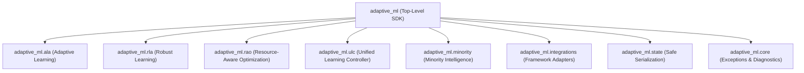

# AdaptiveML Public API Reference Index

This is the comprehensive public API reference for **AdaptiveML** (`aml-core` v0.1.0.dev0, import namespace `adaptive_ml`).

All classes, functions, and exceptions listed here are part of the stable public SDK export contract defined in `adaptive_ml/__init__.py` and can be imported directly via `import robust_adapt as aml` or from the respective subpackage.

---

## 1. API Modules Overview

---

## 2. API Domain References

### [Core Foundations & Exceptions](core.md)
Foundational exception hierarchy, input validation utilities, telemetry probes, and structured diagnostics.
- `AdaptiveMLError`, `ValidationError`, `ConfigurationError`, `SerializationError`
- `DiagnosticRegistry`, `DiagnosticEvent`, `get_process_memory_bytes`

### [Pillar 1: Adaptive Learning Algorithms (ALA)](ala.md)
Streaming prequential classification, Hoeffding Tree induction, statistical drift detection, and recurring concept memory.
- `ALA30AdaptiveLearner`, `AdaptiveClassifier`, `HoeffdingTree`, `VectorizedHoeffdingTree`
- `ReliabilityWeightedADWIN`, `ADWIN`, `CUSUMDetector`
- `RecurringConceptMemory`, `ConceptFingerprinter`, `ClassBalancedReservoirReplay`, `DelayedLabelQueue`

### [Pillar 2: Robust Learning Algorithms (RLA)](rla.md)
Multi-signal sample reliability scoring, asymmetric transition detection, and robust loss functions.
- `RLA30RobustLearner`, `MultiSignalReliabilityEngine`, `AsymmetricTransitionDetector`
- `ClassConditionalReliabilityEstimator`, `EvidenceBasedLabelCorrector`, `DensityAwareMarginScorer`
- `FocalLoss`, `GeneralizedCrossEntropyLoss`, `SymmetricCrossEntropyLoss`

### [Pillar 3: Adaptive Minority Intelligence](minority.md)
Streaming class imbalance defense, online prior estimation, and dynamic false-positive budget regulation.
- `MinorityIntelligence20Learner`, `BetaBinomialPriorTracker`, `OnlineClassPriorTracker`
- `DynamicFPBudgetThresholdManager`, `AdaptiveThresholdManager`, `ClassAwareCalibrator`

### [Pillar 4: Resource-Aware Optimization (RAO)](rao.md)
Dynamic 8-bit optimizer state compression, budget management, and resilient checkpointing.
- `LowMemoryAdamW`, `BlockQuantizer`, `ResilientCheckpointManager`
- `AdaptiveGradientAccumulator`, `DynamicResourceBudgetManager`, `ExecutionProfiler`

### [Pillar 5: Unified Learning Controller (ULC-v5)](ulc.md)
Turnkey cross-pillar arbitration with five-tier intervention hierarchy and anti-thrashing cooldown backoff.
- `UnifiedLearningControllerV5`, `ULCv5Config`, `ULCv5Directive`
- `InterventionTier`, `UtilityScorer`

### [Framework Integrations](integrations.md)
Adapters and protocols for PyTorch, Scikit-Learn, and tabular DataFrames.
- `VectorizedLowMemoryAdamW`, `create_torch_low_memory_adamw`
- `SklearnAdaptiveClassifier`, `SklearnDriftDetectorTransformer`, `SklearnReliabilityFilter`
- `TorchCheckpointAdapter`, `DatasetContract`

### [State & Serialization](state.md)
Zero-pickle SafeTensors binary weight persistence and HMAC-SHA256 authenticated verification.
- `save_state`, `load_state`, `compute_file_sha256`, `compute_file_hmac`, `is_safetensors_available`
