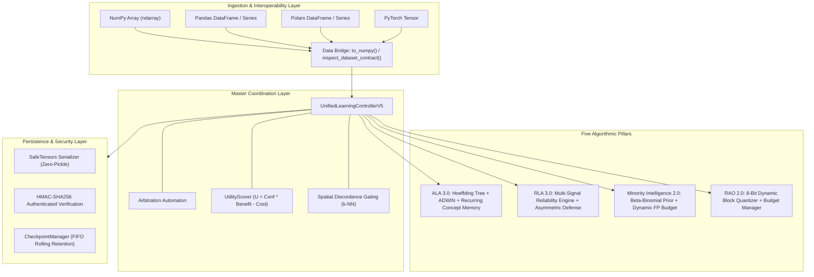

# System Architecture & Technical Specifications

**Distribution Package:** `aml-core` 
**Import Namespace:** `adaptive_ml` 
**Architectural Baseline:** Stage 14 Production Hardened 
**Target Runtimes:** Linux (AMD64, ARM64), macOS (Apple Silicon), Windows (AMD64) 

---

## 1. High-Level Architecture Overview

AdaptiveML provides a unified, local-first streaming architecture engineered for non-stationary environments. The system is decomposed into five core algorithmic pillars, a central arbitration controller, an immutable data bridge, and a cryptographically authenticated state management engine.

---

## 2. Ingestion & Data Contracts Layer

The data layer standardizes inputs into C-contiguous NumPy float64/float32 buffers before reaching algorithm cores:
1. **Zero-Copy Views:** Memory is shared directly whenever source containers match target dtype and contiguity.
2. **Strict Non-Finite Scans:** All matrices are validated against `NaN` and `Inf` to prevent silent poison values.
3. **Immutability Contract:** Ingested buffers are never mutated in-place by downstream learners.

---

## 3. The Five Core Pillars

### Pillar 1: Adaptive Learning Algorithms (ALA 3.0)
- **Hoeffding Tree Induction:** Provable error bounds on streaming decision tree split choices via the Hoeffding inequality:
  $$\epsilon = \sqrt{\frac{R^2 \ln(1 / \delta)}{2 n}}$$
- **Reliability-Weighted ADWIN:** Dynamically sizes a sliding window $W$, cutting sub-windows when statistical mean differences exceed Hoeffding cut bounds.
- **Recurring Concept Memory:** Fingerprints distribution statistics into high-dimensional concept vectors, enabling instantaneous $O(1)$ memory restoration upon recurrence.

### Pillar 2: Robust Learning Algorithms (RLA 3.0)
- **Multi-Signal Reliability Engine:** Evaluates composite sample reliability $r_i \in [0, 1]$ combining prediction margin, spatial $k$-NN neighborhood agreement, and temporal consistency.
- **Asymmetric Transition Defense:** Detects adversarial label noise attacks using rolling contingency tracking.
- **Noise-Robust Losses:** Symmetric Cross-Entropy ($\mathcal{L}_{\text{SCE}}$) and Generalized Cross-Entropy ($\mathcal{L}_{\text{GCE}}$) bound gradient influence on ambiguous points.

### Pillar 3: Adaptive Minority Intelligence 2.0
- **Beta-Binomial Bayesian Prior:** Maintains online posterior distributions over class frequencies under non-stationary drift.
- **Sublinear Cost Weighting:** Scales minority gradient updates via $W_c = (1 / \hat{\pi}_c)^{0.52}$ to prevent gradient destabilization.
- **PID False-Positive Regulation:** Modulates decision threshold $\tau(t)$ to strictly enforce operational alarm quotas.

### Pillar 4: Resource-Aware Optimization (RAO 2.0)
- **8-Bit Dynamic Block Quantization:** Compresses optimizer momentum and second moments into `int8` and `uint8` with per-block float32 scales, achieving $>73\%$ RAM reduction.
- **Dynamic Resource Budget Manager:** Monitors per-step execution latency (ms) and resident memory (MB), dynamically throttling micro-batch sizes under resource contention.

### Pillar 5: Unified Learning Controller (ULC-v5)
- **Arbitration Automaton:** Disambiguates concept drift from label noise bursts via spatial discordance gating.
- **5-Tier Intervention Hierarchy:** Selects optimal interventions from `TIER_0_NOOP` through `TIER_4_HARD_RESET` based on expected utility scoring.
- **Anti-Thrashing Cooldown:** Enforces non-zero cooldown intervals after adaptation events to prevent oscillatory thrashing.

---

## 4. State Persistence & Fault Recovery

- **Zero-Pickle Specification:** All weights are persisted via HuggingFace SafeTensors binary buffers.
- **Cryptographic Tamper-Proofing:** Companion metadata stores SHA-256 digests and optional HMAC-SHA256 signatures.
- **Atomic Renames:** Writes to `.tmp` files committed via atomic POSIX/Windows `os.replace`.
