# AdaptiveML — Comprehensive Architecture Diagrams Catalog

> **Document Status**: Complete Baseline Deliverable (Phase 7)  
> **Document Identifier**: `DOC-DES-P7-012`  
> **Last Updated**: 2026-11-01  
> **Scope**: Collection of 12 official Mermaid architectural diagrams matching written specifications  
> **Compliance**: Fully compliant with GitHub Flavored Markdown and Antigravity Mermaid rendering standards

---

## 1. System Context Diagram

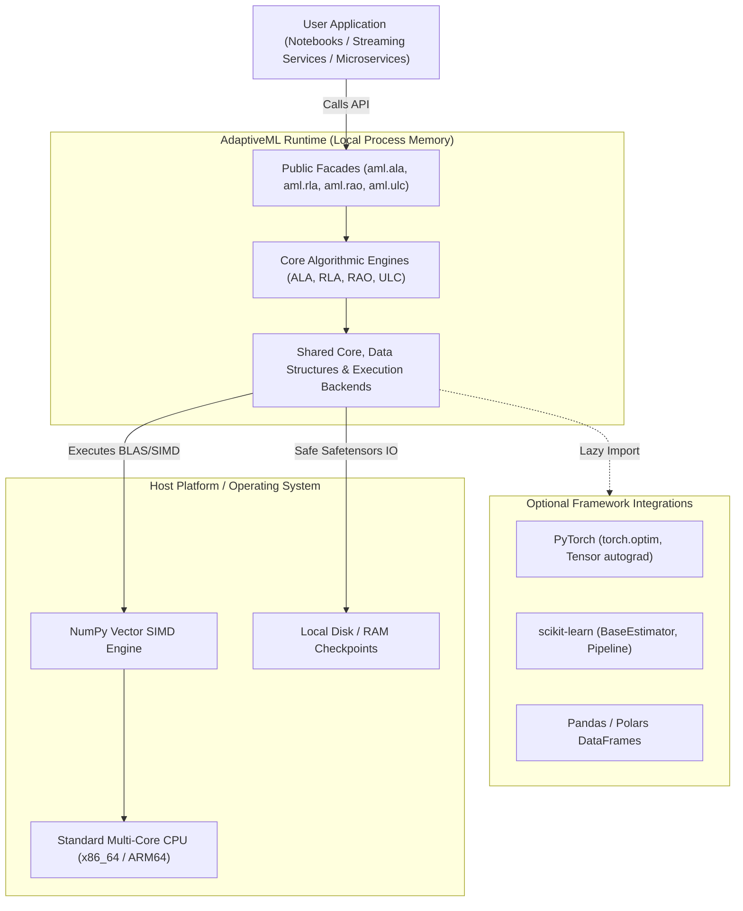

---

## 2. Six-Layer Architectural Model

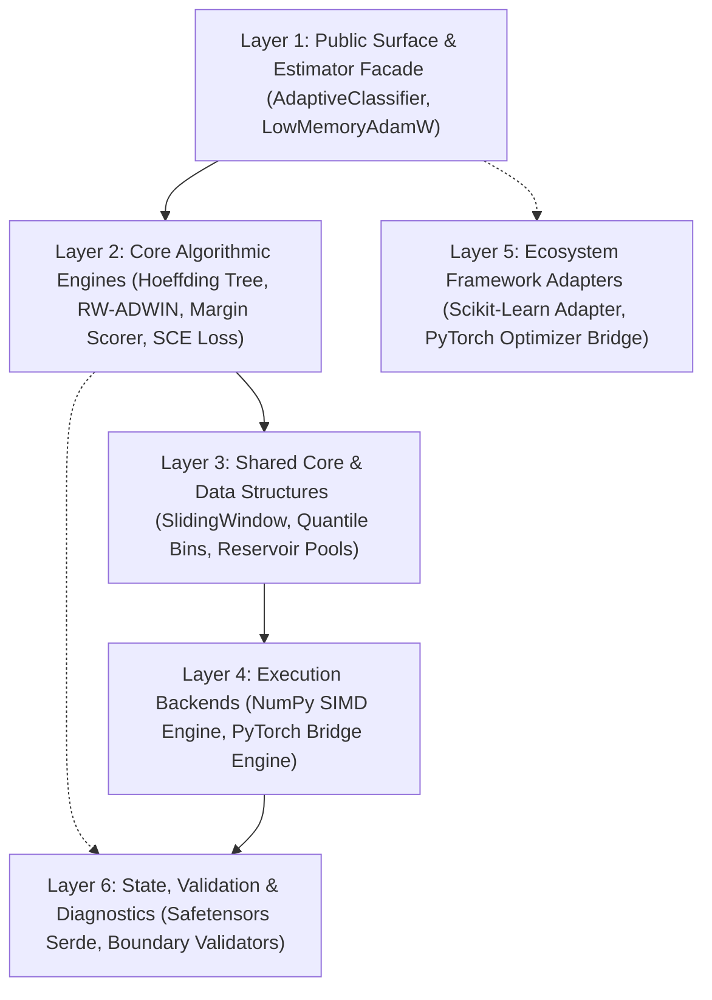

---

## 3. Package Dependency & Module Boundary DAG

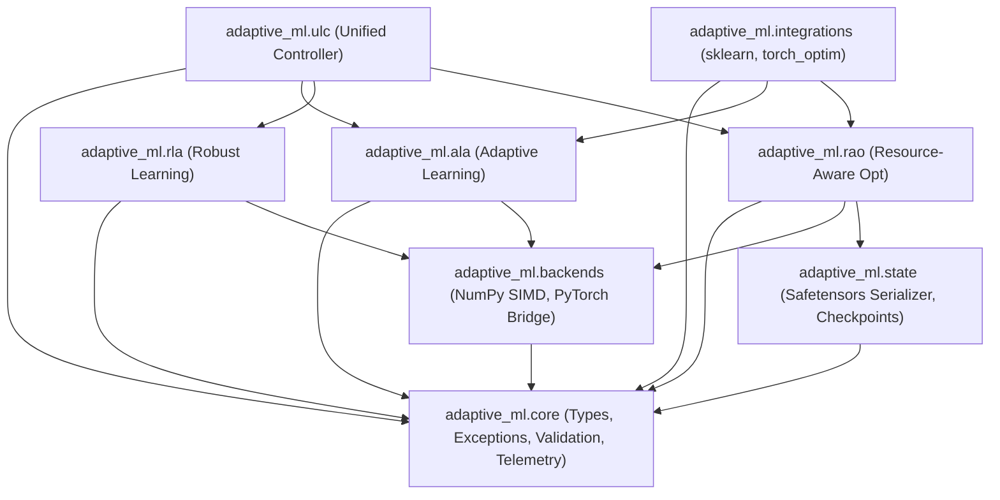

---

## 4. ALA Streaming Pipeline Architecture

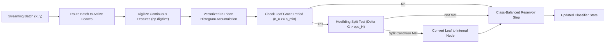

---

## 5. RLA Denoising & Weighting Flow

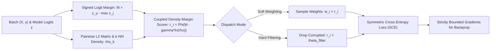

---

## 6. RAO Block-Quantization Memory Flow

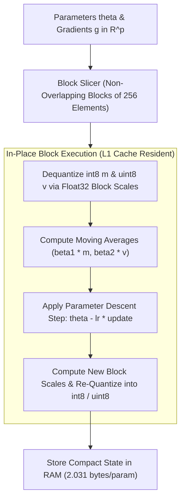

---

## 7. ULC Dual-Evidence Finite State Machine

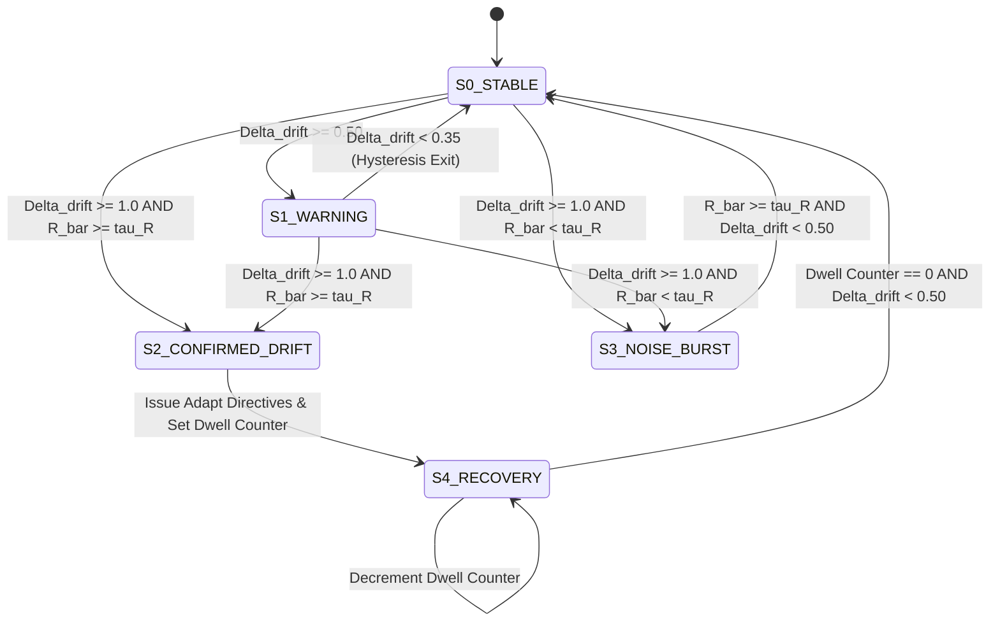

---

## 8. Cross-Pillar Coordination Sequence Diagram

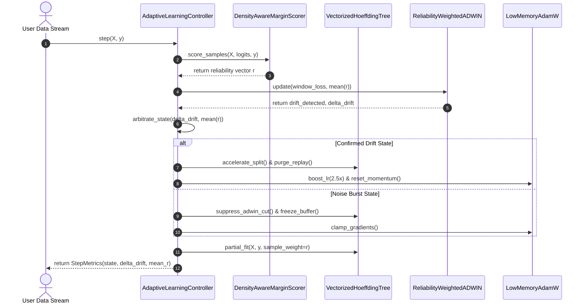

---

## 9. Streaming Decision Tree Node Splitting Sequence

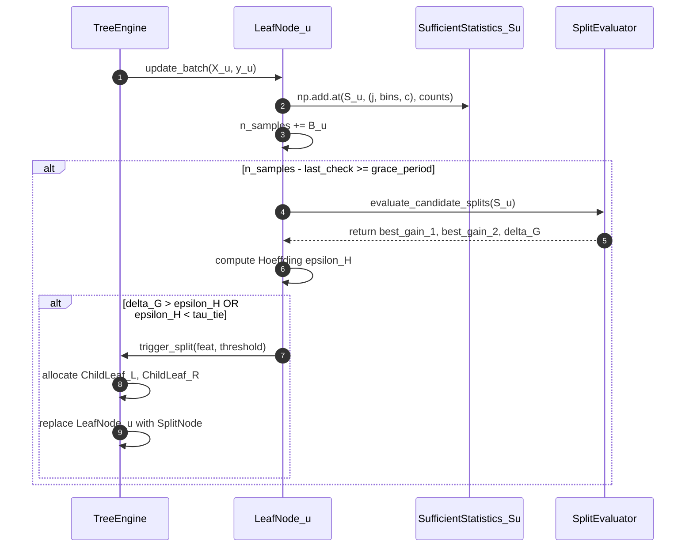

---

## 10. Memory Layout & Cache Alignment Diagram

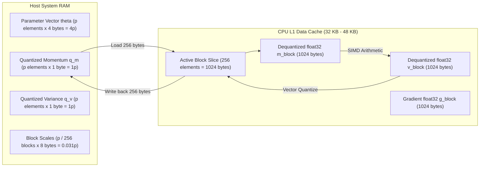

---

## 11. Checkpoint & Serialization Protocol

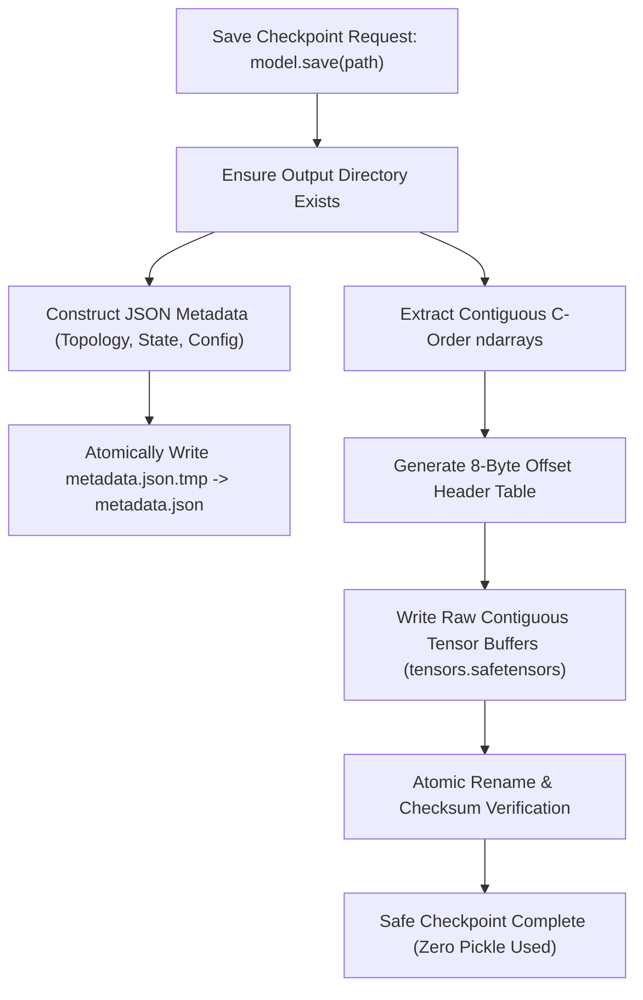

---

## 12. Test Pyramid & Validation Flow

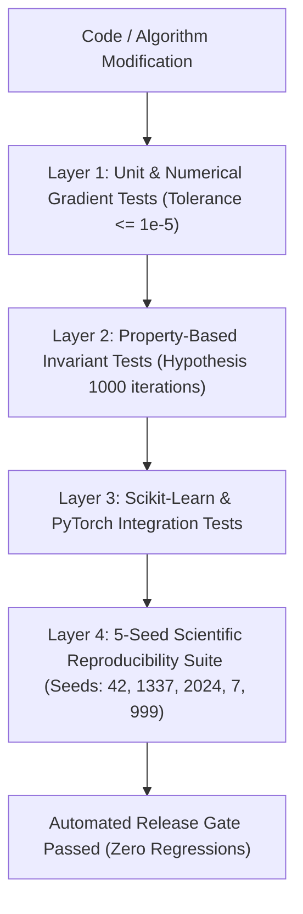
