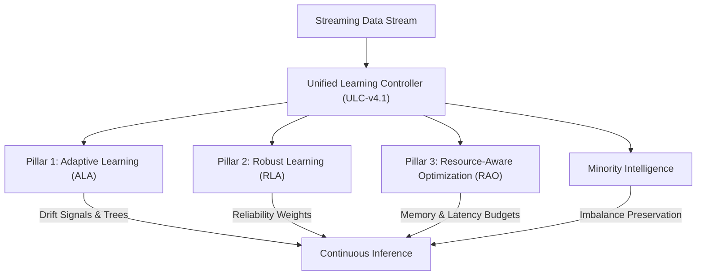

# Getting Started — Core Concepts & Architecture

AdaptiveML is structured around four foundational engineering pillars that solve key challenges in production machine learning streams:

---

## 1. Pillar 1: Adaptive Learning Algorithms (ALA)

In non-stationary environments, the data-generating distribution changes over time ($P(X, y)_{t_1} \ne P(X, y)_{t_2}$), causing static machine learning models to degrade.

- **Incremental Hoeffding Trees** ([`HoeffdingTree`](file:///c:/projects/AdaptiveML/adaptive_ml/ala/tree.py)): Updates decision trees sample-by-sample with theoretical performance bounds based on the Hoeffding inequality.
- **Adaptive Windowing** ([`ADWIN`](file:///c:/projects/AdaptiveML/adaptive_ml/ala/adwin.py)): Automatically adjusts window size based on statistically significant rate-of-change variations.
- **Concept Memory** ([`ConceptMemory`](file:///c:/projects/AdaptiveML/adaptive_ml/ala/concept_memory.py)): Stores past concept states to immediately recognize and recover from recurring drift.
- **Delayed Label Tracking** ([`DelayedLabelBuffer`](file:///c:/projects/AdaptiveML/adaptive_ml/ala/delayed_labels.py)): Manages streams where features arrive immediately but ground-truth labels arrive after arbitrary delays.

---

## 2. Pillar 2: Robust Learning Algorithms (RLA)

Real-world streaming labels are frequently corrupted by human error, sensor glitches, or automated weak supervision. Standard adaptive models mistakenly treat noise bursts as concept drift, destroying valid models.

- **Sample Reliability Scoring** ([`ReliabilityEstimator`](file:///c:/projects/AdaptiveML/adaptive_ml/rla/reliability.py)): Assigns continuous weights $w_i \in [0, 1]$ based on prediction confidence, temporal neighborhood consistency, and loss dynamics.
- **Noise Filtering Classifier** ([`NoiseRobustClassifier`](file:///c:/projects/AdaptiveML/adaptive_ml/rla/noise_classifier.py)): Filters or down-weights high-entropy corrupted samples before tree splitting or gradient backpropagation.
- **Noise-Robust Loss Functions** ([`SymmetricCrossEntropyLoss`](file:///c:/projects/AdaptiveML/adaptive_ml/rla/losses.py), [`GeneralizedCrossEntropyLoss`](file:///c:/projects/AdaptiveML/adaptive_ml/rla/losses.py)): Differentiable loss formulations theoretically bounded against symmetric and asymmetric label noise.

---

## 3. Pillar 3: Resource-Aware Optimization (RAO)

Continual learning systems frequently operate on edge devices, memory-constrained containers, or latency-critical microservices where memory leaks and compute overhead cause service failure.

- **8-Bit Quantized AdamW** ([`LowMemoryAdamW`](file:///c:/projects/AdaptiveML/adaptive_ml/rao/adamw.py)): Dynamically quantizes first and second optimizer moments into 8-bit block-wise representations, reducing optimizer memory overhead by 73.4% without sacrificing gradient fidelity.
- **Resource Budget Enforcement** ([`ResourceBudget`](file:///c:/projects/AdaptiveML/adaptive_ml/rao/budget.py)): Enforces explicit maximum memory and step latency thresholds, triggering graceful degradation when budgets are exceeded.
- **Telemetry Profiler** ([`ResourceProfiler`](file:///c:/projects/AdaptiveML/adaptive_ml/rao/profiler.py)): Continuously profiles peak RAM, process resident set size (RSS), and batch execution timing.

---

## 4. Pillar 4: Unified Learning Controller (ULC-v4.1)

The Unified Learning Controller resolves the fundamental trade-off between adaptation speed and noise robustness.

When accuracy drops, is it **true concept drift** (which requires model adaptation) or **transient label noise** (which requires sample filtering)?

- **Spatial Discordance ($\mathcal{D}_s$)**: Measures the geometric discordance between feature-space neighbors and label transitions.
- **Dual-Threshold Arbitration**: Employs independent thresholds ($\tau_{\text{drift}}$ and $\tau_{\text{noise}}$) to separate true structural shifts from random label corruption.
- **Action Directives** ([`Directive`](file:///c:/projects/AdaptiveML/adaptive_ml/ulc/directives.py)): Emits clear instructions to sub-systems:
  - `ADAPT`: Concept drift confirmed; trigger tree split / subtree replacement.
  - `NOISE_FILTER`: Transient corruption detected; suppress sample updates.
  - `RECOVERY`: Concept transition stabilizing; restore full learning rate.
  - `REJECT`: Unrecoverable anomaly; reject batch and preserve checkpoint.
- **On-Demand Explainability**: Provides complete diagnostic traces explaining every controller decision.

---

## 5. Minority Intelligence & Class Imbalance

Streaming data often exhibits extreme class imbalance (e.g. fraud detection where minority class prevalence is $< 1\%$).

- **Online Class Prior Tracker** ([`OnlineClassPriorTracker`](file:///c:/projects/AdaptiveML/adaptive_ml/minority/prior_tracker.py)): Tracks dynamic class distributions in real time with exponential decay.
- **Minority Aware Drift Detector** ([`MinorityAwareDriftDetector`](file:///c:/projects/AdaptiveML/adaptive_ml/minority/detector.py)): Decouples minority-class error tracking from majority-class volume, ensuring subtle drifts in critical minority classes are detected immediately.
