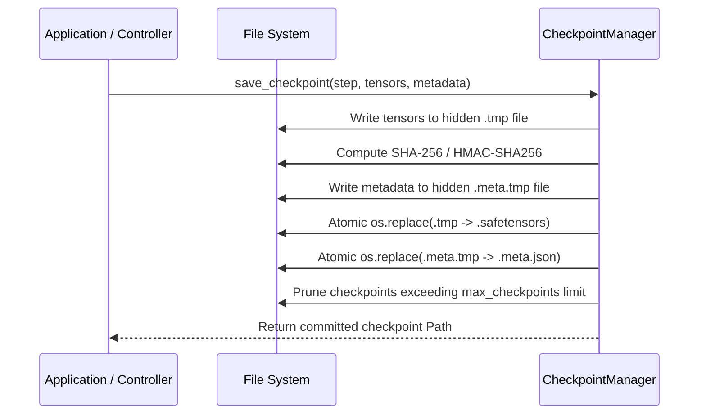

# Checkpoints, State Persistence & Fault Recovery Guide

In mission-critical streaming applications, state persistence must be secure, atomic, and resilient against sudden process interruptions or hardware faults.

AdaptiveML provides a comprehensive persistence architecture built upon the **SafeTensors** specification, completely eliminating the arbitrary code execution vulnerabilities inherent to Python's native `pickle`.

---

## 1. Architectural Principles

AdaptiveML's checkpoint architecture adheres to four core guarantees:

1. **Zero-Pickle Security:** Model parameters and optimizer moments are serialized as raw memory-mapped binary tensors. Deserialization cannot execute arbitrary Python code.
2. **Cryptographic Integrity Verification:** Every persisted tensor file is indexed with an automatic SHA-256 cryptographic digest written to companion `.meta.json` metadata.
3. **HMAC-SHA256 Tamper Protection:** High-security deployments can provide an authentication secret key ($\ge 16$ bytes). Any tampering, modification, or byte substitution causes an immediate `SerializationError`.
4. **Atomic File Operations:** Checkpoints are written to hidden temporary files (`.checkpoint.tmp`) and committed via atomic operating system rename (`os.replace`), preventing corrupted half-written files on crash.



---

## 2. Using `save_state` and `load_state`

The functional persistence API provides direct, low-level state saving and loading:

```python
import numpy as np
from pathlib import Path
from robust_adapt.state import save_state, load_state

# 1. Prepare model parameter tensors
tensors = {
    "weights": np.random.randn(10, 5).astype(np.float32),
    "biases": np.zeros(5, dtype=np.float32),
    "step_count": np.array([1250], dtype=np.int64),
}

metadata = {
    "model_name": "AdaptiveClassifierV5",
    "accuracy": "0.942",
    "drift_count": "3",
}

# 2. Persist state atomically
target_path = Path("checkpoints/model_step_1250")
save_state(target_path, tensors=tensors, metadata=metadata)
print(f"State committed to: {target_path}.safetensors")

# 3. Restore state with integrity verification
loaded_tensors, loaded_meta = load_state(target_path, verify_integrity=True)
print(f"Restored weights shape: {loaded_tensors['weights'].shape}")
print(f"Recorded step: {loaded_meta['step_count']}")
```

---

## 3. Cryptographic HMAC Authentication

To guarantee that checkpoints cannot be tampered with in untrusted storage environments:

```python
import secrets
from robust_adapt.state import save_state, load_state
from robust_adapt.core import SerializationError

# Generate a cryptographically secure 32-byte key
auth_key = secrets.token_bytes(32)

# Save with HMAC signature
save_state("checkpoints/secure_model", tensors=tensors, auth_key=auth_key)

# Load with identical secret key
restored, meta = load_state("checkpoints/secure_model", auth_key=auth_key)
print("HMAC authentication successful!")

# Tampering or incorrect key will raise SerializationError
wrong_key = secrets.token_bytes(32)
try:
    load_state("checkpoints/secure_model", auth_key=wrong_key)
except SerializationError as exc:
    print(f"Tamper detected: {exc}")
```

---

## 4. Automated Rolling Checkpoints with `CheckpointManager`

In continuous streaming applications, `CheckpointManager` automatically handles step indexing, rolling window retention, and rollback:

```python
from robust_adapt.state import CheckpointManager
import numpy as np

# Retain only the 3 most recent checkpoints
manager = CheckpointManager(
    checkpoint_dir="checkpoints/stream_run_1",
    max_checkpoints=3,
    prefix="stream_ckpt"
)

# Periodically snapshot model during streaming loop
for step in [100, 200, 300, 400]:
    state = {
        "weights": np.random.randn(8, 2).astype(np.float32),
        "step": np.array([step]),
    }
    manager.save_checkpoint(step=step, tensors=state, metadata={"metric": 0.95})

# Inspect retained checkpoints
available = manager.list_checkpoints()
print("Available checkpoints:", available)  # Retains [200, 300, 400]; step 100 pruned

# Load latest checkpoint
latest_state, latest_meta = manager.load_latest()
print("Latest step restored:", latest_meta["step"])

# Roll back to specific historical step
step_200_state, step_200_meta = manager.load_step(200)
print("Restored step 200 successfully!")
```

---

## 5. Denial-of-Service (DoS) Ceilings

To protect edge devices and containers from memory exhaustion attacks, `load_state` enforces strict size ceilings:
- **Tensor File Ceiling:** $5\text{ GB}$ maximum default (configurable via `max_file_size_bytes`).
- **Metadata JSON Ceiling:** $64\text{ MB}$ maximum default.

Files exceeding these thresholds are rejected before memory allocation, preventing decompression bomb attacks.
