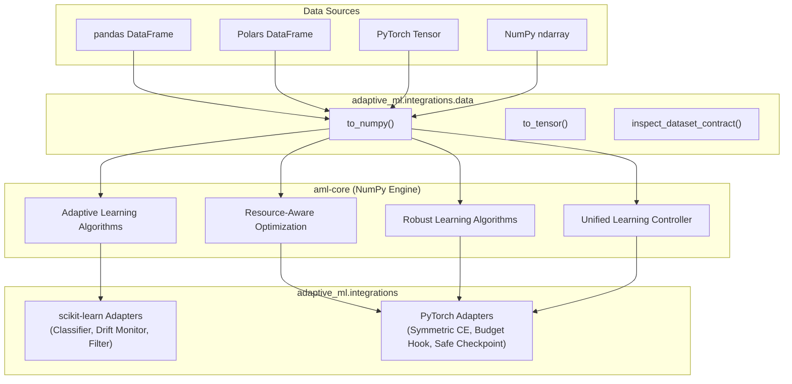

# AdaptiveML Framework Interoperability & Integration Architecture

**Distribution Package:** `aml-core`<br>
**Import Namespace:** `adaptive_ml`<br>
**Current Version:** `0.1.0.dev0`<br>
**Design Philosophy:** CPU-First, Lightweight Core, Opt-In Framework Bridges<br>

---

## 1. Overview

AdaptiveML provides a unified foundation for continual learning, concept drift adaptation, robust noise handling, and resource-bounded optimization. Rather than attempting to replace established deep learning and machine learning libraries, AdaptiveML is designed from the ground up to **complement** them.

AdaptiveML adheres to a strict modular dependency contract:
- **Core Engine:** Built on pure, vectorized NumPy (`numpy>=1.24.0`). Installs with zero C++ compilation or heavy dependencies.
- **Opt-In Framework Bridges:** Specialized adapters located in [`adaptive_ml.integrations`](file:///c:/projects/AdaptiveML/adaptive_ml/integrations/) connect AdaptiveML to external ecosystems:
  - **scikit-learn:** Native estimator and transformer interfaces (`BaseEstimator`, `ClassifierMixin`, `TransformerMixin`).
  - **PyTorch:** Custom autograd loss modules (`nn.Module`), 8-bit quantized optimizers, runtime budget hooks, and SafeTensors checkpoint adapters.
  - **Tabular DataFrames:** Zero-copy and view-based data conversion across pandas and Polars.
  - **Serialization:** Cryptographically safe tensor serialization via SafeTensors, eliminating pickle CVE vulnerabilities.



---

## 2. Integration Guides

Explore the detailed technical documentation for each framework:

- [scikit-learn Integration Guide](file:///c:/projects/AdaptiveML/docs/integrations/sklearn.md) — Pipelines, cross-validation, streaming classifiers, and drift transformers.
- [PyTorch Integration Guide](file:///c:/projects/AdaptiveML/docs/integrations/pytorch.md) — Robust autograd loss portfolio, 8-bit quantized AdamW, budget callbacks, and SafeTensors.
- [Data Interoperability Guide](file:///c:/projects/AdaptiveML/docs/integrations/data_interoperability.md) — Fast zero-copy conversions between NumPy, pandas, Polars, and PyTorch.
- [Safe Checkpointing Architecture](file:///c:/projects/AdaptiveML/docs/integrations/checkpoints.md) — SafeTensors + JSON metadata serialization eliminating arbitrary code execution risks.
- [TensorFlow Integration Assessment](file:///c:/projects/AdaptiveML/docs/integrations/tensorflow.md) — Technical evaluation and deferral rationale for TensorFlow/Keras.
- [Troubleshooting & Diagnostics](file:///c:/projects/AdaptiveML/docs/integrations/troubleshooting.md) — Resolving missing optional dependencies, shape mismatches, and memory pressure.

---

## 3. Installation Extras

Install only the extras needed for your target runtime:

```bash
# Minimal streaming edge deployment (NumPy only)
pip install robust-adapt

# Classical ML & Scikit-learn pipelines
pip install robust-adapt[sklearn]

# Deep learning with PyTorch & SafeTensors
pip install robust-adapt[torch,safetensors]

# Tabular dataframes (Pandas + Polars)
pip install robust-adapt[dataframe]

# Complete ecosystem bundle
pip install robust-adapt[all]
```
