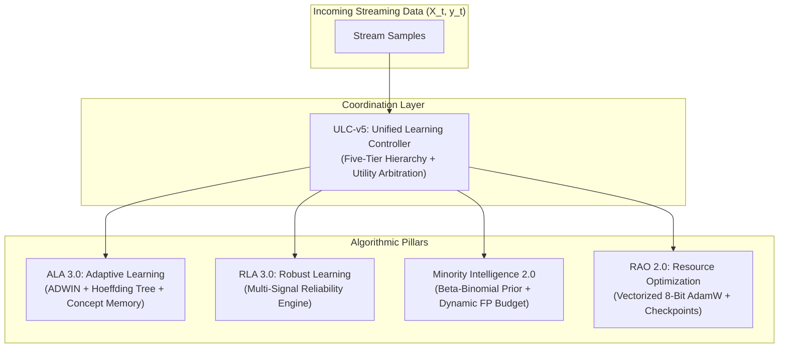

# Architectural Overview & Pillar Coordination

AdaptiveML is structured around five independently usable algorithmic pillars coordinated by the Unified Learning Controller:

---

## Pillar Summary

### 1. ALA — Adaptive Learning Algorithms
- **Primary Class**: `AdaptiveClassifier`, `ReliabilityWeightedADWIN`, `RecurringConceptMemory`.
- **Functionality**: Bounded-memory prequential stream classification, statistical drift detection, and automated restoration of historical concept models without costly retraining.

### 2. RLA — Robust Learning Algorithms
- **Primary Class**: `MultiSignalReliabilityEngine`, `RLA30RobustLearner`.
- **Functionality**: Multi-signal estimation of label veracity combining margin confidence, spatial $k$-NN consensus, and temporal consistency. Dynamically downweights or cleans corrupted labels.

### 3. Adaptive Minority Intelligence
- **Primary Class**: `MinorityIntelligence20Learner`, `BetaBinomialPriorTracker`, `DynamicFPBudgetThresholdManager`.
- **Functionality**: Bayesian tracking of streaming class priors and dynamic calibration of decision thresholds to preserve minority recall under severe class imbalance ($<1\%$).

### 4. RAO — Resource-Aware Optimization
- **Primary Class**: `VectorizedLowMemoryAdamW`, `LowMemoryAdamW`, `ResilientCheckpointManager`.
- **Functionality**: 8-bit dynamic block quantization of optimizer moments, cutting state RAM by $>71\%$ while preserving full 32-bit precision on 1D biases and normalization scales.

### 5. ULC — Unified Learning Controller
- **Primary Class**: `UnifiedLearningControllerV5`.
- **Functionality**: Synthesizes cross-pillar signals into a calibrated expected utility score:
  $$U = (\text{Confidence} \times \text{Benefit}) - \text{Operational Cost}$$
  Arbitrates interventions across a Five-Tier Hierarchy (NOOP, Parameter Damping, Concept Restore, Soft Replay Reset, Hard Reset) with exponential cooldown backoff to suppress thrashing.
