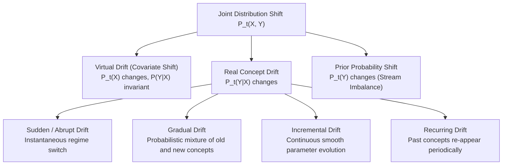

# AdaptiveML — Literature Review: ALA Research Dossier
## Primary Research Dossier 1: Adaptive Learning Algorithms & Concept Drift

> **Document Status**: Complete Baseline Deliverable (Phase 4)  
> **Document Identifier**: `DOC-LIT-001`  
> **Last Updated**: 2026-11-01  
> **Research Pillar**: Pillar 1 — ALA (Adaptive Learning Algorithms)

---

## 1. Research Background & Problem Formulation

In conventional machine learning theory, the learning algorithm assumes that training samples are independent and identically distributed ($i.i.d.$) drawn from a stationary joint probability distribution:
$$S = \{(x_1, y_1), (x_2, y_2), \dots, (x_N, y_N)\} \sim P(X, Y)$$

In real-world data streams, this stationarity assumption is violated. Data arrives sequentially in non-stationary environments where the joint distribution changes over time:
$$P_t(X, Y) \ne P_{t+\Delta}(X, Y)$$

This phenomenon, termed **Concept Drift**, degrades the generalization capability of static models.

### Mathematical Taxonomy of Distribution Shift
The joint distribution can be decomposed in two standard ways:
1. **Covariate & Conditional Shift**: $P(X, Y) = P(Y|X) P(X)$
   - **Virtual Drift (Covariate Shift)**: $P_t(X) \ne P_{t+\Delta}(X)$ while the posterior $P(Y|X)$ remains invariant. Decision boundaries do not change, but feature density shifts.
   - **Real Concept Drift**: $P_t(Y|X) \ne P_{t+\Delta}(Y|X)$. The true conditional mapping between features and targets changes, invalidating previous decision boundaries.
2. **Prior Probability & Class-Conditional Shift**: $P(X, Y) = P(X|Y) P(Y)$
   - **Prior Probability Shift**: $P_t(Y) \ne P_{t+\Delta}(Y)$ (e.g. streaming class imbalance).
   - **Class-Conditional Shift**: $P_t(X|Y) \ne P_{t+\Delta}(X|Y)$.



---

## 2. Historical Development of Concept Drift & Continual Learning

```
1954: Page-Hinkley & CUSUM Sequential Change Detection (Page, Biometrika)
  └── 2000: Hoeffding Trees for Infinite Streams (Domingos & Hulten, KDD)
        └── 2004: DDM (Drift Detection Method based on Bernoulli errors, Gama et al.)
              └── 2007: ADWIN (Adaptive Windowing with Hoeffding bounds, Bifet & Gavaldà)
                    └── 2017: Adaptive Random Forest (ARF, Gomes et al., Machine Learning)
                    └── 2017: Elastic Weight Consolidation (EWC, Kirkpatrick et al., PNAS)
                          └── 2020: KSWIN (Kolmogorov-Smirnov non-parametric drift, Raab et al.)
```

---

## 3. Taxonomy of Algorithmic Approaches in ALA

Adaptive learning solutions are broadly partitioned into two distinct methodological paradigms:

### Paradigm 1: Active (Detector-Guided) Adaptation
The system decouples change detection from model retraining:
1. A statistical detector continuously monitors streaming error rates or input distributions.
2. The model remains stable until a change-point alarm is triggered.
3. Upon alarm, the system initiates a structured update: resetting weights, switching to a shadow background model, or pruning obsolete decision branches.
- *Examples*: DDM, EDDM, ADWIN, Page-Hinkley, KSWIN.

### Paradigm 2: Passive (Continuous) Adaptation & Continual Learning
The system updates model parameters continuously on every incoming observation or mini-batch without explicit drift alarm signals:
1. **Regularization Approaches**: Penalize changes to critical parameters identified via Fisher Information or path integrals (EWC, Synaptic Intelligence).
2. **Replay Approaches**: Maintain bounded memory buffers of past experiences to replay alongside current streams (Reservoir Sampling, Experience Replay).
3. **Dynamic Architecture**: Expand model capacity or allocate new subnetworks dynamically as new patterns emerge (Progressive Networks, PackNet).

---

## 4. Mathematical Mechanisms of Major Algorithms

### 4.1 ADWIN (Adaptive Windowing)
Maintains a variable-length window $W$ of recent real-valued values. Evaluates whether any partition $W = W_0 \cdot W_1$ satisfies:
$$|\hat{\mu}_{W_0} - \hat{\mu}_{W_1}| \ge \epsilon_{\text{cut}} = \sqrt{\frac{1}{2m} \ln\frac{4|W|}{\delta}}, \quad \text{where } m = \frac{1}{|W_0|^{-1} + |W_1|^{-1}}$$
- **False Positive Bound**: With probability at least $1 - \delta$, no false alarm is raised if the underlying distribution is stationary (proven via Hoeffding's inequality).
- **Sub-window Bucket Storage**: Buckets are maintained in logarithmic quantity: $O(\log |W|)$ memory, avoiding storing raw stream arrays.

### 4.2 Elastic Weight Consolidation (EWC)
When adapting an existing model to a new stream or task, EWC regularizes weight trajectories using the diagonal elements of the Fisher Information Matrix $F$:
$$\mathcal{L}(\theta) = \mathcal{L}_{\text{current}}(\theta) + \sum_{i} \frac{\lambda}{2} F_{i} (\theta_i - \theta_{A, i}^*)^2$$
where $F_i = \mathbb{E}\left[ \left( \frac{\partial \ln P(Y|X, \theta)}{\partial \theta_i} \right)^2 \right]$ measures parameter importance for previous knowledge.

---

## 5. Algorithmic Comparison Matrix

| Algorithm | Type | Time Complexity | Memory Complexity | Target Drift Type | Sensitivity to Transient Noise | Open-Source Implementation |
| :--- | :--- | :---: | :---: | :--- | :--- | :--- |
| **Page-Hinkley** | Active Detector | $O(1)$ | $O(1)$ | Abrupt / Sudden | Moderate | River, Menelaus |
| **DDM** | Active Detector | $O(1)$ | $O(1)$ | Abrupt | High | River, Menelaus |
| **EDDM** | Active Detector | $O(1)$ | $O(1)$ | Slow Gradual | Extreme | River, Menelaus |
| **ADWIN** | Active Detector | $O(\log W)$ | $O(\log W)$ | Sudden & Gradual | Moderate | River, Menelaus |
| **KSWIN** | Active Detector | $O(W \log W)$ | $O(W)$ | Virtual / Non-parametric | Low | River |
| **Hoeffding Tree** | Incremental Estimator| $O(d \cdot v)$ | $O(d \cdot v \cdot \text{nodes})$| Gradual (local splits) | Low | River |
| **Adaptive RF** | Streaming Ensemble | $O(M \cdot d)$ | $O(M \cdot \text{nodes})$ | All Drift Types | Low | River |
| **EWC** | Continual Regularizer| $O(\Phi)$ | $O(\Phi)$ (Fisher weights) | Task/Domain Drift | Moderate | Avalanche |

---

## 6. Experimental Methodologies & Benchmark Protocols

### 6.1 Prequential Evaluation (Test-Then-Train)
In streaming environments, standard static train/test splits are invalid. The literature enforces **Prequential (Interleaved Test-Then-Train) Evaluation**:
1. For each incoming instance or micro-batch $(X_t, y_t)$:
   - The model makes a prediction: $\hat{y}_t = f_t(X_t)$.
   - Loss and evaluation metrics are accumulated: $\mathcal{M} \leftarrow \text{Metric}(\hat{y}_t, y_t)$.
   - The model updates its parameters on the instance: $f_{t+1} \leftarrow \text{Update}(f_t, X_t, y_t)$.
2. Metrics are reported using rolling decay windows: $\bar{S}_t = \alpha \cdot \bar{S}_{t-1} + (1-\alpha) \cdot S_t$.

### 6.2 Standard Benchmark Datasets in ALA
- **Electricity (ELEC2)**: 45,312 instances; Australian New South Wales electricity market price shifts.
- **Forest CoverType**: 581,012 instances; 54 attributes; real non-stationary ecological inventory.
- **Synthetic SEA Concepts**: Abrupt drift generated via $f(x_1, x_2) = x_1 + x_2 > \theta$, where threshold $\theta \in \{8, 9, 7, 9.5\}$.
- **Split-MNIST / Permuted-MNIST**: Canonical continual learning vision benchmarks.

---

## 7. Unresolved Research Questions in ALA

1. **The Drift-Noise Disentanglement Problem**: Statistical drift detectors evaluate error rate divergence. When a batch of noisy labels arrives, the error rate spikes, causing detectors to flag false-positive concept drift and triggering destructive model resets.
2. **The Memory-Compute Tradeoff on Micro-Batches**: Dict-based streaming models in River process samples sequentially, ignoring CPU SIMD/BLAS vectorization. How can an incremental estimator maintain continuous adaptation while operating on contiguous 2D NumPy array chunks?

---

## 8. Direct Relationship to AdaptiveML

AdaptiveML Pillar 1 (ALA) builds upon these foundations by:
1. Providing **vectorized 2D NumPy array streaming estimators (`partial_fit`)**, achieving multi-fold throughput speedups over River's `learn_one`.
2. Implementing **noise-gated ADWIN**, where statistical sub-window comparison is weighted by sample reliability to suppress false-alarm drift alarms on corrupted observations.

---

## 9. Authoritative References & DOIs

1. Page, E. S. (1954). *Continuous Inspection Schemes*. Biometrika, 41(1/2), 100–115. [10.1093/biomet/41.1-2.100](https://doi.org/10.1093/biomet/41.1-2.100)
2. Bifet, A., & Gavaldà, R. (2007). *Learning from time-changing data with adaptive windowing*. SIAM SDM 2007, 443–448. [10.1137/1.9781611972771.42](https://doi.org/10.1137/1.9781611972771.42)
3. Gomes, H. M., et al. (2017). *Adaptive random forests for evolving data stream classification*. Machine Learning, 106(9), 1469–1495. [10.1007/s10994-017-5642-8](https://doi.org/10.1007/s10994-017-5642-8)
4. Kirkpatrick, J., et al. (2017). *Overcoming catastrophic forgetting in neural networks*. PNAS, 114(13), 3521–3526. [10.1073/pnas.1611835114](https://doi.org/10.1073/pnas.1611835114)
5. Raab, C., et al. (2020). *Reactive soft prototype computing for concept drift streams*. Neurocomputing, 416, 340–351. [10.1016/j.neucom.2019.11.111](https://doi.org/10.1016/j.neucom.2019.11.111)
