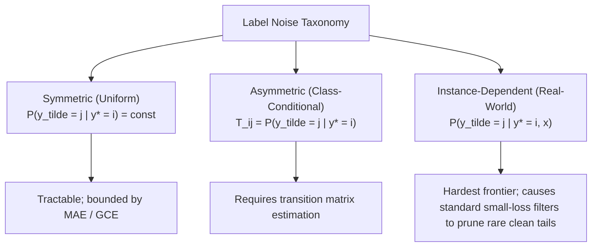

# AdaptiveML — Literature Review: RLA Research Dossier
## Primary Research Dossier 2: Robust Learning Algorithms, Noisy Labels & Imbalance

> **Document Status**: Complete Baseline Deliverable (Phase 4)  
> **Document Identifier**: `DOC-LIT-002`  
> **Last Updated**: 2026-11-01  
> **Research Pillar**: Pillar 2 — RLA (Robust Learning Algorithms)

---

## 1. Research Background & Problem Formulation

Standard supervised machine learning relies on **Empirical Risk Minimization (ERM)**. Given training set $S = \{(x_i, \tilde{y}_i)\}_{i=1}^N$, where $\tilde{y}_i$ denotes the observed (potentially corrupted) label:
$$\mathcal{R}_{\text{emp}}(f) = \frac{1}{N} \sum_{i=1}^N \mathcal{L}(f(x_i), \tilde{y}_i)$$

When labels are clean, ERM converges to the Bayes optimal classifier under cross-entropy loss. However, deep neural networks and flexible non-parametric estimators have sufficient capacity to memorize random labels (Zhang et al., ICLR 2017). When trained with standard Cross-Entropy on corrupted labels, models overfit to noise, degrading test-set generalization.

### Comprehensive Label Noise Taxonomy
1. **Symmetric (Uniform) Noise**:
   A label flips to any other class with equal probability $\eta / (K - 1)$:
   $$P(\tilde{y} = j | y^* = i) = \begin{cases} 1 - \eta & \text{if } j = i \\ \frac{\eta}{K-1} & \text{if } j \ne i \end{cases}$$
2. **Asymmetric (Class-Conditional) Noise**:
   Flipping probabilities depend on the true latent class $i$ (e.g. *Cat* $\leftrightarrow$ *Dog*, *Beaver* $\leftrightarrow$ *Otter*). Captured by a transition matrix $T_{i, j} = P(\tilde{y} = j | y^* = i)$.
3. **Instance-Dependent (Feature-Dependent) Noise**:
   The most realistic real-world noise model. The probability of an annotation error depends directly on feature difficulty $x$:
   $$P(\tilde{y} = j | y^* = i, x) = \eta_{i, j}(x)$$
   (e.g., borderline or low-resolution medical images are more frequently misannotated).



---

## 2. Historical Development of Robust Machine Learning

```
1964: Robust Statistics & Huber Loss (Huber, Ann. Math. Statist.)
  └── 2017: Deep Learning Memorization of Noise Established (Zhang et al., ICLR)
        └── 2018: Generalized Cross Entropy (GCE, Zhang & Sabuncu, NeurIPS)
        └── 2018: Co-teaching (Han et al., NeurIPS)
        └── 2019: Symmetric Cross Entropy (SCE, Wang et al., ICCV)
        └── 2019: Class-Balanced Loss (Cui et al., CVPR)
        └── 2020: DivideMix (Li, Socher, Hoi, ICLR)
        └── 2021: Confident Learning (Northcutt et al., JAIR / Cleanlab)
        └── 2023: Imbalanced Learning with Noisy Labels (Chen et al., ACL)
```

---

## 3. Taxonomy of Methodological Approaches in RLA

Robust machine learning methods fall into four primary paradigms:

```
+-------------------------------------------------------------------------------------------------------+
|                                    RLA ALGORITHMIC TAXONOMY                                           |
+--------------------------+----------------------------+-----------------------+-----------------------+
| 1. Robust Loss Functions | 2. Sample Selection        | 3. Label Correction   | 4. Data Curation      |
+--------------------------+----------------------------+-----------------------+-----------------------+
| - Generalized CE (GCE)   | - Co-teaching / JoCoR      | - Transition Matrix   | - Confident Learning  |
| - Symmetric CE (SCE)     | - MentorNet                |   Correction          |   (Cleanlab)          |
| - Peer Loss              | - Small-loss filtering     | - Probabilistic       | - Active Learning     |
| - Curricular Loss        | - DivideMix (GMM on loss)  |   Label Smoothing     | - Outlier Pruning     |
+--------------------------+----------------------------+-----------------------+-----------------------+
```

---

## 4. Mathematical Mechanisms of Major Algorithms

### 4.1 Generalized Cross Entropy (GCE)
Zhang & Sabuncu (NeurIPS 2018) proposed utilizing the negative Box-Cox transformation as an interpolation between Cross-Entropy and Mean Absolute Error:
$$\mathcal{L}_{\text{GCE}}(f(x), y) = \frac{1 - f_y(x)^q}{q}, \quad q \in (0, 1]$$
- **Gradient Formulation**:
  $$\frac{\partial \mathcal{L}_{\text{GCE}}}{\partial \theta} = - f_y(x)^{q-1} \cdot \frac{\partial f_y(x)}{\partial \theta} = f_y(x)^q \cdot \left( -\frac{1}{f_y(x)} \frac{\partial f_y(x)}{\partial \theta} \right) = f_y(x)^q \cdot \nabla_\theta \mathcal{L}_{\text{CE}}$$
  The gradient of GCE is equivalent to standard Cross-Entropy **scaled by $f_y(x)^q$**. For corrupt labels where the model prediction $f_y(x)$ is low, the gradient contribution is automatically attenuated to near zero.

### 4.2 Symmetric Cross Entropy (SCE)
Wang et al. (ICCV 2019) proved that standard Cross-Entropy overfits because it is not symmetric. They paired CE with **Reverse Cross Entropy (RCE)**:
$$\mathcal{L}_{\text{SCE}} = \alpha \mathcal{L}_{\text{CE}}(p, y) + \beta \mathcal{L}_{\text{RCE}}(p, y) = -\alpha \sum_{k=1}^K y_k \ln p_k - \beta \sum_{k=1}^K p_k \ln y_k$$
By parameterizing $\ln y_k = A$ if $y_k = 1$ and $B$ if $y_k = 0$, RCE acts as a symmetric regularizer with a bounded supremum: $\mathcal{L}_{\text{RCE}} \le -A - (K-1)B$, preventing gradient explosion on mislabeled instances.

### 4.3 Class-Balanced Loss (Effective Number of Samples)
Cui et al. (CVPR 2019) resolved the distortion of naive inverse-frequency weighting by formalizing sample volume overlap in high-dimensional space:
$$E_n = \frac{1 - \beta^n}{1 - \beta}, \quad W_{n_y} = \frac{1}{E_{n_y}} = \frac{1 - \beta}{1 - \beta^{n_y}}$$
where $\beta = \frac{N-1}{N} \in [0, 1)$ represents the probability that a new sample overlaps with existing volume.

---

## 5. Algorithmic Comparison Matrix

| Algorithm | Paradigm | Time Complexity | Memory Complexity | Robustness Boundary | Imbalance Sensitivity | Open Implementation |
| :--- | :--- | :---: | :---: | :--- | :--- | :--- |
| **GCE** | Robust Loss | $O(K)$ | $O(1)$ | Up to 60% symmetric | High (Hurts minority) | PyTorch (academic) |
| **SCE** | Robust Loss | $O(K)$ | $O(1)$ | Up to 70% symmetric | Moderate | PyTorch (academic) |
| **Co-teaching**| Sample Selection| $2 \times O(\text{Backprop})$| $2\Phi$ (Dual nets)| Up to 50% asymmetric| Extreme (Prunes tails)| PyTorch (academic) |
| **DivideMix** | Semi-Supervised | $4 \times O(\text{Backprop})$| $2\Phi$ + GMM | Up to 80% symmetric | Extreme | PyTorch (academic) |
| **Cleanlab** | Offline Curation| $K \times O(\text{Train})$ | $O(N \cdot K)$ matrix | High (Offline only) | High (Prunes tails) | `cleanlab` (AGPL-3.0) |
| **Focal Loss** | Imbalanced Loss | $O(K)$ | $O(1)$ | **NEGATIVE (Fails noise)**| Low (Focuses on tails)| `torchvision` native|

---

## 6. The Core Research Breakdown: The Small-Loss Dilemma

Every state-of-the-art sample selection and noise-filtering system in current literature relies on the **Small-Loss Criterion**:
$$\ell(x_i, y_i) < \tau \implies \text{Clean}; \quad \ell(x_i, y_i) \ge \tau \implies \text{Noisy / Prune}$$

### Why This Fails Under Real-World Class Imbalance
1. Minority-class instances (e.g. rare disease symptoms, rare financial fraud vectors) have very few supporting exemplars in the training set.
2. Because representations for sparse classes are under-formed during early training, their training loss $\ell(x_{\text{minority}}, y_{\text{minority}})$ remains **persistently high**.
3. Small-loss algorithms (Cleanlab, Co-teaching, MentorNet) classify these legitimate rare samples as "noisy labels" and systematically prune or downweight them.
4. **Result**: The classifier starves the minority class of data, destroying minority recall.

---

## 7. Direct Relationship to AdaptiveML

AdaptiveML Pillar 2 (RLA) addresses this breakdown by:
1. Providing clean-room, vectorized implementations of **Generalized Cross Entropy (GCE)** and **Symmetric Cross Entropy (SCE)** for both PyTorch and NumPy.
2. Formulating a **Density-Aware Margin Reliability Metric** that normalizes sample loss against local feature-space density:
   $$\text{Score}(x_i, y_i) = \mathcal{M}(x_i, y_i) \cdot \log\left( 1 + \frac{1}{\rho_k(x_i)} \right)$$
   High-loss samples residing in sparse feature regions are identified as **Legitimate Rare Samples** and protected from deletion.

---

## 8. Authoritative References & DOIs

1. Zhang, Z., & Sabuncu, M. (2018). *Generalized cross entropy loss for training deep neural networks with noisy labels*. NeurIPS 2018, 8771–8781. [arXiv:1805.07836](https://arxiv.org/abs/1805.07836)
2. Wang, Y., et al. (2019). *Symmetric cross entropy for robust learning with noisy labels*. IEEE/CVF ICCV 2019, 322–330. [10.1109/ICCV.2019.00041](https://doi.org/10.1109/ICCV.2019.00041)
3. Northcutt, C., Jiang, L., & Chuang, I. (2021). *Confident learning: Estimating uncertainty in dataset labels*. JAIR, 70, 1373–1411. [10.1613/jair.1.12125](https://doi.org/10.1613/jair.1.12125)
4. Cui, Y., et al. (2019). *Class-balanced loss based on effective number of samples*. IEEE/CVF CVPR 2019, 9268–9277. [10.1109/CVPR.2019.00949](https://doi.org/10.1109/CVPR.2019.00949)
5. Chen, M., et al. (2023). *Learning with Noisy Labels Over Imbalanced Subpopulations*. Findings of ACL 2023. [openreview:i-LNL2023](https://openreview.net/forum?id=i-LNL2023)
