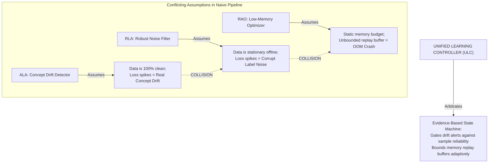

# AdaptiveML — Cross-Cutting Research Synthesis: Unified Learning Controller (ULC)

> **Document Status**: Complete Baseline Deliverable (Phase 4)  
> **Document Identifier**: `DOC-LIT-004`  
> **Last Updated**: 2026-11-01  
> **Nature of Document**: Cross-Cutting Research Synthesis across ALA, RLA, and RAO (*Not a Fourth Primary Dossier*)

---

## 1. The Fallacy of Naive Composition

A foundational insight of systems engineering and algorithmic theory is that:
> **Composing independently functional algorithms does NOT automatically produce a stable, functional unified system.**

When an engineer sequentially stitches together:
- A Concept Drift Detector from stream mining (e.g. ADWIN from River),
- A Robust Loss function from noisy-label learning (e.g. GCE from PyTorch research repos), and
- A Low-Memory Optimizer from deep learning optimization (e.g. 8-bit Adam),

the resulting pipeline breaks because these isolated algorithms make **diametrically opposed, conflicting assumptions about data dynamics and runtime state**.

---

## 2. In-Depth Analysis of Cross-Pillar Conflict Modes

### 2.1 Conflict Mode 1: The Drift-Noise Collision (ALA $\longleftrightarrow$ RLA)
- **The Tension**:
  - ALA drift detectors (ADWIN, DDM) monitor running classification error $e_t \in \{0, 1\}$. When errors exceed Hoeffding thresholds, ALA declares drift and triggers model re-calibration.
  - RLA recognizes that training streams contain noisy or corrupted labels ($\tilde{y}_i \ne y^*$). When noisy batches arrive, error rates spike artificially.
- **The Catastrophe in Naive Composition**:
  - The drift detector mistakes temporary label corruption for structural concept drift.
  - It declares a false alarm, clears the historical memory buffer, and aggressively adapts the model to the corrupted batch.
  - **The model overfits completely to the corrupted labels, destroying previously acquired knowledge.**

### 2.2 Conflict Mode 2: The Minority-Pruning Dilemma (RLA $\longleftrightarrow$ ALA)
- **The Tension**:
  - As new concepts emerge in non-stationary streams (ALA), they initially appear as **low-frequency minority instances**.
  - RLA sample selection heuristics (small-loss selection, Confident Learning) assume high-loss instances are corrupt labels.
- **The Catastrophe in Naive Composition**:
  - Emerging concept patterns exhibit high initial loss because the model has not yet updated its parameters.
  - RLA classifies the emerging concept as "label noise" and prunes or downweights it.
  - **The model is permanently blinded to genuine emerging concept drift.**

### 2.3 Conflict Mode 3: The Memory-Plasticity Tradeoff (ALA $\longleftrightarrow$ RAO)
- **The Tension**:
  - ALA mechanisms (Experience Replay, Reservoir Buffers, Elastic Weight Consolidation) require accumulating historical samples or tracking Fisher Information matrices to prevent catastrophic forgetting.
  - RAO operates under strict memory ceilings on commodity CPUs and edge devices.
- **The Catastrophe in Naive Composition**:
  - In response to continuous drift, ALA expands replay buffers.
  - Peak runtime memory exceeds available host RAM, triggering an OS OOM process kill.

---

## 3. Mathematical Principles of ULC In-Loop Arbitration

The Unified Learning Controller resolves these contradictions by acting as a **probabilistic evidence arbitrator**:

### 3.1 Dual-Evidence Drift Gating
When ALA signals a candidate drift event ($\Delta \mu \ge \epsilon_{\text{cut}}$), ULC does not immediately reset the model. Instead, it computes the **Local Sample Reliability Distribution**:
$$\bar{R}_W = \frac{1}{|W_1|} \sum_{i \in W_1} \text{Reliability}(x_i, y_i)$$
- **Case 1 (False Alarm Noise Burst)**: If $\bar{R}_W < \tau_{\text{noise}}$, the error spike is driven by corrupt labels. ULC **suppresses the drift alarm**, attenuates batch gradients, and preserves the historical memory buffer.
- **Case 2 (Genuine Concept Drift)**: If $\bar{R}_W \ge \tau_{\text{noise}}$, the error spike is driven by high-confidence, structurally coherent samples. ULC **confirms genuine drift**, accelerates model plasticity, and triggers selective buffer updating.

### 3.2 Density-Aware Emerging Pattern Preservation
To prevent RLA from pruning emerging concepts, sample reliability is evaluated relative to local feature density $\rho(x)$. High-loss samples in dense clusters are flagged as corrupt noise; high-loss samples in sparse, newly emerging clusters are flagged as **Emerging Concepts** and granted a plasticity boost.

---

## 4. Synthesis Conclusion

The Unified Learning Controller is not an infrastructure workflow scheduler (like ZenML or Ray). It is an **in-loop algorithmic state automaton**.

By formally harmonizing the conflicting mathematical assumptions of ALA, RLA, and RAO, ULC transforms three isolated algorithmic pillars into a resilient, adaptive, resource-bounded learning system.
