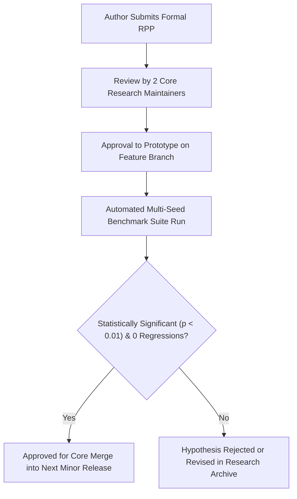

# PHASE 21 DELIVERABLE 02 — RESEARCH EXPERIMENT GOVERNANCE
## Research Proposal Template, Scientific Peer Review Protocol, and Hypothesis-Driven Merge Criteria

**Document Identifier:** `docs/research/phase_21/RESEARCH_EXPERIMENT_GOVERNANCE.md`<br>
**Phase:** 21 — Continuous R&D<br>
**Baseline Git Commit:** `master @ 67e9ef1b347ca223828a1f225e85e35a086a1f30`<br>
**Date:** 2026-11-06<br>
**Auditor:** Scientific Governance Director & Research Integrity Reviewer<br>

---

## 1. Core Research Governance Invariant

> [!CRITICAL]
> **ANTI-HACKING & REPRODUCIBILITY MANDATE:**<br>
> In accordance with Section 9 of the Master Execution Prompt:
> 1. **No feature shall be merged into the core library solely because it improves performance on a single synthetic benchmark.**
> 2. Every proposed algorithmic change must follow the formal **Research Proposal Protocol (RPP)**.
> 3. Algorithmic modifications must demonstrate multi-seed statistical significance ($p < 0.01$), zero regression on decoupled baseline pillars, and bounded resource overhead.

---

## 2. Research Proposal Template (RPP)

Before implementing or modifying core algorithms in `adaptive_ml/`, researchers must complete this formal proposal:

```markdown
# RESEARCH PROPOSAL: [Title of Proposed Algorithmic Enhancement]
**Proposal ID:** RPP-202X-XXX<br>
**Proposer(s):** [Name and Affiliation]<br>
**Target Pillar:** [ALA / RLA / RAO / Minority / ULC]<br>
**Target Milestone:** [Version 0.X.0]<br>

### 1. Research Question & Hypothesis
- **Formal Question:** What specific deficiency or open challenge does this research address?
- **Hypothesis:** State the testable mathematical or empirical hypothesis.

### 2. Theoretical Motivation & Related Work
- Explain the scientific basis. Cite at least 3 peer-reviewed baseline papers.

### 3. Proposed Algorithmic Formulation
- Provide mathematical equations, state transitions, and pseudocode.

### 4. Benchmark Dataset & Baseline Evaluation
- Datasets to be evaluated (Must include at least 1 authentic real-world stream).
- Established baselines for comparison.
- Target random seeds (Minimum: 5 fixed seeds).

### 5. Explicit Success & Failure Criteria
- **Success Criteria:** e.g., $\ge 5\%$ improvement in macro-F1 with $p < 0.01$ and $\le 10\%$ memory increase.
- **Failure Criteria:** Under what specific conditions must this hypothesis be rejected?

### 6. Resource Overhead & Computational Complexity
- Asymptotic time complexity: $\mathcal{O}(\cdot)$ per streaming step.
- Peak memory impact: Peak resident bytes allocated.

### 7. Backward Compatibility & Cross-Pillar Risks
- Does this change break existing `partial_fit()` or Scikit-Learn adapter contracts?
- Does it interact unpredictably with other pillars or the ULC controller?
```

---

## 3. Proposal Review & Merge Approval Gate



### Mandatory Criteria for Core Merge:
- [ ] 5-seed paired t-test confirms statistical significance ($p < 0.01$).
- [ ] Zero regression on stationary, noisy, or imbalanced benchmark streams.
- [ ] Peak CPU memory and latency remain within specified budget ceilings.
- [ ] 100% test pass on existing unit, integration, and example suites.
