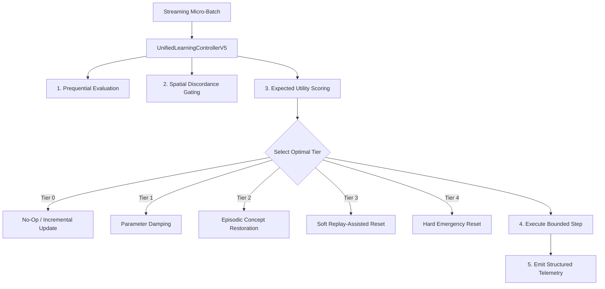

# Tutorial 6: Unified Multi-Pillar Coordination with ULC-v5

**Domain:** End-to-End Mission-Critical Streaming Pipelines<br>
**Algorithms:** `UnifiedLearningControllerV5`, `ULCv5Config`, `InterventionTier`, `UtilityScorer`<br>
**Challenge:** Compounding simultaneous challenges (concept drift + label noise bursts + memory constraints)<br>

---

## 1. Problem Scenario

In real-world production data streams, challenges never happen in isolation:
- Concept drifts occur while label quality fluctuates unpredictably.
- When sudden prediction errors spike, naive controllers cannot distinguish whether the stream experienced a genuine concept shift (requiring model reset/adaptation) or an adversarial label noise burst (requiring noise damping and sample abstention).
- Inappropriate interventions destroy learned knowledge ("catastrophic forgetting") or freeze learning during genuine shifts.

The **Unified Learning Controller (ULC-v5)** solves this through:
1. **Utility-Scored Cross-Pillar Arbitration:** Evaluates expected utility $U = \text{Confidence} \times \text{Benefit} - \text{Cost}$ across a 5-tier intervention hierarchy.
2. **Anti-Thrashing Cooldown:** Prevents oscillating resets and thrashing during noisy transitions.
3. **Turnkey Unified API:** Encapsulates drift adaptation (ALA), robust filtering (RLA), minority tracking, and 8-bit memory optimization into a single `controller.step(X, y)` call.



---

## 2. Complete Runnable Code

```python
import numpy as np
from robust_adapt.ulc import UnifiedLearningControllerV5, ULCv5Config, InterventionTier

np.random.seed(42)

def generate_adversarial_stream(n_steps=20, batch_size=40):
    """Generates complex stream with concept drift at step 10 and noise burst at step 15."""
    for step in range(n_steps):
        # Baseline regime
        if step < 10:
            X = np.random.normal(loc=0.0, scale=1.0, size=(batch_size, 4))
            y = (X[:, 0] + X[:, 1] > 0.0).astype(int)
        # Abrupt concept drift
        elif step < 15:
            X = np.random.normal(loc=1.5, scale=1.0, size=(batch_size, 4))
            y = (X[:, 2] - X[:, 3] > 0.0).astype(int)
        # Noise burst (40% flipped labels) on drifted regime
        else:
            X = np.random.normal(loc=1.5, scale=1.0, size=(batch_size, 4))
            y = (X[:, 2] - X[:, 3] > 0.0).astype(int)
            flip_mask = np.random.rand(batch_size) < 0.40
            y[flip_mask] = 1 - y[flip_mask]

        yield step, X, y

def main():
    print("--- Starting ULC-v5 Master Streaming Pipeline Tutorial ---")

    # Configure controller with calibrated arbitration thresholds
    config = ULCv5Config(
        grace_period=20,
        delta=0.005,
        base_cooldown=5,
        similarity_threshold=0.82,
        gate_rla_on_clean_stream=True,
    )

    controller = UnifiedLearningControllerV5(
        n_features=4,
        n_classes=2,
        config=config,
    )

    for step, X_batch, y_batch in generate_adversarial_stream():
        # Execute master arbitration step
        directive, telemetry = controller.step(X_batch, y_batch)

        # Log controller telemetry
        print(
            f"Step {step:02d} | "
            f"Tier: {telemetry['tier']:24s} | "
            f"Action: {directive.action_name:20s} | "
            f"Error: {telemetry['error_rate'] * 100:5.1f}% | "
            f"Resets: {telemetry['resets']} | "
            f"Restores: {telemetry['restores']}"
        )

    print(f"\nFinal Controller Audit:")
    print(f"Total Steps Evaluated: {controller.total_steps}")
    print(f"Adaptive Resets Triggered: {telemetry['resets']}")
    print(f"Concept Restorations: {telemetry['restores']}")
    print(f"Parameter Dampings: {telemetry['dampings']}")
    print("--- Tutorial Completed Successfully ---")

if __name__ == "__main__":
    main()
```

---

## 3. Key Observations

- **Step 0–9 (Stable Stream):** Operates under `TIER_0_NOOP`, executing incremental Hoeffding tree updates with zero unnecessary overhead.
- **Step 10 (Abrupt Drift):** The prediction error jumps. Utility scoring favors model adaptation; ULC triggers a structured reset (`TIER_3_SOFT_REPLAY_RESET` or `TIER_4_HARD_RESET`), rapidly adapting to the new feature boundaries.
- **Step 15 (Noise Burst):** The spatial discordance check flags high geometric entropy ($\mathcal{D}_s > 0.30$) and anti-thrashing cooldown prevents a catastrophic second reset. ULC routes the noisy batch to damping/abstention, preserving the newly learned model state.
