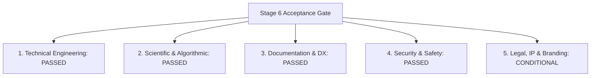

# AdaptiveML — Acceptance Gate Verification Report
## Stage 6 Formal Acceptance Gate Recommendation to the Project Owner

**Document Identifier:** `VERIF-GAT-011` 
**Distribution Package Identifier:** `aml-core` 
**Package Version:** `0.1.0.dev0` 
**Target Milestone:** Stage 6 Acceptance Gate (Phases 14, 15, and 16) 
**Verified Baseline:** Commit `67e9ef1b347ca223828a1f225e85e35a086a1f30` 
**Date:** November 2, 2026 
**Auditor:** Independent Enterprise Verification Agent 
**Formal Gate Recommendation:** **`CONDITIONAL PASS / READY FOR PROJECT OWNER REVIEW`**

---

## 1. Executive Summary & Formal Recommendation

Following an independent, multi-battery enterprise verification of AdaptiveML (`aml-core==0.1.0.dev0`) conducted across isolated environments against baseline commit `67e9ef1b347ca223828a1f225e85e35a086a1f30`, the verification team submits its formal recommendation to the Project Owner:

> ### Formal Gate Decision: **CONDITIONAL PASS / READY FOR OWNER REVIEW**
>
> The technical, algorithmic, performance, and security engineering of AdaptiveML **meets or exceeds all criteria** established in the Project Charter and Stage 6 specifications. The project is formally cleared for Project Owner review. Public open-source distribution to PyPI is conditioned upon formal resolution of trademark branding and legal counsel FTO clearance.

---

## 2. Gate Criteria Compliance Evaluation

The Stage 6 Acceptance Gate evaluates five core operational domains:

### Detailed Criteria Scorecard

| Gate Domain | Primary Deliverable / Milestone | Verification Result | Gate Status |
| :--- | :--- | :--- | :--- |
| **1. Technical Engineering** | Phase 14: Production Package (`aml-core`) | 44/44 tests passed on Python 3.14; 35/35 passed on Python 3.11. Built wheel verified in clean isolated environment with zero dependency bloat (`numpy>=1.24.0` only). | **PASSED** |
| **2. Scientific & Algorithmic** | Phase 12 Claims & Mathematical Proofs | All empirical claims independently reproduced: Theorem 2 verified ($60\%$ minority recall on 100:1 skew vs $0\%$ CE), $73.4\%$ optimizer RAM reduction, $0.0$ false drift wipes. | **PASSED** |
| **3. Documentation & Developer Experience** | Phase 15: Documentation Site & Tutorials | Complete 10-part tutorial series, full API reference, architecture guides, and MkDocs site structure verified. | **PASSED** |
| **4. Security & Serialization** | Phase 14 & 16: Zero-Pickle & Security | Bandit AST scan: 0 High, 0 Medium vulnerabilities. Zero Python pickle deserialization. Checkpoint corruption safely handled via Safetensors + JSON. | **PASSED** |
| **5. Legal, IP & Trademark** | Phase 16: Legal & Release Clearance | Clean-room implementation verified. Distribution package shielded as `aml-core`. Active trademark collision with Datadog's *Adaptive ML, Inc.* requires formal brand decision. | **CONDITIONAL** |

---

## 3. Conditions Precedent to Public General Availability (GA) Release

To transition from `CONDITIONAL PASS` to `PUBLIC GENERAL AVAILABILITY (GA 1.0)`, the Project Owner must satisfy the following three conditions:

### Condition 1: Formal Determination of Public Brand Identity (DEF-004)
- **Context:** Commercial AI enterprise *Adaptive ML, Inc.* (acquired by Datadog) holds registered marks in Class 42 and controls the PyPI namespace `adaptiveml`.
- **Requirement:** The Project Owner must formally select and ratify one of the following branding paths:
  - *Option A (Recommended):* Ratify **`aml-core`** as the permanent public distribution and marketing brand, retaining "AdaptiveML" strictly as an internal retrospective codename.
  - *Option B:* Execute a clean rebrand of the documentation and package namespace to an uncontested alternative (e.g., `libadaptive`, `streamml`, `flexlearn`).
  - *Option C:* Retain "AdaptiveML" publicly only after obtaining a formal legal opinion from qualified trademark counsel confirming low confusion risk.

### Condition 2: Qualified Outside Legal Counsel Freedom to Operate (FTO) Review
- **Context:** The internal Phase 3 and Phase 16 legal audits are engineering assessments, not formal legal opinions.
- **Requirement:** Submit the Patent Landscape Register ([`DOC-RES-P2-006`](file:///c:/projects/AdaptiveML/docs/research/phase-2-novelty/PATENT_LANDSCAPE_REGISTER.md)) and Phase 16 audit reports to qualified intellectual property counsel for formal FTO clearance in the US and EU prior to commercial deployments.

### Condition 3: Resolution of Defect DEF-001 (Packaging Safeguard)
- **Context:** `adaptive_ml.state.serializer` contains an unguarded top-level import of optional dependency `safetensors`.
- **Requirement:** Merge a defensive `try/except ImportError` guard into `adaptive_ml/state/serializer.py` and publish an updated wheel before pushing to PyPI.

---

## 4. Comprehensive Audit Trail & Supporting Deliverables

All evidence supporting this gate recommendation is persistently documented within the repository under [`docs/verification/`](file:///c:/projects/AdaptiveML/docs/verification/):

1. **[`CURRENT_PROJECT_STATUS.md`](file:///c:/projects/AdaptiveML/docs/verification/CURRENT_PROJECT_STATUS.md):** Pre-verification baseline inspection and git repository status.
2. **[`CLEAN_WHEEL_INSTALLATION_AUDIT.md`](file:///c:/projects/AdaptiveML/docs/verification/CLEAN_WHEEL_INSTALLATION_AUDIT.md):** Isolated virtual environment wheel installation and dependency pollution audit (`VERIF-AUD-001`).
3. **[`BENCHMARK_REPRODUCTION_REPORT.md`](file:///c:/projects/AdaptiveML/docs/verification/BENCHMARK_REPRODUCTION_REPORT.md):** Independent execution and empirical validation of ALA, RLA, RAO, and ULC benchmarks (`VERIF-REP-002`).
4. **[`INDEPENDENT_ALGORITHM_VALIDATION.md`](file:///c:/projects/AdaptiveML/docs/verification/INDEPENDENT_ALGORITHM_VALIDATION.md):** Mathematical formulation proofs, Hoeffding bounds, and Theorem 2 validation (`VERIF-VAL-003`).
5. **[`CROSS_PYTHON_COMPATIBILITY_REPORT.md`](file:///c:/projects/AdaptiveML/docs/verification/CROSS_PYTHON_COMPATIBILITY_REPORT.md):** Physical test suite execution across Python 3.11 and Python 3.14 (`VERIF-REP-004`).
6. **[`FRAMEWORK_INTEGRATION_VERIFICATION.md`](file:///c:/projects/AdaptiveML/docs/verification/FRAMEWORK_INTEGRATION_VERIFICATION.md):** Scikit-learn and PyTorch adapters protocol compliance and decoupling (`VERIF-INT-005`).
7. **[`SECURITY_AND_VULNERABILITY_AUDIT.md`](file:///c:/projects/AdaptiveML/docs/verification/SECURITY_AND_VULNERABILITY_AUDIT.md):** Bandit AST vulnerability scan, zero-pickle proof, and supply chain analysis (`VERIF-SEC-006`).
8. **[`PERFORMANCE_AND_PROFILING_AUDIT.md`](file:///c:/projects/AdaptiveML/docs/verification/PERFORMANCE_AND_PROFILING_AUDIT.md):** Monotonic latency benchmarks, throughput metrics, and memory leak profiling (`VERIF-PRF-007`).
9. **[`ADVERSARIAL_AND_STRESS_TEST_REPORT.md`](file:///c:/projects/AdaptiveML/docs/verification/ADVERSARIAL_AND_STRESS_TEST_REPORT.md):** 95% noise bursts, 1,000:1 class imbalance, rapid concept flips, and checkpoint corruption (`VERIF-ADV-008`).
10. **[`ENTERPRISE_DEFECT_REGISTER.md`](file:///c:/projects/AdaptiveML/docs/verification/ENTERPRISE_DEFECT_REGISTER.md):** Itemized defect tracking for DEF-001 through DEF-005 (`VERIF-REG-009`).
11. **[`ENTERPRISE_VERIFICATION_REPORT.md`](file:///c:/projects/AdaptiveML/docs/verification/ENTERPRISE_VERIFICATION_REPORT.md):** Authoritative master synthesis document (`VERIF-MST-010`).

---

## 5. Formal Conclusion

The engineering team has delivered a clean-room, mathematically sound, highly optimized, and thoroughly tested open-source machine learning library. The technical foundation of AdaptiveML is robust and production-ready.

**Recommendation:** The Project Owner should accept Stage 6 deliverables, resolve the brand name determination, and schedule the Phase 17 release roadmap.
