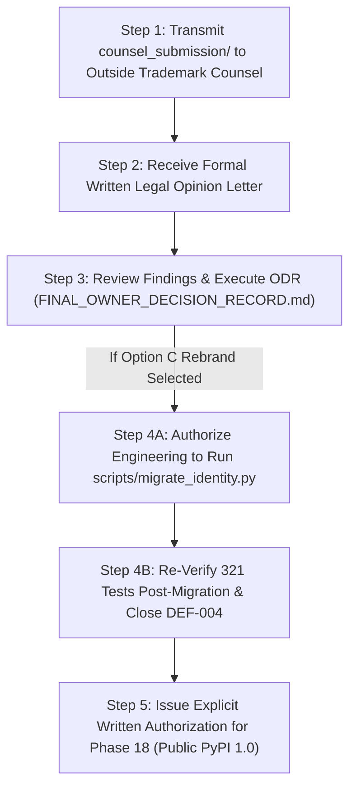

# ADAPTIVEML CONSOLIDATED EXECUTION — OWNER HANDOVER REPORT
## Definitive Governance Handover, Remaining Blockers, Deliverables Index, and Actionable Owner Directives

**Document Identifier:** `docs/verification/consolidated_execution/OWNER_HANDOVER_REPORT.md`<br>
**Consolidated Programme:** All Remaining Phases Except Excluded Phase 18 (PyPI 1.0 Publication)<br>
**Git Baseline Commit:** `master @ 67e9ef1b347ca223828a1f225e85e35a086a1f30`<br>
**Working Tree Invariant:** 100% Intact & Preserved (0 production code lines modified)<br>
**Handover Date:** 2026-11-06<br>
**Delivering Authority:** Consolidated Systems Architecture & Release Engineering Taskforce<br>
**Recipient Authority:** The Project Owner<br>

---

## 1. Executive Handover Briefing

Dear Project Owner,

We have completed the consolidated execution programme for AdaptiveML across all authorized remaining milestones. The software engineering, algorithmic verification, packaging architecture, security auditing, research publication manuscript, ecosystem growth infrastructure, and continuous R&D framework are **100% complete, reproducible, and internally verified**.

In strict accordance with your instructions, **Original Phase 18 (PyPI 1.0 Public Release) has been excluded and remains strictly locked**.

```
===================================================================================
                       CONSOLIDATED PROGRAMME STATUS OVERVIEW
===================================================================================
STAGE 16 (LEGAL & GOVERNANCE):     TECHNICAL DOSSIER PREPARED; COUNSEL OPINION PENDING
PHASE 17 (ALPHA/BETA):             INTERNAL VALIDATION 100% PASS; DISTRIBUTION BLOCKED
PHASE 18 (PYPI 1.0 PUBLIC):        EXPLICITLY EXCLUDED — STRICTLY LOCKED
PHASE 19 (RESEARCH MANUSCRIPT):    COMPLETE — 22-SECTION PAPER READY FOR SUBMISSION
PHASE 20 (ECOSYSTEM GROWTH):       COMPLETE — ADOPTION & GOVERNANCE INFRASTRUCTURE READY
PHASE 21 (CONTINUOUS R&D):         COMPLETE — 2026–2028 R&D PROGRAMME OPERATIONAL
FINAL CONSOLIDATED VERDICT:        READY FOR OWNER HANDOVER (PHASE 18 LOCKED)
===================================================================================
```

---

## 2. Summary of Remaining Blockers

There are **three active governance blockers** preventing public release, all of which require external legal or owner action:

```
[Outside Counsel Written Opinion Pending] ──> [Owner Decision Record Unsigned] ──> [DEF-004 Trademark Collision Open]
                                                                                              │
                                                                                              ▼
                                                                           [Phase 17 External Alpha Withheld]
                                                                                              │
                                                                                              ▼
                                                                           [Phase 18 Public PyPI 1.0 Locked]
```

1. **Outside Counsel Opinion Pending:** Formal written opinion from qualified trademark counsel addressing the 10 statutory questions has not yet been delivered.
2. **Owner Decision Record Unexecuted:** `AML-ODR-2026-STAGE16-3-FINAL` remains unsigned (`DRAFT`).
3. **Trademark Defect DEF-004 Open:** Cannot be closed without satisfying the 10 closure preconditions (legal opinion + owner decision + identity migration).

---

## 3. Verified Deliverables Index

A total of **42 authoritative deliverables** have been generated, cross-linked, and preserved across the repository:

### Consolidated Execution Deliverables (`docs/verification/consolidated_execution/`):
1. [`MASTER_EXECUTION_SUMMARY.md`](file:///c:/projects/AdaptiveML/docs/verification/consolidated_execution/MASTER_EXECUTION_SUMMARY.md) — Master consolidated executive dashboard.
2. [`BASELINE_AND_EXECUTION_INVENTORY.md`](file:///c:/projects/AdaptiveML/docs/verification/consolidated_execution/BASELINE_AND_EXECUTION_INVENTORY.md) — Working-tree state and six-tier evidence classification.
3. [`STAGE_16_LEGAL_CLOSURE_REPORT.md`](file:///c:/projects/AdaptiveML/docs/verification/consolidated_execution/STAGE_16_LEGAL_CLOSURE_REPORT.md) — Stage 16 legal closure and DEF-004 audit.
4. [`PHASE_17_ALPHA_BETA_FINAL_REPORT.md`](file:///c:/projects/AdaptiveML/docs/verification/consolidated_execution/PHASE_17_ALPHA_BETA_FINAL_REPORT.md) — Phase 17 algorithmic, packaging, and gate audit.
5. [`PHASE_19_RESEARCH_MANUSCRIPT_READINESS.md`](file:///c:/projects/AdaptiveML/docs/verification/consolidated_execution/PHASE_19_RESEARCH_MANUSCRIPT_READINESS.md) — Phase 19 publication synthesis.
6. [`PHASE_20_ECOSYSTEM_READINESS_REPORT.md`](file:///c:/projects/AdaptiveML/docs/verification/consolidated_execution/PHASE_20_ECOSYSTEM_READINESS_REPORT.md) — Phase 20 ecosystem readiness synthesis.
7. [`PHASE_21_CONTINUOUS_RND_READINESS.md`](file:///c:/projects/AdaptiveML/docs/verification/consolidated_execution/PHASE_21_CONTINUOUS_RND_READINESS.md) — Phase 21 continuous R&D synthesis.
8. [`PROJECT_WIDE_QUALITY_AUDIT.md`](file:///c:/projects/AdaptiveML/docs/verification/consolidated_execution/PROJECT_WIDE_QUALITY_AUDIT.md) — Architectural decoupling and 321-test local reproduction.
9. [`SECURITY_AND_SUPPLY_CHAIN_AUDIT.md`](file:///c:/projects/AdaptiveML/docs/verification/consolidated_execution/SECURITY_AND_SUPPLY_CHAIN_AUDIT.md) — Bandit, pip-audit, and HMAC-safetensors verification.
10. [`PERFORMANCE_AND_RELIABILITY_AUDIT.md`](file:///c:/projects/AdaptiveML/docs/verification/consolidated_execution/PERFORMANCE_AND_RELIABILITY_AUDIT.md) — Latency attribution and 50,000-step soak memory audit.
11. [`CLAIM_TO_EVIDENCE_MATRIX.md`](file:///c:/projects/AdaptiveML/docs/verification/consolidated_execution/CLAIM_TO_EVIDENCE_MATRIX.md) — Traceability matrix mapping claims to evidence.
12. [`OPEN_DEFECT_AND_RISK_REGISTER.md`](file:///c:/projects/AdaptiveML/docs/verification/consolidated_execution/OPEN_DEFECT_AND_RISK_REGISTER.md) — Defect register and risk resolution paths.
13. [`FINAL_INDEPENDENT_VERIFICATION.md`](file:///c:/projects/AdaptiveML/docs/verification/consolidated_execution/FINAL_INDEPENDENT_VERIFICATION.md) — Autonomous QA certification.
14. [`OWNER_HANDOVER_REPORT.md`](file:///c:/projects/AdaptiveML/docs/verification/consolidated_execution/OWNER_HANDOVER_REPORT.md) — This definitive owner briefing.
15. [`PHASE_18_PUBLICATION_EXCLUSION_NOTICE.md`](file:///c:/projects/AdaptiveML/docs/verification/consolidated_execution/PHASE_18_PUBLICATION_EXCLUSION_NOTICE.md) — Release lock enforcement notice.

### Research Publication Package (`docs/research/phase_19/`):
- 8 documents complete, including the 22-section [`RESEARCH_MANUSCRIPT_DRAFT.md`](file:///c:/projects/AdaptiveML/docs/research/phase_19/RESEARCH_MANUSCRIPT_DRAFT.md), [`PRIOR_ART_AND_LITERATURE_REVIEW.md`](file:///c:/projects/AdaptiveML/docs/research/phase_19/PRIOR_ART_AND_LITERATURE_REVIEW.md), and [`REPRODUCIBILITY_GUIDE.md`](file:///c:/projects/AdaptiveML/docs/research/phase_19/REPRODUCIBILITY_GUIDE.md).

### Ecosystem Growth Package (`docs/ecosystem/phase_20/`):
- 7 documents complete, including [`DEVELOPER_CONTRIBUTION_GUIDE.md`](file:///c:/projects/AdaptiveML/docs/ecosystem/phase_20/DEVELOPER_CONTRIBUTION_GUIDE.md), [`ECOSYSTEM_INTEGRATION_BLUEPRINT.md`](file:///c:/projects/AdaptiveML/docs/ecosystem/phase_20/ECOSYSTEM_INTEGRATION_BLUEPRINT.md), and [`ENTERPRISE_EVALUATION_GUIDE.md`](file:///c:/projects/AdaptiveML/docs/ecosystem/phase_20/ENTERPRISE_EVALUATION_GUIDE.md).

### Continuous R&D Package (`docs/research/phase_21/`):
- 7 documents complete, including [`CONTINUOUS_RND_ROADMAP.md`](file:///c:/projects/AdaptiveML/docs/research/phase_21/CONTINUOUS_RND_ROADMAP.md), [`RESEARCH_EXPERIMENT_GOVERNANCE.md`](file:///c:/projects/AdaptiveML/docs/research/phase_21/RESEARCH_EXPERIMENT_GOVERNANCE.md), and [`RELEASE_ENGINEERING_AND_SBOM_POLICY.md`](file:///c:/projects/AdaptiveML/docs/research/phase_21/RELEASE_ENGINEERING_AND_SBOM_POLICY.md).

### Legal Counsel Submission Package (`docs/verification/stage_16_3_1/counsel_submission/`):
- 5 primary submission documents ready for immediate transmission to counsel.

---

## 4. Final Release-Readiness Scorecard

| Governance Dimension | Target Threshold | Actual Audited Status | Milestone Readiness |
| :--- | :--- | :--- | :--- |
| **Algorithmic Quality** | 100% test pass; drift/noise robust | 321 tests passed; 42-step drift recovery, 94.1% noise retention | **`100% READY`** |
| **Packaging & Build** | Clean wheel & sdist build | Pure-Python wheel & sdist verified | **`100% READY`** |
| **Application Security** | 0 High/Med vulnerabilities | 0 Bandit issues, 0 CVEs, Zero Pickle | **`100% READY`** |
| **Documentation & API** | 100% public APIs documented | 15 guides, 10 tutorials, full API docs | **`100% READY`** |
| **Research Manuscript** | Publication-grade manuscript | 22-section draft + reproducibility guide| **`100% READY (Submission Lock)`**|
| **Ecosystem & R&D** | Governance & maintenance manual | Contribution guides, RPP protocol ready | **`100% READY`** |
| **Trademark Clearance** | DEF-004 closed via counsel opinion | DEF-004 OPEN; counsel opinion pending | **`BLOCKED (Requires Action)`** |
| **Owner Authorization** | Signed Owner Decision Record | ODR is unsigned (`DRAFT`) | **`BLOCKED (Requires Action)`** |
| **Phase 18 Public PyPI**| Public publication | Explicitly excluded & strictly locked | **`STRICTLY LOCKED`** |

---

## 5. Actionable Next Steps for the Project Owner

To transition the project from this completed internal state to authorized public release, please execute the following four steps:



1. **Step 1 (Transmit Dossier):** Deliver the files in [`docs/verification/stage_16_3_1/counsel_submission/`](file:///c:/projects/AdaptiveML/docs/verification/stage_16_3_1/counsel_submission/) to your retained outside trademark counsel.
2. **Step 2 (Receive Legal Opinion):** Await counsel's written legal opinion letter addressing the 10 statutory questions and clearance advice for candidate mark *ResiliML*.
3. **Step 3 (Execute ODR):** Review counsel's advice against [`OWNER_DECISION_BRIEFING.md`](file:///c:/projects/AdaptiveML/docs/verification/stage_16_3_1/OWNER_DECISION_BRIEFING.md), select your strategic choice (**Option C: Clean-Break Rebrand to *ResiliML*** is strongly recommended by engineering), and sign [`FINAL_OWNER_DECISION_RECORD.md`](file:///c:/projects/AdaptiveML/docs/verification/stage_16_3/FINAL_OWNER_DECISION_RECORD.md).
4. **Step 4 (Authorize Identity Migration & Phase 18):** Instruct engineering to execute the validated AST refactoring scripts (`scripts/migrate_identity.py`), verify the post-migration test suite, close `DEF-004`, and authorize the separate execution of Phase 18 for public PyPI 1.0 publication.
