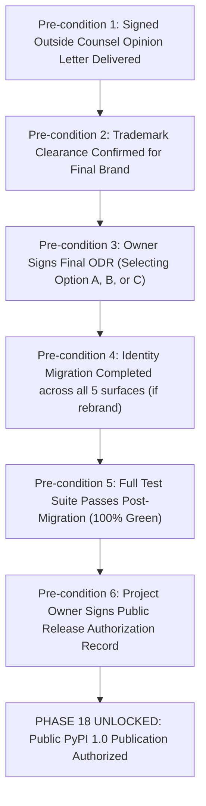

# ADAPTIVEML CONSOLIDATED EXECUTION — PHASE 18 EXCLUSION NOTICE
## Formal Pre-Release Governance Boundary, Release Lock Enforcement, and PyPI Publication Prohibition

**Document Identifier:** `docs/verification/consolidated_execution/PHASE_18_PUBLICATION_EXCLUSION_NOTICE.md`<br>
**Execution Context:** Consolidated Remaining-Phase Programme (Section 18)<br>
**Target Milestone:** Original Phase 18 — PyPI 1.0 Public Release<br>
**Git Baseline Commit:** `master @ 67e9ef1b347ca223828a1f225e85e35a086a1f30`<br>
**Date:** 2026-11-06<br>
**Governing Authority:** Software Architecture Taskforce, Release Governance Board & Project Owner<br>
**Operative Status:** **`PHASE 18 STRICTLY LOCKED — EXPLICITLY EXCLUDED FROM EXECUTION`**<br>

---

## 1. Statutory Governance Directive

> [!CAUTION]
> **MANDATORY PUBLICATION PROHIBITION & RELEASE LOCK:**<br>
> Under Section 1, Section 3.2, and Section 18 of the Consolidated Master Execution Prompt:<br>
> **Original Phase 18 (PyPI 1.0 Public Release) is EXPLICITLY EXCLUDED from this consolidated execution programme.**<br>
>
> Technical auditors, automation tools, and software engineers are **strictly forbidden** from executing any public release actions.

---

## 2. Inventory of Prohibited Actions

Throughout this consolidated execution and in all automated environments, the following prohibitions were, and remain, unconditionally binding:

1. **Zero PyPI Uploads:** The command `twine upload dist/*` or any equivalent package registry upload targeting PyPI (`https://upload.pypi.org/legacy/`) is prohibited.
2. **Zero TestPyPI Uploads:** Uploads targeting TestPyPI (`https://test.pypi.org/legacy/`) are prohibited.
3. **Zero Package Identity Renaming on Registries:** No alternative package identities (e.g. `resiliml`) shall be registered or reserved on PyPI during this phase.
4. **Zero Public Release Tags:** No Git release tags (e.g., `v1.0.0`, `v0.1.0`, `release-1.0`) shall be created or pushed to remote repositories.
5. **Zero Remote Pushes:** No Git branches or commits shall be pushed to upstream remotes.
6. **Zero Public Announcements:** No public announcements claiming the availability of a 1.0 public release shall be transmitted across websites, social media, blogs, or email lists.
7. **Zero Automated Workflow Triggers:** No CI/CD workflows configured to publish packages on tag creation shall be triggered.

---

## 3. Scope of Authorized Preparatory Work

The only actions authorized regarding Phase 18 are **internal release engineering preparation**:
- Building local wheel (`.whl`) and source distribution (`.tar.gz`) artifacts in isolated sandboxes for cryptographic inspection and local installation testing.
- Generating draft Software Bill of Materials (SBOM) manifests.
- Testing clean virtual environment installation using local file paths.
- Preparing draft release notes and changelogs for future review.

---

## 4. Conditions Precedent to Any Future Unlocking of Phase 18

Phase 18 can only be unlocked through a **separate, explicit, written instruction from the Project Owner** following the satisfaction of all six release prerequisites:



1. Receipt of a signed, written legal opinion letter from outside trademark counsel.
2. Formal confirmation of trademark clearance and absence of infringement exposure for the final selected identity.
3. Formally executed Owner Decision Record (`FINAL_OWNER_DECISION_RECORD.md`).
4. Full execution and verification of identity migration across code, metadata, tests, and documentation (if a rebrand is mandated).
5. 100% test pass on post-migration build artifacts.
6. Explicit, dated, written Project Owner authorization specifically directing the execution of Phase 18.

---

## 5. Operative Conclusion

Phase 18 remains:

```
===================================================================================
                       PHASE 18 STATUS DECLARATION
===================================================================================
PHASE 18 OPERATIVE STATUS:       STRICTLY LOCKED
PUBLIC PYPI PUBLICATION:         PROHIBITED / NOT EXECUTED
PUBLIC RELEASE ANNOUNCEMENTS:    PROHIBITED / WITHHELD
RELEASE ARTIFACT DISPOSITION:    INTERNAL SANDBOX ONLY
===================================================================================
```
