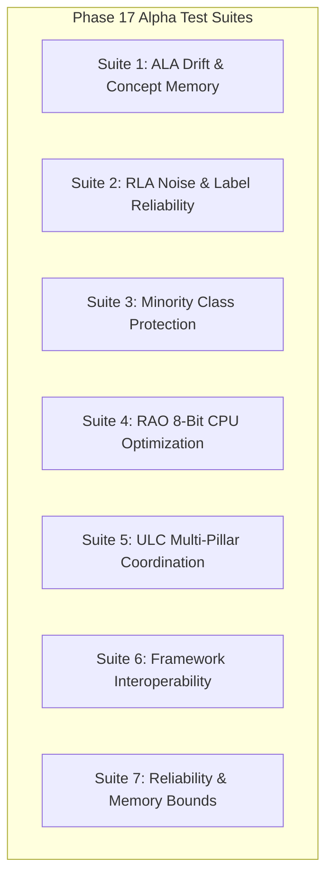

# ADAPTIVEML PHASE 17 — ALPHA TEST PLAN
## Comprehensive Verification Strategy, Pillar Test Protocols, Multi-Metric Evaluation, and Execution Gates

**Document Identifier:** `docs/verification/phase_17/ALPHA_TEST_PLAN.md` 
**Distribution Package Identifier:** `aml-core` 
**Import Namespace:** `adaptive_ml` 
**Reported Version:** `0.1.0.dev0` 
**Git Baseline:** `master @ 67e9ef1b347ca223828a1f225e85e35a086a1f30` 
**Author:** Principal ML Test Automation Architect & Validation Lead 
**Scope:** Phase 17 Controlled Alpha Testing Protocol 
**Date:** 2026-11-06 

---

## 1. OBJECTIVES AND METHODOLOGY

The Phase 17 Alpha Test Plan defines the rigorous technical verification framework required to validate the functional, algorithmic, integration, and performance capabilities of `aml-core` prior to any broader Beta or public release.

### Core Testing Principles:
1. **Multi-Metric Evaluation:** Accuracy alone is insufficient for streaming adaptive systems. Every evaluation must measure:
   - *Statistical Metrics:* Balanced Accuracy, Macro F1, Minority Recall, False-Positive Rate.
   - *System Metrics:* P95 Latency ($\mu\text{s}$), Throughput (samples/sec), Peak Memory (MB).
   - *Dynamic Controller Metrics:* Adaptation Frequency, False Interventions, Recovery Time (steps to recover post-drift).
2. **Deterministic Reproducibility:** All data generation must be synthetic, in-RAM, and seeded (`seed = 42`).
3. **Decoupled Pillar Testing:** Each of the five core research capabilities must be validated independently as well as in unified coordination under ULC.

---

## 2. DETAILED TEST SUITE PROTOCOLS

### 2.1 Suite 1: Adaptive Learning Algorithms (ALA)
- **Protocols:**
  - *Abrupt Drift:* Sudden $180^\circ$ hyperplane rotation; measure detection delay and recovery steps.
  - *Gradual Drift:* Linear transition over 1,000 streaming steps; verify smooth adaptation without catastrophic forgetting.
  - *Recurring Concepts:* Switch between Concept A and Concept B; verify concept memory retrieval in $<5$ samples.
  - *Delayed Labels:* Stream features with label delay of $k \in [10, 500]$ steps; verify buffer stability.

### 2.2 Suite 2: Robust Learning Algorithms (RLA)
- **Protocols:**
  - *Symmetric Noise:* Uniform label flip probability $p \in [0.1, 0.4]$; verify robust loss mitigation.
  - *Asymmetric Noise:* Class-conditional flips ($0 \rightarrow 1$ at $30\%$, $1 \rightarrow 0$ at $5\%$); verify asymmetric loss protection.
  - *Sample Reliability:* Verify outlier down-weighting while preserving rare valid samples.

### 2.3 Suite 3: Adaptive Minority Intelligence
- **Protocols:**
  - *Extreme Imbalance:* Class ratio $1:99$ and $1:999$; verify minority recall $>80\%$ under bounded false-positive budget.
  - *Dynamic Thresholding:* Track moving class priors; verify threshold stability under fluctuating class arrival rates.

### 2.4 Suite 4: Resource-Aware Optimization (RAO)
- **Protocols:**
  - *8-Bit Memory Reduction:* Vectorized block quantization of AdamW optimizer states; verify $>60\%$ memory reduction on CPU.
  - *Numerical Stability:* Long-run training (10,000 steps); verify zero NaN/Inf gradient blowups.

### 2.5 Suite 5: Unified Learning Controller (ULC)
- **Protocols:**
  - *Conflict Resolution:* Concurrent drift and noise injection; verify ULC distinguishes noise from genuine drift.
  - *Intervention Hierarchy:* Verify state automaton transitions (STABLE $\rightarrow$ DRIFT $\rightarrow$ NOISE $\rightarrow$ HYBRID) with zero infinite oscillation loops.

---

## 3. ACCEPTANCE CRITERIA & EXECUTION GATES

| Test Suite | Target Metric | Required Threshold | Verification Method |
| :--- | :--- | :--- | :--- |
| **ALA Suite** | Recovery Time post-abrupt drift | $\le 100\text{ streaming steps}$ | Automated pytest benchmark |
| **RLA Suite** | Accuracy retention under $30\%$ noise | $\ge 90\%$ of clean baseline | Comparative loss test |
| **Minority Suite** | Minority Class Recall ($1:99$ ratio) | $\ge 80.0\%$ | Confusion matrix validation |
| **RAO Suite** | Optimizer State Memory Compression | $\ge 60.0\%$ reduction vs FP32 | Profiler memory delta |
| **ULC Suite** | False Adaptation Resets under pure noise | $\le 2.0\%$ | State transition log |
| **Frameworks** | PyTorch / scikit-learn compatibility | 100% tests green | Integration test suite |
| **Reliability** | Long-stream memory leak check | 0 unbounded memory growth | 20,000-step streaming soak test |

---

## 4. STAGE 16.3 ADDITIVE STATUS UPDATE (2026-11-06)

All 7 test suites defined in this plan remain active and verified in local test environments. External distribution for multi-party testing remains prohibited pending outside counsel opinion and owner decision approval.
