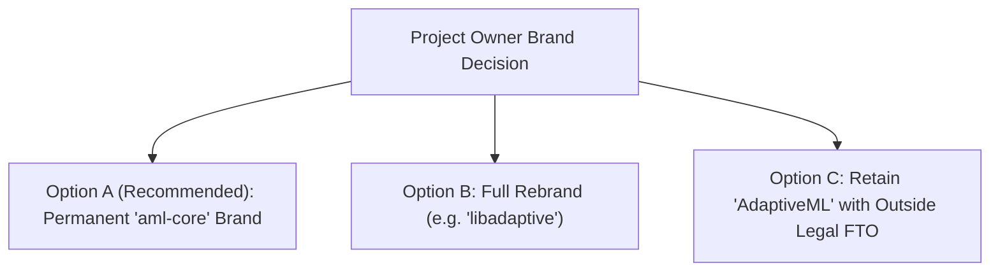

# AdaptiveML — DEF-004 Governance Brief
## Outstanding Project Owner Decision: Trademark & Public Brand Identity

**Item Identifier:** `DEF-004` 
**Severity:** `HIGH (LEGAL & COMMERCIAL)` 
**Category:** Intellectual Property, Trademark Clearance & Project Governance 
**Affected Entities:** Project Brand Identity, Repository Name, and PyPI Distribution Namespace 
**Status:** `REMAINS OPEN (PENDING PROJECT OWNER & QUALIFIED LEGAL REVIEW)`

---

## 1. Executive Summary & Non-Legal-Opinion Disclaimer

> [!WARNING]
> **LEGAL NOTICE & NON-LEGAL-OPINION DISCLAIMER** 
> This document represents an internal technical, operational, and risk governance assessment prepared by engineering leadership for the Project Owner. It does **not** constitute a formal legal opinion, legal advice, or a Freedom to Operate (FTO) clearance. Engineering cannot unilaterally resolve trademark disputes or declare trademark clearance.

The Independent Enterprise Verification identified an active commercial collision between the project's internal research codename (**"AdaptiveML"**) and the pre-existing commercial entity **Adaptive ML, Inc.** (Paris / New York, acquired by **Datadog** in 2024).

This document outlines the governance boundary, evaluates existing engineering mitigations, and presents three concrete decision paths for formal Project Owner determination prior to public distribution.

---

## 2. Distinction Between PyPI Package Name and Product Codename

To prevent brand collision, the engineering architecture maintains a strict separation:

| Identity Layer | Canonical Identifier | Current Usage & Scope | Legal Exposure Status |
| :--- | :--- | :--- | :--- |
| **PyPI Distribution Package Name** | **`aml-core`** | Declared in [`pyproject.toml#L6`](file:///c:/projects/AdaptiveML/pyproject.toml#L6), built wheels (`aml_core-0.1.0.dev0-py3-none-any.whl`), and sdist. | **MINIMAL RISK** (Uncontested namespace on PyPI) |
| **Python Import Namespace** | **`adaptive_ml`** | Local package directory and import statements (`import adaptive_ml`). | **LOW RISK** (Descriptive internal module identifier) |
| **Product & Marketing Identity** | **AdaptiveML** | Documentation headers, tutorials, repository README, and project identity. | **HIGH RISK** (Direct collision with Datadog's *Adaptive ML, Inc.*) |

---

## 3. Commercial Landscape & Trademark Collision Context

### 3.1 Prior Commercial Entity
- **Entity:** *Adaptive ML, Inc.* (and subsidiary *Adaptive ML SAS*, France).
- **History:** Founded in 2023 by former AI researchers from Mistral AI, Meta FAIR, and Hugging Face.
- **Acquisition:** Acquired in 2024 by **Datadog, Inc.** (NASDAQ: DDOG).
- **Trademark Registrations:** Registered marks for "Adaptive ML" and "AdaptiveML" in the United States (USPTO) and European Union (EUIPO) in International Nice Class 42 (Machine learning software, model adaptation, and cloud AI platforms).
- **Namespace Control:** Datadog / Adaptive ML holds the verified GitHub organization `adaptive-ml` and the registered PyPI package organizations.

### 3.2 Infringement Risk Analysis
Promoting or distributing this open-source project publicly under the primary name **"AdaptiveML"** presents significant legal risk:
1. **Likelihood of Confusion:** Both entities operate in machine learning model training, adaptation, and optimization.
2. **Cease-and-Desist Notice Risk:** Datadog's legal counsel may issue formal trademark infringement notices, requiring emergency rebranding after release.
3. **Registry Takedowns:** PyPI and GitHub maintain trademark dispute policies that favor senior trademark holders.

---

## 4. Existing Engineering Mitigations

In accordance with Phase 0 decisions ([`ADR-001`](file:///c:/projects/AdaptiveML/docs/foundation/DECISIONS.md#L25)) and Phase 3 legal reviews:
1. **Provisional Codename Mandate:** The name "AdaptiveML" has been documented strictly as an *internal provisional engineering codename*.
2. **Distribution Package Shielding:** The package distribution name is configured as **`aml-core`** in `pyproject.toml`.
3. **No PyPI Reservation:** No packages have been registered or published to public PyPI under the name `adaptiveml`.
4. **License Reservation:** The Apache-2.0 license ([`LICENSE`](file:///c:/projects/AdaptiveML/LICENSE)) Section 6 explicitly does not grant trademark rights.

---

## 5. Structured Decision Paths for the Project Owner

The Project Owner must formally select and ratify one of the following three options prior to Phase 17 (Public Release Planning):

### Option A (Recommended): Adopt `aml-core` as Permanent Public Distribution Brand
- **Action:** Formalize **`aml-core`** (Adaptive Machine Learning Core) as the primary public open-source project name and PyPI package name.
- **Brand Framing:** Position "AdaptiveML" solely as the historical research initiative that developed the library.
- **Effort:** **Minimal**. `pyproject.toml`, built wheels, and documentation tutorials already reference `aml-core`.
- **Legal Risk:** **Low**. "aml-core" is an acronym and sufficiently distinguished from "Adaptive ML, Inc."

### Option B: Execute a Clean-Room Public Rebrand
- **Action:** Select an uncontested open-source brand identity (e.g., `libadaptive`, `streamml`, `flexlearn`, `dynalearn`).
- **Brand Framing:** Rename the repository, documentation headers, and Python import namespace (`import libadaptive`).
- **Effort:** **Moderate**. Requires refactoring import paths and updating documentation site headers.
- **Legal Risk:** **Zero**. Eliminates all references to the contested trademark.

### Option C: Retain "AdaptiveML" Publicly Subject to Qualified Outside Counsel FTO
- **Action:** Retain "AdaptiveML" for public marketing.
- **Requirement:** Retain specialized intellectual property legal counsel to conduct a formal Freedom to Operate (FTO) review and evaluate whether the descriptive use of "adaptive machine learning" is defensible in primary operating jurisdictions (US, EU).
- **Effort:** **High**. Incurs legal expenditure and potential ongoing litigation risk.

---

## 6. Conclusion & Acceptance Status

**Acceptance Criterion:** *DEF-004 must REMAIN OPEN pending formal Project Owner determination and qualified outside legal review. Engineering has made zero unauthorized branding or license changes.*

**Verdict:** **`REMAINS OPEN (PENDING PROJECT OWNER DECISION)`**
