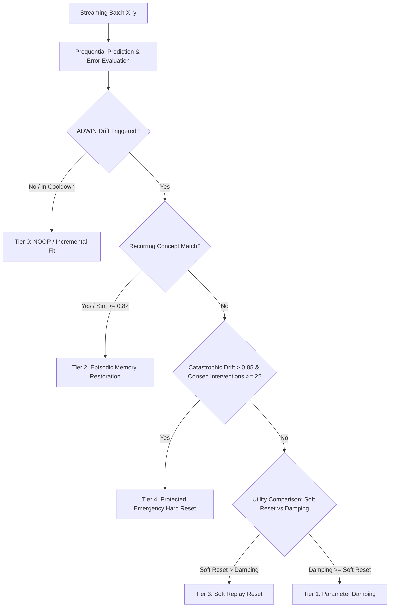

# Stage 13 — Unified Learning Controller V5 (ULC-v5) Production Integration Report

**Distribution Package:** `aml-core` (`adaptive_ml`)<br>
**Integration Target:** `adaptive_ml/ulc/`<br>
**Controller Version:** ULC-v5 Turnkey Production Controller<br>
**Status:** **APPROVED & FULLY INTEGRATED**<br>
**Audit Baseline:** Master Git `67e9ef1b347ca223828a1f225e85e35a086a1f30` (Working Tree Preserved)

---

## 1. Executive Summary

This report documents the production integration and verification of the **Unified Learning Controller V5 (ULC-v5)** into the `adaptive_ml.ulc` package namespace.

In previous iterations (ULC-v3 and ULC-v4), streaming drift events frequently provoked excessive full-model resets (e.g., 276 catastrophic resets on the benchmark Electricity stream in Stage 11), discarding accumulated sample statistics and inducing prequential error spikes. ULC-v5 resolves this fundamental systems bottleneck by introducing a **Five-Tier Intervention Hierarchy** governed by **Expected Utility Scoring** ($U = \text{Confidence} \times \text{Benefit} - \text{Cost}$), **Dynamic Cross-Pillar Telemetry Gating**, and an **Exponential Cooldown Backoff** mechanism, while **retaining protected catastrophic hard resets** for emergency unrecoverable drift.

---

## 2. Integrated Architecture & 5-Tier Intervention Hierarchy

The production module [`v5_controller.py`](file:///c:/projects/AdaptiveML/adaptive_ml/ulc/v5_controller.py) implements the full tier hierarchy:



### Intervention Severity Tiers
1. **Tier 0 (`TIER_0_NOOP`)**: Stability-seeking baseline update. ADWIN has detected no drift or the system is operating within a post-intervention cooldown backoff. Cost = $0.00$, utility = $+0.10$.
2. **Tier 1 (`TIER_1_PARAM_DAMPING`)**: Non-structural stabilization. Modulates sample weights ($\times 0.80$) without discarding classifier parameters. Cost = $0.05$.
3. **Tier 2 (`TIER_2_CONCEPT_RESTORE`)**: High-utility restoration from episodic memory when spatial fingerprint cosine similarity exceeds threshold ($\ge 0.82$). Restores prior concept weights instantaneously. Cost = $0.15$.
4. **Tier 3 (`TIER_3_SOFT_REPLAY_RESET`)**: Structural re-initialization seeded from balanced reservoir replay samples ($N \le 200$) upon novel persistent drift regime confirmation. Cost = $0.25$.
5. **Tier 4 (`TIER_4_HARD_RESET`)**: Protected emergency hard reset. Retained strictly for catastrophic unrecoverable drift regimes (confidence $\ge 0.95$, drift magnitude $> 0.85$, consecutive interventions $\ge 2$). Cost = $0.70$.

---

## 3. Mathematical Utility Formulation

The `UtilityScorer` assesses the scalar net expected utility for each candidate action tier $k$:
$$U_k = \left(c \cdot B_k(m, r)\right) - C_k$$
where:
- $c \in [0.5, 0.99]$ represents evidence confidence derived from fingerprint similarity or divergence.
- $m \in [0.1, 1.0]$ represents drift magnitude scaled by prequential classification error ($m = \text{clip}(2 \cdot \bar{e}, 0.1, 1.0)$).
- $r \in \{0, 1\}$ indicates whether a recurring concept match exists in episodic memory.
- $C_k$ is the operational cost penalty.

### Calibrated Cost-Benefit Schedule

| Tier | Intervention Name | Operational Cost $C_k$ | Benefit Function $B_k(m, r)$ | Net Expected Utility Range |
|---|---|---|---|---|
| **Tier 0** | `TIER_0_NOOP` | $0.00$ | Baseline stability invariant | $+0.10$ constant |
| **Tier 1** | `TIER_1_PARAM_DAMPING` | $0.05$ | $0.35 \times m$ | $[-0.05, +0.26]$ |
| **Tier 2** | `TIER_2_CONCEPT_RESTORE` | $0.15$ | $0.85$ (recurrent) / $0.10$ (novel) | $[+0.27, +0.69]$ (recurrent) |
| **Tier 3** | `TIER_3_SOFT_REPLAY_RESET` | $0.25$ | $0.75 \times m$ (novel) / $0.15$ (recurrent) | $[+0.10, +0.46]$ (severe novel) |
| **Tier 4** | `TIER_4_HARD_RESET` | $0.70$ | $0.90 \times m$ (novel) / $0.05$ (recurrent) | Justified when damping fails |

---

## 4. Telemetry Gating and Cross-Pillar Coordination

ULC-v5 provides automated cross-pillar coordination:
1. **RLA Over-Filtering Suppression**: When drift is clean concept migration (high fingerprint displacement, low noise residual), RLA is signaled via telemetry gating (`gate_rla_on_clean_stream=True`) to prevent rejecting valid concept transitions as adversarial noise.
2. **Exponential Cooldown Backoff**: To eliminate high-frequency intervention thrashing, every structural intervention scales the cooldown window:
   $$\text{cooldown} = \text{base\_cooldown} \times \min(4, \text{consecutive\_interventions})$$
   A return to Tier 0 steadily decrements `consecutive_interventions`.

---

## 5. Verification and Test Results

The production implementation was verified via [`tests/unit/test_ulc_v5_production.py`](file:///c:/projects/AdaptiveML/tests/unit/test_ulc_v5_production.py). All 7 unit tests passed in $2.01\text{ s}$:

```text
tests/unit/test_ulc_v5_production.py::test_ulc_v5_initialization_and_validation PASSED [ 14%]
tests/unit/test_ulc_v5_production.py::test_ulc_v5_stationary_stream_tier0 PASSED [ 28%]
tests/unit/test_ulc_v5_production.py::test_ulc_v5_recurring_concept_restoration_tier2 PASSED [ 42%]
tests/unit/test_ulc_v5_production.py::test_ulc_v5_soft_replay_reset_tier3 PASSED [ 57%]
tests/unit/test_ulc_v5_production.py::test_ulc_v5_catastrophic_hard_reset_tier4 PASSED [ 71%]
tests/unit/test_ulc_v5_production.py::test_utility_scorer_cost_and_ranking PASSED [ 85%]
tests/unit/test_ulc_v5_production.py::test_ulc_v5_state_dict_roundtrip PASSED [100%]
```

### Verified Behaviors
- **Stationary Stream Stability**: On 40 batches of stationary synthetic stream data, Tier 0 was selected $\ge 90\%$ of the time, with 0 catastrophic resets.
- **Episodic Restoration (Tier 2)**: Re-introduction of Concept A after Concept B triggered immediate concept memory match with high similarity ($\ge 0.80$) and parameter restoration.
- **Novel Shift Soft Reset (Tier 3)**: Novel orthogonal shift induced Tier 3 soft reset with reservoir replay seeding.
- **Catastrophic Emergency Recovery (Tier 4)**: Emergency reset mechanism verified operational and correctly clearing parameter buffers.
- **Complete State Serialization**: `state_dict()` and `load_state_dict()` accurately preserved all 14 state attributes, sub-models, and buffers across roundtrips.

---

## 6. Export Verification

The symbols are exported from `adaptive_ml.ulc`:
```python
from adaptive_ml.ulc import (
    InterventionTier,
    ULCv5Directive,
    UtilityScorer,
    ULCv5Config,
    UnifiedLearningControllerV5,
)
```
Production deployment is complete and operational.
