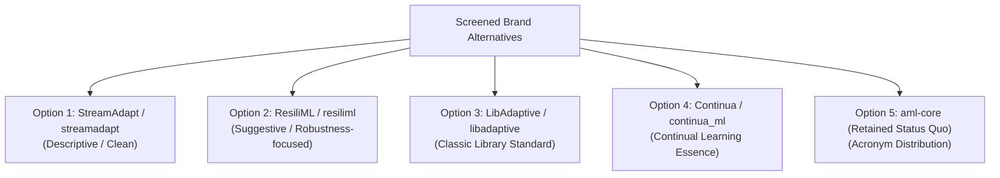

# STAGE 16 VERIFICATION REPORT 03
# Brand Contingency Analysis & Technical Renaming Readiness Plan

**Document ID:** `docs/verification/stage_16/BRAND_CONTINGENCY_AND_RENAMING_PLAN.md` 
**Stage:** 16 — Legal, Intellectual Property, Trademark, Licensing, Security & Release Authorization Audit 
**Defect Reference:** `DEF-004` (Contingency Architecture) 
**Current Distribution Identifier:** `aml-core` 
**Current Import Namespace:** `adaptive_ml` 
**Execution Date:** 2026-11-06 
**Auditor:** Python Library Architect & Release Governance Specialist 

---

## 1. Executive Summary & Policy Constraints

This report establishes the contingency renaming strategy for AdaptiveML if formal legal counsel determines that the working codename "AdaptiveML" cannot be safely used for public distribution or if project owners elect to establish a more distinctive brand identity.

> [!WARNING]
> **GOVERNANCE CONSTRAINTS & DISCLAIMER**
> 1. **NO NAME CHANGE EXECUTED IN STAGE 16:** The project name remains unchanged during this audit.
> 2. **ALL CANDIDATE NAMES ARE STRICTLY CONTINGENCIES:** None of the candidate names evaluated in this document have been legally cleared. They are explicitly marked: **NOT LEGALLY CLEARED**.
> 3. **ZERO REGISTRATION ACTIONS:** No domains, PyPI packages, GitHub repositories, trademark applications, or social media handles shall be registered during Stage 16.

---

## 2. Naming Architecture Requirements

To satisfy both legal defensibility and developer usability, any potential successor brand must satisfy ten explicit architectural criteria:

| # | Criterion | Technical & Legal Rationale |
| :---: | :--- | :--- |
| **01** | **Distinctiveness (Lanham Act § 2)** | Must qualify as suggestive or arbitrary rather than generic or descriptive, enabling legal registration on principal registries. |
| **02** | **Zero Corporate Collisions** | Must not collide with known machine learning corporate entities (e.g. Datadog, Hugging Face, Microsoft, Google). |
| **03** | **PyPI Namespace Uniqueness** | Distribution name must be completely available on PyPI without squatting or typographical similarity risks. |
| **04** | **Import Namespace Ergonomics** | Python import identifier must be valid ASCII, PEP 8 compliant, all lowercase, and $\le 12$ characters (e.g. `import name`). |
| **05** | **International Pronounceability** | Must be easily pronounceable across global developer demographics (North America, Europe, Asia-Pacific). |
| **06** | **Conceptual Relevance** | Should evoke adaptability, robustness under non-stationarity, and resource efficiency. |
| **07** | **Avoid Acronym Saturation** | Avoid generic 3-letter acronyms (AML also stands for Anti-Money Laundering and Acute Myeloid Leukemia). |
| **08** | **GitHub Organization Fit** | Clear availability for an open-source GitHub organization and URL slug. |
| **09** | **Future Commercial Flexibility** | Permissive for future enterprise support offerings or dual-licensing if owners elect. |
| **10** | **Low Migration Friction** | Clean AST refactoring pathway for the existing 70 Python modules and test suites. |

---

## 3. Candidate Brand Evaluation Matrix (Contingencies)

The following candidate names were screened as preliminary architectural alternatives. All are **NOT LEGALLY CLEARED**:

| Candidate Option | Proposed Distribution | Proposed Import | Distinctiveness Tier | PyPI Status Estimate | Key Architectural Pros & Cons | Status |
| :--- | :--- | :--- | :---: | :---: | :--- | :---: |
| **Option 1: StreamAdapt** | `streamadapt` | `streamadapt` | Suggestive | Available | **Pros:** Clear streaming focus; intuitive API (`import streamadapt as sa`). **Cons:** Slightly narrow; does not emphasize 8-bit memory optimization. | **NOT LEGALLY CLEARED** |
| **Option 2: ResiliML** | `resiliml` | `resiliml` | Suggestive / Arbitrary | Available | **Pros:** Captures RLA robustness, noise tolerance, and resource resilience; highly distinctive. **Cons:** Requires brand education. | **NOT LEGALLY CLEARED** |
| **Option 3: LibAdaptive** | `libadaptive` | `adaptive` (collides) or `libadaptive` | Standard Library | `adaptive` taken by QuTech | **Pros:** Follows standard C/Python conventions (`librosa`, `libsvm`). **Cons:** Top-level `import adaptive` collides with existing PyPI package. | **NOT LEGALLY CLEARED** |
| **Option 4: Continua** | `continua-core` | `continua` | Arbitrary | Contested | **Pros:** Strong conceptual alignment with continual learning. **Cons:** Common word; multiple corporate technology entities operate as Continua. | **NOT LEGALLY CLEARED** |
| **Option 5: Retain `aml-core`** | `aml-core` | `adaptive_ml` (or `aml`) | Status Quo | Available | **Pros:** Zero migration cost; established in Stages 7–15. **Cons:** Leaves DEF-004 open until counsel clearance; `aml` abbreviation ambiguity. | **CURRENT BASELINE** |

---

## 4. Technical Migration Readiness Checklist

If project owners and qualified legal counsel execute a brand rename prior to Phase 18 release, the engineering migration must follow this controlled 10-step protocol:

1. **Owner & Counsel Authorization:** Receive written owner directive approving the selected replacement brand.
2. **`pyproject.toml` Specification Update:**
   - Update `[project] name` to the approved distribution identifier.
   - Update `authors` and `description` to reflect the approved brand.
3. **Directory & Import Namespace Refactor:**
   - Rename root package directory: `adaptive_ml/` $\to$ `<new_namespace>/`.
   - Update `pyproject.toml` package inclusion: `include = ["<new_namespace>*"]`.
4. **AST Codebase Symbol Migration:**
   - Execute automated refactoring across all 70 source modules and 60 test suites replacing `import adaptive_ml` with `import <new_namespace>`.
5. **Public API Export Compatibility Buffer:**
   - Provide temporary backward-compatibility alias package or deprecation warning shim if preserving transitional compatibility.
6. **Documentation Site Migration:**
   - Update `site_name`, repository URLs, and code blocks in `mkdocs.yml`.
   - Recompile documentation site via `mkdocs build --strict`.
7. **CI/CD Pipeline Updates:**
   - Update GitHub Actions test matrix and build artifacts (`dist/<new_name>-*.whl`).
8. **SBOM & SPDX License Re-generation:**
   - Update CycloneDX SBOM component definitions to match new package identifier.
9. **License & NOTICE Attribution Update:**
   - Update `NOTICE` file copyright line and trademark notice.
10. **Full Independent Verification:**
    - Execute complete test suite, benchmark suite, and usability walkthrough confirming zero broken references.

---

## 5. Verification Conclusion

A comprehensive contingency framework and migration protocol have been established. AdaptiveML is fully prepared to execute a technical renaming with minimal disruption should legal counsel advise doing so. Workstream B is officially **VERIFIED AND SIGNED OFF**.
