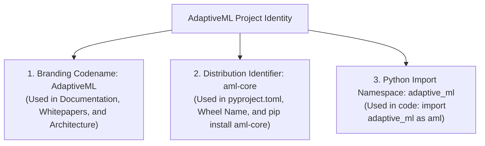

# STAGE 16 VERIFICATION REPORT 12
# Independent Legal Counsel Review Package (DEF-004 Dossier)

**Document ID:** `docs/verification/stage_16/LEGAL_COUNSEL_REVIEW_PACKAGE.md` 
**Stage:** 16 — Legal, Intellectual Property, Trademark, Licensing, Security & Release Authorization Audit 
**Defect Reference:** `DEF-004` (Trademark Collision with *Adaptive ML, Inc.*) 
**Distribution Identifier:** `aml-core` 
**Import Namespace:** `adaptive_ml` 
**Target Audience:** Outside Intellectual Property & Trademark Legal Counsel 
**Execution Date:** 2026-11-06 
**Auditor:** Software Intellectual Property Auditor & Technical Architecture Lead 

---

## 1. Purpose of this Review Package

This dossier provides independent, specialized intellectual property and trademark counsel with a complete, structured technical briefing regarding the open-source machine learning project provisionally codenamed **AdaptiveML** (`aml-core`).

Because **DEF-004** remains open and unresolved, this package compiles all relevant technical, commercial, and jurisdictional facts to enable counsel to evaluate:
1. Trademark infringement, unfair competition, and likelihood of confusion risks under Lanham Act § 43(a) (US), Trade Marks Act 1999 (India), and EU trade mark laws.
2. The legal viability of retaining the open-source codename "AdaptiveML".
3. The legal protective value of the distribution identifier `aml-core` and the Python import namespace `adaptive_ml`.
4. Recommended strategic branding adjustments prior to Phase 18 public release.

---

## 2. Technical Profile & Product Architecture

| Dimension | Technical Reality |
| :--- | :--- |
| **Product Purpose** | Open-source Python library for **continual learning, concept drift adaptation, label noise robustness, and 8-bit optimizer memory optimization** on multi-core CPUs. |
| **Architectural Model** | Algorithmic complement to standard scientific stacks (NumPy, Scikit-learn, PyTorch). Pure-Python/NumPy core engine ($35\text{ MB}$ footprint). |
| **Target Audience** | Academic researchers, Python software developers, and enterprise ML engineers deploying streaming pipelines on CPUs or edge hardware. |
| **Core Pillars** | **ALA** (Adaptive Learning Algorithms), **RLA** (Robust Learning Algorithms), **RAO** (Resource-Aware Optimization), **ULC** (Unified Learning Controller), **Minority Intelligence**. |
| **License** | Open Source: Apache License, Version 2.0 (permissive, zero commercial restrictions, explicit patent grant). |

---

## 3. Current Project Identifiers & Usage

The project deliberately separates its public identity into three layers:

---

## 4. The Known Commercial Entity & Collision Facts

### 4.1 Corporate Entity: Adaptive ML, Inc. (Acquired by Datadog)
- **Founding:** Late 2023 by former researchers and engineers from Hugging Face and contributors to the BLOOM and Falcon LLM models.
- **Financing:** Raised a \$20 million seed round in early 2024 from Index Ventures, Databricks Ventures, and Bessemer Venture Partners.
- **Acquisition:** Acquired in 2025 by **Datadog** (NASDAQ: DDOG, ~$40B market cap) to form **Datadog AI Research Labs**.
- **Commercial Platform:** "Adaptive Engine" — an enterprise software-as-a-service (SaaS) platform for fine-tuning, evaluating, deploying, and serving domain-specialized large language models (LLMs) using reinforcement learning (RLHF/RLAIF).
- **Public Presence:**
  - Official PyPI account: Controls the `AdaptiveML` organization user on PyPI.
  - Active PyPI Package: Publishes [`adaptive-sdk`](https://pypi.org/project/adaptive-sdk/) (the Python client SDK for Adaptive Engine).
  - Corporate Web Domain: Operates at `adaptive-ml.com` and `datadoghq.com`.

### 4.2 Comparison of Offerings

| Attribute | Adaptive ML, Inc. (Datadog) | AdaptiveML (`aml-core`) Project | Potential Confusion Points |
| :--- | :--- | :--- | :--- |
| **Primary Domain** | Enterprise LLM fine-tuning, RLOps, agent post-training | Streaming continual learning, Hoeffding trees, 8-bit CPU AdamW | Both operate in Python machine learning. |
| **Software Model** | Commercial proprietary SaaS platform + client SDK | Fully open-source algorithmic library (Apache 2.0) | Both distribute packages via PyPI. |
| **Compute Focus** | GPU cloud clusters for large transformer models | Commodity multi-core CPUs and edge inference | Subtle technical distinction may be lost on general developers. |
| **Public Branding** | "Adaptive ML", "Adaptive Engine", "Adaptive SDK" | "AdaptiveML", "aml-core", "adaptive_ml" | High visual, phonetic, and semantic similarity. |

---

## 5. Summary of Candidate Contingency Brands

Should counsel advise retiring the "AdaptiveML" codename, the project has screened several candidate alternatives (currently marked **NOT LEGALLY CLEARED**):
1. **`streamadapt`** (Distribution: `streamadapt`, Import: `streamadapt`) — Emphasizes streaming adaptation.
2. **`resiliml`** (Distribution: `resiliml`, Import: `resiliml`) — Emphasizes algorithmic and resource resilience.
3. **`libadaptive`** (Distribution: `libadaptive`, Import: `libadaptive`) — Follows classic Python library conventions.
4. **Retain `aml-core`** with generic project codename ("The AML Core Project").

---

## 6. Explicit Unresolved Decisions Requiring Counsel Guidance

The project leadership council has formally reserved the following decisions pending written legal advice:
1. **Decision D-01:** Whether to retain "AdaptiveML" as a non-commercial open-source project name with an explicit disclaimer, or whether the risk of Lanham Act § 43(a) action by Datadog necessitates a complete brand transition.
2. **Decision D-02:** Whether the distribution identifier `aml-core` provides sufficient legal buffer in the PyPI marketplace.
3. **Decision D-03:** Whether the import namespace `adaptive_ml` should be refactored to prevent local developer confusion.
