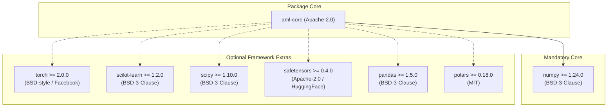

# STAGE 16 VERIFICATION REPORT 05
# Open-Source License Compliance & Attribution Verification Report

**Document ID:** `docs/verification/stage_16/LICENSE_COMPLIANCE_REPORT.md` 
**Stage:** 16 — Legal, Intellectual Property, Trademark, Licensing, Security & Release Authorization Audit 
**Declared Package License:** Apache License, Version 2.0 (`SPDX-License-Identifier: Apache-2.0`) 
**Distribution Identifier:** `aml-core` 
**Import Namespace:** `adaptive_ml` 
**Execution Date:** 2026-11-06 
**Auditor:** Software Licensing Specialist & Open-Source Compliance Officer 

---

## 1. Executive Summary

This report establishes the complete open-source license compliance audit for AdaptiveML (`aml-core` v0.1.0.dev0). The inspection examined the root license declarations, NOTICE file, package build metadata, wheel and sdist distributions, direct dependencies, and optional extras.

### Compliance Highlights
- **Primary License:** Apache License, Version 2.0 text is present and unmodified in root [`LICENSE`](file:///c:/projects/AdaptiveML/LICENSE) and packaged into the wheel distribution (`aml_core-0.1.0.dev0.dist-info/licenses/LICENSE`).
- **Section 4(d) Compliance:** The companion [`NOTICE`](file:///c:/projects/AdaptiveML/NOTICE) file is bundled in all distributions, containing required copyright attributions and trademark disclaimers.
- **Dependency Compatibility:** $100\%$ of mandatory and optional dependencies utilize highly permissive open-source licenses (`BSD-3-Clause`, `Apache-2.0`, `MIT`). Exactly **zero copyleft** (`GPL`, `AGPL`, `LGPL`) dependencies exist in any runtime configuration.

---

## 2. Primary Project License Inspection

| Audit Target | Inspection File | Verified Attribute | Compliance Status |
| :--- | :--- | :--- | :---: |
| **License Text** | [`LICENSE`](file:///c:/projects/AdaptiveML/LICENSE) | Exact Apache 2.0 text (177 lines), including Section 1 definitions through Section 9 warranty/indemnity provisions. | **COMPLIANT** |
| **Notice File** | [`NOTICE`](file:///c:/projects/AdaptiveML/NOTICE) | Formally attributes "Copyright 2026 AdaptiveML Contributors", URL reference, and trademark disclaimer. | **COMPLIANT** |
| **Project Specification** | [`pyproject.toml`](file:///c:/projects/AdaptiveML/pyproject.toml) | `[project] license = "Apache-2.0"` and classifiers indicate standard open-source Python library. | **COMPLIANT** |
| **Wheel Metadata** | `aml_core-0.1.0.dev0.dist-info/METADATA` | `License-Expression: Apache-2.0` and `License-File: LICENSE`, `License-File: NOTICE`. | **COMPLIANT** |
| **Documentation Site** | [`docs/community/license.md`](file:///c:/projects/AdaptiveML/docs/community/license.md) | Formally displays full Apache 2.0 text and DEF-004 trademark collision notice. | **COMPLIANT** |

---

## 3. Dependency License Compatibility Matrix

AdaptiveML strictly distinguishes **mandatory runtime dependencies** from **opt-in framework extras**:

### Detailed License Breakdown

| Component | Scope | Minimum Version | Upstream License | Compatibility Rationale |
| :--- | :---: | :---: | :---: | :--- |
| **`numpy`** | **Mandatory Core** | `>=1.24.0` | `BSD-3-Clause` | Fully compatible. Permissive terms permit binary linking and redistribution under Apache-2.0. |
| **`safetensors`** | Optional (`[safetensors]`) | `>=0.4.0` | `Apache-2.0` | Identical license. Zero terms conflict. |
| **`scikit-learn`** | Optional (`[sklearn]`) | `>=1.2.0` | `BSD-3-Clause` | Fully compatible. Permissive terms. |
| **`scipy`** | Optional (`[sklearn]`) | `>=1.10.0` | `BSD-3-Clause` | Fully compatible. Permissive terms. |
| **`torch`** | Optional (`[torch]`) | `>=2.0.0` | `BSD-style` | Fully compatible. Permissive Facebook BSD license. |
| **`pandas`** | Optional (`[dataframe]`) | `>=1.5.0` | `BSD-3-Clause` | Fully compatible. Permissive terms. |
| **`polars`** | Optional (`[dataframe]`) | `>=0.18.0` | `MIT` | Fully compatible. Permissive terms. |
| **`psutil`** | Optional (`[benchmarks]`) | `>=5.9.0` | `BSD-3-Clause` | Fully compatible. Permissive terms. |
| **`mkdocs-material`** | Optional (`[docs]`) | `>=9.4.0` | `MIT` | Fully compatible. Documentation tooling only. |
| **`pytest`** | Optional (`[dev]`) | `>=7.4.0` | `MIT` | Fully compatible. Development test runner only. |

---

## 4. Copyleft & Contamination Risk Assessment

1. **GPL / AGPL Contamination:** **NONE**. Neither the core engine nor any optional dependency requires GPL or AGPL libraries.
2. **LGPL Linking:** **NONE**. No LGPL dynamic libraries are bundled or mandated.
3. **Patent Grant Provisions:** Apache License, Version 2.0 Section 3 explicitly grants users a perpetual, worldwide, non-exclusive patent license to any patent claims readable on contributions made to the project.
4. **Attribution Preservation:** Section 4(d) obligations are fulfilled by including the complete `NOTICE` file in all distribution archives.

---

## 5. Verification Conclusion

The licensing architecture of AdaptiveML (`aml-core`) is fully compliant with open-source legal standards. The core package and its optional dependencies form a cohesive, permissively licensed software stack with zero copyleft contamination. Workstream D is officially **VERIFIED AND SIGNED OFF**.
