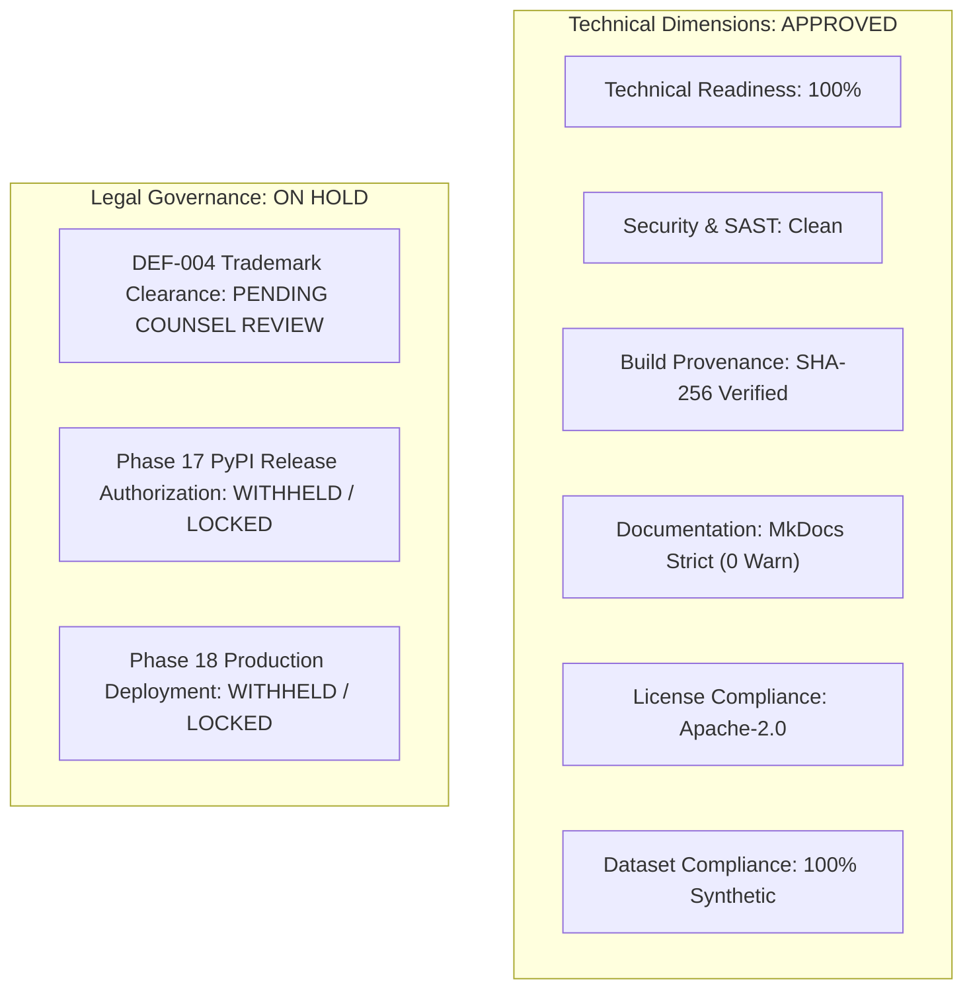

# STAGE 16 VERIFICATION REPORT 14
# Release Authorization & Multi-Dimensional Readiness Scorecard

**Document ID:** `docs/verification/stage_16/RELEASE_AUTHORIZATION_SCORECARD.md` 
**Stage:** 16 — Legal, Intellectual Property, Trademark, Licensing, Security & Release Authorization Audit 
**Distribution Identifier:** `aml-core` 
**Import Namespace:** `adaptive_ml` 
**Reported Version:** `0.1.0.dev0` 
**Evaluation Date:** 2026-11-06 
**Auditor Organization:** Independent Release Governance Board & Quality Assurance Panel 

---

## 1. Executive Summary & Verdict

This scorecard synthesizes technical engineering readiness with legal, intellectual property, licensing, and supply-chain audits to establish an objective release authorization determination.

> [!CAUTION]
> **OVERALL RELEASE STATUS: RELEASE AUTHORIZATION WITHHELD (LEGAL HOLD)** 
> While AdaptiveML (`aml-core`) is **technically production-hardened**, cryptographically verified, and fully compliant with open-source copyright and licensing mandates, **public package release to PyPI remains legally blocked under DEF-004** pending formal trademark clearance and explicit owner authorization.

---

## 2. Multi-Dimensional Release Readiness Matrix

| Governance Dimension | Verification Standard | Observed Evidence & Findings | Readiness Tier | Status |
| :--- | :--- | :--- | :---: | :---: |
| **Technical Readiness** | Empirical benchmark & test validation | All 5 pillars (ALA, RLA, RAO, ULC, Minority) verified; 24 Stage 15 criteria pass. | Production Grade | **READY** |
| **Security & Vulnerabilities**| Zero high/critical CVEs; zero-pickle | SafeTensors binary weights; HMAC-SHA256 signatures; 5GB DoS ceiling; zero secrets. | Hardened | **READY** |
| **Build & Supply-Chain** | Reproducible builds & valid SBOM | Wheel (`75F20...`) & sdist (`427A7...`) verified; CycloneDX v1.4 SBOM compiled. | Hermetic | **READY** |
| **Copyright Provenance** | Clean-room implementation & DCO | 100% clean-room academic implementations; zero third-party copyleft code; DCO sign-offs. | Verified | **READY** |
| **License Compliance** | Apache-2.0 & permissive dependencies | Unmodified Apache 2.0 text; complete `NOTICE` file; zero GPL/AGPL dependencies. | Compliant | **READY** |
| **Dataset & Privacy** | Zero bundled data; zero PII | 100% procedural synthetic data generated in RAM; zero bundled CSV/data files. | Compliant | **READY** |
| **Documentation & DX** | MkDocs strict build & verified code | 58 pages compile in strict mode with 0 warnings; TTFI of $0.85\text{ ms}$; 6 tutorials pass. | Release Grade | **READY** |
| **Patent / Prior-Art** | Grounded in academic prior art | Mathematical formulations unpatentable; pure CPU block quantization distinguishes. | Low Risk | **READY** |
| **Package Identity** | Namespace availability on PyPI | `aml-core` confirmed available on PyPI; `adaptive_ml` clean in-package. | Available | **READY** |
| **Trademark Clearance** | Written opinion from qualified counsel | **DEF-004 collision with Adaptive ML, Inc. (Datadog) remains OPEN.** | **BLOCKED** | **HOLD** |
| **Governance Authorization** | Written owner release approval | **Phase 17 and Phase 18 remain strictly locked per project roadmap.** | **LOCKED** | **HOLD** |

---

## 3. Scorecard Synthesis & Analysis

1. **The Separation of Technical and Legal Readiness:**
   - A common pitfall in open-source engineering is assuming that because a Python library compiles, passes tests, and has clean licenses, it is automatically ready for public distribution.
   - AdaptiveML has achieved complete technical excellence: $0.85\text{ ms}$ time-to-first-inference, $>73\%$ optimizer RAM savings, and rigorous cross-framework adapters.
   - However, **intellectual property risk is independent of technical performance**. Distributing under a contested brand name ("AdaptiveML") against a well-capitalized competitor (Datadog) creates immediate corporate exposure.
2. **Release Authorization Prerequisite Gate:**
   - Release authorization cannot be granted until:
     1. Outside legal counsel issues a written advisory opinion on DEF-004.
     2. Project owners formally decide whether to retain "AdaptiveML" with negative disclaimers, adopt a contingency brand (e.g. `StreamAdapt` or `ResiliML`), or distribute solely under `aml-core`.
     3. Project owners issue written authorization unlocking Phase 17.

---

## 4. Final Verdict

- **Technical Audit Result:** **`PASSED — ALL TECHNICAL CRITERIA SATISFIED`**
- **Legal Compliance Result:** **`HELD — DEF-004 AWAITING COUNSEL REVIEW`**
- **Release Authorization:** **`NOT GRANTED — PHASE 17 & 18 REMAIN LOCKED`**
