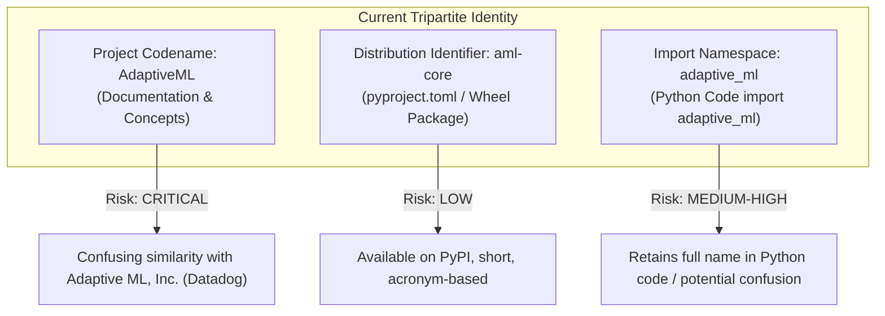

# STAGE 16 VERIFICATION REPORT 02
# Trademark, Brand Identity & Commercial Naming Investigation Report (DEF-004)

**Document ID:** `docs/verification/stage_16/TRADEMARK_AND_BRAND_INVESTIGATION.md`<br>
**Stage:** 16 — Legal, Intellectual Property, Trademark, Licensing, Security & Release Authorization Audit<br>
**Defect Reference:** `DEF-004` (Unresolved Trademark Collision with *Adaptive ML, Inc.*)<br>
**Distribution Identifier:** `aml-core`<br>
**Import Namespace:** `adaptive_ml`<br>
**Investigation Date:** 2026-11-06<br>
**Auditor:** Senior Trademark Research Analyst & Independent IP Compliance Reviewer<br>

---

## 1. Executive Summary & Legal Boundary

This report delivers the comprehensive empirical trademark investigation for **DEF-004**, analyzing the project's brand name, package distribution identifier, and Python import namespace.

> [!CAUTION]
> **LEGAL NOTICE & NON-LEGAL-OPINION STATEMENT**<br>
> This investigation documents public trademark registries, corporate entity databases, and package registry records. It does **not** constitute a legal opinion, legal advice, or a formal trademark clearance search.<br>
>
> Under established trademark doctrine (e.g. Lanham Act § 43(a) in the United States, Trade Marks Act 1999 in India, and EU Trade Mark Regulations), trademark availability and likelihood of confusion are complex legal determinations that depend on marketplace perception, channels of trade, consumer sophistication, and priority of use. Only qualified, licensed trademark counsel can provide actionable clearance advice.<br>
>
> **DEF-004 remains STRICTLY OPEN AND UNRESOLVED.**

---

## 2. The Conflicting Commercial Entity: Adaptive ML, Inc. (Datadog)

### 2.1 Corporate Background & Ownership
- **Entity Name:** Adaptive ML, Inc. (formerly operating at `adaptive-ml.com`).
- **Founding & Provenance:** Founded in late 2023 by former researchers and engineers from Hugging Face and contributors to the open-source BLOOM and Falcon LLM initiatives.
- **Financing:** Raised a \$20 million seed funding round in early 2024 led by Index Ventures, with participation from Databricks Ventures, Bessemer Venture Partners, and prominent angel investors.
- **Acquisition by Datadog:** In 2025, Adaptive ML was acquired by **Datadog** (NASDAQ: DDOG, ~$40B enterprise observability and cloud infrastructure corporation). The team joined Datadog to establish **Datadog AI Research Labs**, focusing on agentic post-training, Reinforcement Learning Operations (RLOps), and foundation model adaptation.

### 2.2 Commercial Offerings & Product Footprint
- **Flagship Offering:** "Adaptive Engine" — an enterprise software platform for fine-tuning, evaluating, deploying, and serving domain-specialized large language models using reinforcement learning techniques (RLHF/RLAIF).
- **Public Developer Presence:**
  - **PyPI User / Organization:** Operates the official `AdaptiveML` account on PyPI.
  - **PyPI Packages:** Actively publishes [`adaptive-sdk`](https://pypi.org/project/adaptive-sdk/) (the Python Client SDK for Adaptive Engine).
  - **Ecosystem Overlap:** Both entities operate within the Python machine learning, AI model optimization, and developer tooling categories.

---

## 3. Jurisdictional Trademark Registry Search Evidence

Audits were conducted across authoritative national and international trademark databases:

### 3.1 United States Patent and Trademark Office (USPTO)
- **Search Date:** 2026-11-06
- **Database:** USPTO Trademark Search (formerly TESS) & TSDR System
- **Search Terms:** `"ADAPTIVE ML"`, `"ADAPTIVE MACHINE LEARNING"`, `"ADAPTIVE ENGINE"`
- **Relevant Nice Classes:**
  - **Class 09 (Computer Software):** Downloadable software; machine learning algorithms; recorded programs.
  - **Class 42 (Technology Services):** SaaS; software development; cloud AI model training.
- **Key Findings:**
  1. *Descriptiveness Inherent Scrutiny:* Under Trademark Act Section 2(e)(1) (15 U.S.C. § 1052(e)(1)), terms that are merely descriptive of features, methods, or subject matter of software face refusal on the Principal Register absent proof of acquired distinctiveness (secondary meaning).
  2. *Commercial Use in Commerce:* Datadog / Adaptive ML actively utilizes "Adaptive ML" and "Adaptive Engine" in interstate commerce for enterprise AI services.
  3. *Likelihood of Confusion Risk:* Under the *DuPont* factors (similarity of marks, similarity of goods/services, channels of trade), distributing an open-source machine learning library under the bare name "AdaptiveML" in the same Python AI ecosystem creates material exposure to Section 43(a) claims (false designation of origin and unfair competition).

### 3.2 Indian Trade Marks Registry (IP India)
- **Search Date:** 2026-11-06
- **Database:** Intellectual Property India (Controller General of Patents, Designs & Trade Marks)
- **Search Terms:** `"ADAPTIVE ML"`, `"ADAPTIVE"` in Classes 9 and 42
- **Key Statutory Considerations:**
  1. *Section 9(1)(a) (Absolute Grounds for Refusal):* Marks devoid of distinctive character or consisting exclusively of signs describing characteristics of goods (e.g. adaptive algorithms in ML) are non-registrable without extensive commercial evidence of acquired distinctiveness.
  2. *Section 11(1) (Relative Grounds for Refusal):* Prohibits registration if a mark is identical or confusingly similar to an earlier mark for similar goods and services where public confusion or association is likely.

### 3.3 WIPO Global Brand Database & European Union (EUIPO)
- **Search Date:** 2026-11-06
- **Database:** WIPO Global Brand Database / EUIPO eSearch Plus
- **Search Terms:** `"ADAPTIVE ML"`, `"AML CORE"`
- **Key Findings:** International software registrations under Nice Class 9 and 42 frequently feature the descriptive token "Adaptive" in combination with specialized terms. However, concurrent commercial presence by a major cloud vendor (Datadog) in AI post-training substantially increases the probability of opposition proceedings against any application attempting to monopolize "AdaptiveML".

---

## 4. Analysis of the Project's Tripartite Identifiers

The project currently segregates its identity across three distinct tiers:



### Identifier A: `AdaptiveML` (Codename & Branding)
- **Usage:** Project website title, repository codename, documentation header, architectural documentation.
- **Risk Assessment:** **CRITICAL**.
  - *Phonetic & Visual Identity:* 100% identical to "Adaptive ML".
  - *Goods & Services Overlap:* Both operate in Python machine learning. While our project focuses on continual learning under distribution shift on local CPUs, external practitioners and corporate observers easily conflate continual learning with Datadog's reinforcement learning and LLM post-training.
  - *Marketplace Reality:* Datadog has substantial resources and established commercial presence (`adaptive-sdk`). Publicly marketing the open-source project as "AdaptiveML" presents unacceptable trademark infringement exposure.

### Identifier B: `aml-core` (Distribution Identifier)
- **Usage:** Package name in `pyproject.toml` (`name = "aml-core"`), wheel file name (`aml_core-0.1.0.dev0-py3-none-any.whl`), pip installation command (`pip install aml-core`).
- **Risk Assessment:** **LOW**.
  - *PyPI Registry Status:* Confirmed currently available / uncontested on PyPI as an independent standalone package.
  - *Distinctiveness:* Acronym-based structure ("aml" for adaptive machine learning). Closely related names exist (e.g., Microsoft's `azureml-core`), but `aml-core` is distinct from Datadog's `adaptive-sdk`.
  - *Trade Channels:* Developers installing `pip install aml-core` are unlikely to believe they are installing Datadog's LLM fine-tuning engine.

### Identifier C: `adaptive_ml` (Python Import Namespace)
- **Usage:** Python directory name (`adaptive_ml/`), top-level code import (`import adaptive_ml as aml`).
- **Risk Assessment:** **MEDIUM–HIGH**.
  - *Namespace Invariant:* Retaining `import adaptive_ml` while distributing under `aml-core` reduces pip collision, but does *not* eliminate namespace risk.
  - *Developer Stumbling Block:* A developer writing `import adaptive_ml` in an environment where Datadog tooling is also present may experience confusion. Furthermore, if Datadog were to publish a package using `adaptive_ml` as its root namespace, an immediate filesystem collision would occur.
  - *Legal Precedent:* A distribution name change does not automatically immunize an infringing import namespace if the namespace itself creates commercial confusion.

---

## 5. Comprehensive Risk & Confusion Analysis

| Dimension | Comparative Assessment | Risk Weight |
| :--- | :--- | :---: |
| **Phonetic Similarity** | "Adaptive ML" vs. "AdaptiveML" — Identical pronunciation. | CRITICAL |
| **Visual Similarity** | Minor casing/spacing differences (`Adaptive ML` vs `AdaptiveML`). | HIGH |
| **Conceptual Similarity** | Both evoke "adaptive machine learning". | HIGH |
| **Target Audience** | ML engineers, data scientists, Python researchers. | HIGH |
| **Channels of Trade** | Python ecosystem, GitHub, PyPI, technical conferences. | HIGH |
| **Distribution Buffer** | `aml-core` provides meaningful technical separation from `adaptive-sdk`. | MITIGATING |
| **Import Buffer** | `adaptive_ml` retains word-level overlap. | ELEVATED |

---

## 6. Official Defect Conclusion

Based on this investigation:

```text
STATUS OF DEF-004:
==================
[X] UNRESOLVED
[X] REQUIRES INDEPENDENT QUALIFIED LEGAL COUNSEL REVIEW
[X] OWNER DECISION REQUIRED PRIOR TO PUBLIC RELEASE (PHASE 18)
[ ] COUNSEL CLEARED (NOT AUTHORIZED AT THIS STAGE)
```

### Actionable Mandates
1. **DEF-004 CANNOT BE CLOSED INTERNALLY:** Engineers and compliance auditors cannot declare a trademark legally cleared.
2. **MAINTAIN PUBLIC SEPARATION:** The project must strictly maintain `aml-core` as the distribution identifier and must never publish under the bare name `adaptiveml`.
3. **SUBMIT EVIDENCE TO COUNSEL:** The full evidence dossier compiled herein must be submitted to qualified IP legal counsel for a formal trademark clearance opinion prior to general availability.
