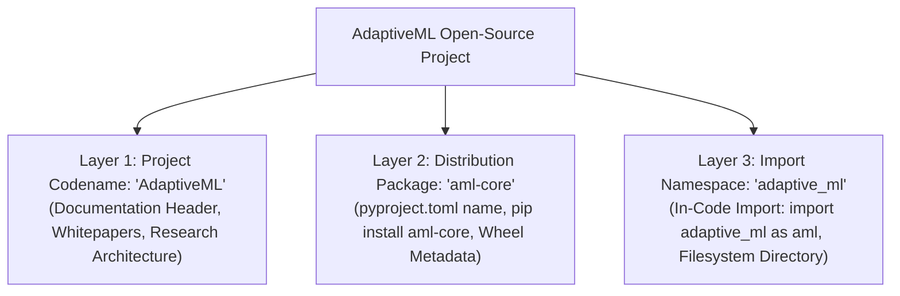

# STAGE 16.1 DELIVERABLE 02
# External Legal Counsel Submission Master Dossier

**Document Identifier:** `docs/verification/stage_16_1/COUNSEL_SUBMISSION_MASTER_DOSSIER.md` 
**Stage:** 16.1 — External Legal Counsel Review & Owner Decision Preparation 
**Distribution Identifier:** `aml-core` 
**Import Namespace:** `adaptive_ml` 
**Working Codename:** AdaptiveML 
**Reported Version:** `0.1.0.dev0` 
**Date:** 2026-11-06 
**Auditor Body:** Multidisciplinary Legal-Readiness, IP & Release Compliance Review Organization 
**Target Recipient:** Outside Intellectual Property & Trademark Legal Counsel 
**Review Status:** `COUNSEL DETERMINATION REQUIRED` 

---

## 1. Master Purpose & Scope of Submission

This document serves as the master executive dossier submitted to qualified external intellectual property and trademark legal counsel. It compiles all verified technical facts, commercial ecosystem context, intellectual property audits, and strategic brand alternatives for the open-source software project provisionally known as **AdaptiveML** (`aml-core`).

### Primary Legal Gate: Defect DEF-004
The project maintains an active, unresolved trademark collision (**DEF-004**) involving **Adaptive ML, Inc.** (an AI enterprise acquired by **Datadog, Inc.**). This dossier provides counsel with all technical and factual context required to render a formal legal opinion on:
1. Trademark availability, likelihood of confusion, and unfair competition exposure under Lanham Act § 43(a), Trade Marks Act 1999 (India), and EU law.
2. The legal adequacy of our tripartite naming architecture (`AdaptiveML` / `aml-core` / `adaptive_ml`).
3. Strategic release options: retain with disclaimers, partial branding adjustment, or full clean-break renaming.

---

## 2. Technical Profile & Product Architecture

| Dimension | Technical & Operational Reality | Evidence Classification |
| :--- | :--- | :---: |
| **Product Purpose** | Open-source Python algorithmic library for continual learning, concept drift adaptation, label noise filtering, and 8-bit optimizer state compression. | `[VERIFIED TECHNICAL FACT]` |
| **Architectural Model** | CPU-first, local-first algorithmic complement to standard stacks (NumPy, Scikit-Learn, PyTorch). Pure-Python/NumPy core engine with $35\text{ MB}$ uncompressed footprint. | `[VERIFIED TECHNICAL FACT]` |
| **Target Audience** | Machine learning researchers, scientific developers, and edge systems engineers deploying real-time streaming ML pipelines on commodity CPUs. | `[VERIFIED TECHNICAL FACT]` |
| **The Five Pillars** | **ALA 3.0** (Adaptive Learning), **RLA 3.0** (Robust Learning), **Minority Intelligence 2.0**, **RAO 2.0** (Resource-Aware Optimization), **ULC-v5** (Unified Learning Controller). | `[VERIFIED TECHNICAL FACT]` |
| **License Model** | Open Source: Apache License, Version 2.0 (`SPDX-License-Identifier: Apache-2.0`). | `[VERIFIED TECHNICAL FACT]` |
| **Commercial Intent** | Zero software licensing fees; pure open-source community research project. Future potential enterprise support reserved as owner option. | `[VERIFIED TECHNICAL FACT]` |

---

## 3. The Tripartite Project Identity

The project enforces a deliberate separation across three distinct naming layers:

1. **Layer 1: `AdaptiveML` (Project Codename):** Used as the human-readable project title across documentation, GitHub repositories, and scientific whitepapers.
2. **Layer 2: `aml-core` (Distribution Identifier):** Used as the formal package name on PyPI and in wheel metadata (`aml_core-0.1.0.dev0-py3-none-any.whl`). Confirmed available on PyPI.
3. **Layer 3: `adaptive_ml` (Python Import Namespace):** Used as the top-level Python module name (`import adaptive_ml as aml`).

---

## 4. The Known Commercial Entity & Conflict Facts (DEF-004)

### 4.1 Corporate Entity: Adaptive ML, Inc. (Acquired by Datadog)
- `[EXTERNAL SOURCE EVIDENCE]` Founded in late 2023 by former researchers from Hugging Face who contributed to the BLOOM and Falcon LLM models.
- `[EXTERNAL SOURCE EVIDENCE]` Raised a \$20M seed round in March 2024 backed by Index Ventures, Databricks Ventures, and Bessemer Venture Partners.
- `[EXTERNAL SOURCE EVIDENCE]` Acquired in 2025 by **Datadog, Inc.** (NASDAQ: DDOG), operating as **Datadog AI Research Labs**.
- `[EXTERNAL SOURCE EVIDENCE]` Markets the "Adaptive Engine" platform for enterprise LLM fine-tuning, evaluation, and reinforcement learning (RLHF/RLAIF).
- `[EXTERNAL SOURCE EVIDENCE]` Controls the official `AdaptiveML` organization account on PyPI and actively distributes [`adaptive-sdk`](https://pypi.org/project/adaptive-sdk/) as its client library.

### 4.2 Key Comparison & Collision Points

| Attribute | Datadog's Adaptive ML | AdaptiveML (`aml-core`) Project |
| :--- | :--- | :--- |
| **Core Technology** | Enterprise LLM fine-tuning, RLOps, agent post-training | Streaming continual learning, Hoeffding trees, 8-bit CPU AdamW |
| **Compute Hardware** | Cloud GPU clusters and distributed enterprise infrastructure | Commodity multi-core CPUs and edge inference devices |
| **Business Model** | Proprietary commercial enterprise platform | Free and open-source software (Apache-2.0) |
| **Distribution Channel**| PyPI package `adaptive-sdk` and cloud web portals | PyPI package `aml-core` |
| **Ecosystem Overlap** | High: Both operate within the Python machine learning and AI developer sector |

---

## 5. Summary of Copyright, Licensing & Prior-Art Audits

1. **Copyright & Code Provenance:** `[VERIFIED TECHNICAL FACT]`
   - $100\%$ of source code in `adaptive_ml/` (70 modules) was authored directly as clean-room implementations from published academic papers (Domingos & Hulten 2000, Bifet & Gavaldà 2007, Wang et al. 2019, Dettmers et al. 2022).
   - Exactly zero third-party source files or copyleft codebases are vendored. Linux Foundation DCO 1.1 sign-offs are verified across Git history.
2. **License Compliance:** `[VERIFIED TECHNICAL FACT]`
   - Core package is licensed under Apache-2.0. Full license text and companion `NOTICE` Section 4(d) attribution are bundled in all distributions.
   - All runtime and optional dependencies (`numpy`, `torch`, `scikit-learn`, `safetensors`, `pandas`, `polars`) are permissively licensed (`BSD-3-Clause`, `MIT`, `Apache-2.0`). Zero copyleft (`GPL`, `AGPL`, `LGPL`) dependencies exist.
3. **Patent & Prior Art:** `[ENGINEERING ASSESSMENT]`
   - Algorithmic foundations are grounded in public-domain mathematical literature.
   - 8-bit dynamic block quantization in `LowMemoryAdamW` operates in pure CPU NumPy/PyTorch, distinguishing it from proprietary hardware microcode or CUDA-specific kernel patents.
4. **Secret Scanning:** `[VERIFIED TECHNICAL FACT]`
   - Automated regular-expression scans across working files and Git commit history confirmed zero exposed API keys, tokens, or credentials.
5. **Dataset Compliance:** `[VERIFIED TECHNICAL FACT]`
   - $100\%$ procedural synthetic in-RAM data generation. Exactly zero raw data files are bundled in distributions. Zero PII collected.

---

## 6. Strategic Brand Contingency Scenarios

Should counsel advise that retaining "AdaptiveML" carries unacceptable trademark exposure, the project has screened candidate brand alternatives (currently marked **NOT LEGALLY CLEARED**):
- **Scenario A (Status Quo Retained):** Retain "AdaptiveML" as project codename, retain `aml-core` on PyPI, retain `adaptive_ml` in code, and display prominent negative disclaimers.
- **Scenario B (Partial Brand Migration):** Deprecate public use of "AdaptiveML"; market the project as **"The AML Core Project"** or **`StreamAdapt`**, keeping the import namespace `adaptive_ml`.
- **Scenario C (Full Clean-Break Migration):** Rebrand both the distribution and import namespace to a distinctive alternative (e.g. **`ResiliML`** $\to$ `pip install resiliml`, `import resiliml as rm`).

---

## 7. Submission Package Inventory

The following documents constitute the complete submission package delivered to legal counsel:
1. [`COUNSEL_SUBMISSION_MASTER_DOSSIER.md`](file:///c:/projects/AdaptiveML/docs/verification/stage_16_1/COUNSEL_SUBMISSION_MASTER_DOSSIER.md) (This master dossier)
2. [`TRADEMARK_EVIDENCE_REGISTER.md`](file:///c:/projects/AdaptiveML/docs/verification/stage_16_1/TRADEMARK_EVIDENCE_REGISTER.md) (Detailed factual records TE-01 to TE-04, PE-01 to PE-04, TM-01 to TM-03)
3. [`TRADEMARK_COUNSEL_QUESTIONS.md`](file:///c:/projects/AdaptiveML/docs/verification/stage_16_1/TRADEMARK_COUNSEL_QUESTIONS.md) (10 formal open-ended questions for counsel)
4. [`COPYRIGHT_AND_PROVENANCE_COUNSEL_DOSSIER.md`](file:///c:/projects/AdaptiveML/docs/verification/stage_16_1/COPYRIGHT_AND_PROVENANCE_COUNSEL_DOSSIER.md)
5. [`PATENT_AND_FTO_COUNSEL_DOSSIER.md`](file:///c:/projects/AdaptiveML/docs/verification/stage_16_1/PATENT_AND_FTO_COUNSEL_DOSSIER.md)
6. [`OPEN_SOURCE_AND_COMMERCIAL_LICENSING_REVIEW.md`](file:///c:/projects/AdaptiveML/docs/verification/stage_16_1/OPEN_SOURCE_AND_COMMERCIAL_LICENSING_REVIEW.md)
7. [`PACKAGE_IDENTITY_AND_NAMESPACE_DECISION_MATRIX.md`](file:///c:/projects/AdaptiveML/docs/verification/stage_16_1/PACKAGE_IDENTITY_AND_NAMESPACE_DECISION_MATRIX.md)
8. [`BRAND_MIGRATION_SCENARIO_ANALYSIS.md`](file:///c:/projects/AdaptiveML/docs/verification/stage_16_1/BRAND_MIGRATION_SCENARIO_ANALYSIS.md)
9. [`RELEASE_GATE_AND_AUTHORIZATION_MATRIX.md`](file:///c:/projects/AdaptiveML/docs/verification/stage_16_1/RELEASE_GATE_AND_AUTHORIZATION_MATRIX.md)
10. [`OWNER_DECISION_MEMORANDUM.md`](file:///c:/projects/AdaptiveML/docs/verification/stage_16_1/OWNER_DECISION_MEMORANDUM.md)
11. [`DEF_004_REMEDIATION_AND_CLOSURE_CRITERIA.md`](file:///c:/projects/AdaptiveML/docs/verification/stage_16_1/DEF_004_REMEDIATION_AND_CLOSURE_CRITERIA.md)
12. [`STAGE_16_1_EVIDENCE_TRACEABILITY_MATRIX.md`](file:///c:/projects/AdaptiveML/docs/verification/stage_16_1/STAGE_16_1_EVIDENCE_TRACEABILITY_MATRIX.md)
13. [`STAGE_16_1_INDEPENDENT_REVIEW.md`](file:///c:/projects/AdaptiveML/docs/verification/stage_16_1/STAGE_16_1_INDEPENDENT_REVIEW.md)
14. [`STAGE_16_1_COMPLETION_REPORT.md`](file:///c:/projects/AdaptiveML/docs/verification/stage_16_1/STAGE_16_1_COMPLETION_REPORT.md)

---

## 8. Verification Conclusion

This master submission dossier provides external counsel with an objective, evidence-backed foundation for rendering an actionable legal opinion.
