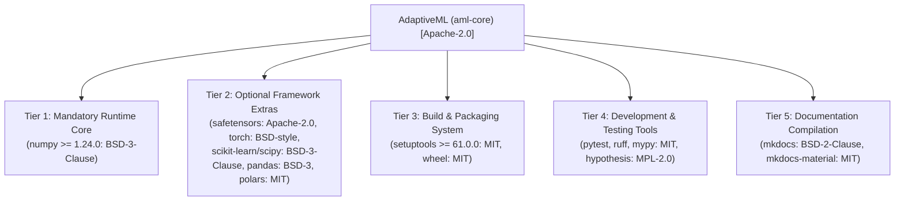

# STAGE 16.1 DELIVERABLE 07
# Open-Source License Compliance & Commercial Distribution Readiness Review

**Document Identifier:** `docs/verification/stage_16_1/OPEN_SOURCE_AND_COMMERCIAL_LICENSING_REVIEW.md` 
**Stage:** 16.1 — External Legal Counsel Review & Owner Decision Preparation 
**Distribution Identifier:** `aml-core` 
**Import Namespace:** `adaptive_ml` 
**Working Codename:** AdaptiveML 
**Date:** 2026-11-06 
**Auditor:** Software Licensing Specialist & Open-Source Compliance Officer 
**Target Recipient:** Outside Intellectual Property & Commercial Licensing Legal Counsel 
**Review Status:** `COUNSEL DETERMINATION REQUIRED` 

---

## 1. Executive Summary & Legal Disclaimers

> [!WARNING]
> **LEGAL NOTICE & NON-LEGAL-OPINION STATEMENT** 
> This document audits the software licenses, dependency manifests, build metadata, and commercial redistribution obligations across AdaptiveML (`aml-core` v0.1.0.dev0). It is prepared for review by qualified commercial licensing and open-source legal counsel. 
>
> Technical and packaging compliance with open-source license terms does **not** constitute a formal legal guarantee of non-infringement or commercial warranty.

---

## 2. Multi-Tier Dependency License Inventory

AdaptiveML enforces a strict dependency boundary, preventing transitive license contamination by separating dependencies into distinct operational tiers:

### Detailed Multi-Tier Dependency Audit Table

| Tier Category | Package Name | Declared Version | Upstream License | Commercial Permissibility | Copyleft Contamination Risk |
| :--- | :--- | :---: | :---: | :---: | :---: |
| **Tier 1: Mandatory Core** | `numpy` | `>=1.24.0` | `BSD-3-Clause` | Fully Permissive (Binary linking & redistribution permitted) | **ZERO** (Permissive) |
| **Tier 2: Optional Extra** | `safetensors` | `>=0.4.0` | `Apache-2.0` | Fully Permissive (Identical terms) | **ZERO** (Permissive) |
| **Tier 2: Optional Extra** | `torch` | `>=2.0.0` | `BSD-style` | Fully Permissive (Binary redistribution permitted) | **ZERO** (Permissive) |
| **Tier 2: Optional Extra** | `scikit-learn` | `>=1.2.0` | `BSD-3-Clause` | Fully Permissive (Binary redistribution permitted) | **ZERO** (Permissive) |
| **Tier 2: Optional Extra** | `scipy` | `>=1.10.0` | `BSD-3-Clause` | Fully Permissive (Binary redistribution permitted) | **ZERO** (Permissive) |
| **Tier 2: Optional Extra** | `pandas` | `>=1.5.0` | `BSD-3-Clause` | Fully Permissive (Binary redistribution permitted) | **ZERO** (Permissive) |
| **Tier 2: Optional Extra** | `polars` | `>=0.18.0` | `MIT` | Fully Permissive (Binary redistribution permitted) | **ZERO** (Permissive) |
| **Tier 2: Optional Extra** | `psutil` | `>=5.9.0` | `BSD-3-Clause` | Fully Permissive (Binary redistribution permitted) | **ZERO** (Permissive) |
| **Tier 3: Build System** | `setuptools` | `>=61.0.0` | `MIT` | Build-time tool only (Not bundled in runtime) | **ZERO** (Permissive) |
| **Tier 3: Build System** | `wheel` | Latest | `MIT` | Packaging utility only (Not bundled in runtime) | **ZERO** (Permissive) |
| **Tier 4: Dev & Test** | `pytest` | `>=7.4.0` | `MIT` | Dev-only test framework (Not bundled) | **ZERO** (Permissive) |
| **Tier 4: Dev & Test** | `pytest-cov` | `>=4.1.0` | `MIT` | Dev-only coverage tool (Not bundled) | **ZERO** (Permissive) |
| **Tier 4: Dev & Test** | `hypothesis` | `>=6.80.0` | `MPL-2.0` | Weak copyleft isolated strictly to test files (Not bundled) | **ZERO** (Non-bundled) |
| **Tier 4: Dev & Test** | `mypy` | `>=1.5.0` | `MIT` | Static typing tool (Not bundled) | **ZERO** (Permissive) |
| **Tier 4: Dev & Test** | `ruff` | `>=0.1.0` | `MIT` | Linter/formatter (Not bundled) | **ZERO** (Permissive) |
| **Tier 5: Documentation** | `mkdocs` | `>=1.5.0` | `BSD-2-Clause` | Static site compiler (Not bundled in wheel) | **ZERO** (Permissive) |
| **Tier 5: Documentation** | `mkdocs-material` | `>=9.4.0` | `MIT` | Theme provider (Not bundled in wheel) | **ZERO** (Permissive) |

---

## 3. Bundled Asset & Dataset License Verification

1. **Third-Party Code Bundling:** `[VERIFIED TECHNICAL FACT]` Exactly **zero** third-party `.py` files, dynamic C libraries, or vendored repositories exist in `adaptive_ml/` or in the built wheel archive (`aml_core-0.1.0.dev0-py3-none-any.whl`).
2. **Dataset Bundling:** `[VERIFIED TECHNICAL FACT]` Exactly **zero** raw data files (`.csv`, `.tsv`, `.parquet`, `.jsonl`, `.sqlite`) are bundled in the package. All test fixtures and streaming benchmarks generate synthetic floating-point matrices ephemerally in RAM.
3. **Media & Documentation Assets:** `[VERIFIED TECHNICAL FACT]` All diagrams are defined in plain-text Mermaid syntax. Zero commercial stock photographs or proprietary fonts are included.

---

## 4. Commercial Distribution Checklist for Counsel

Should project owners authorize commercial distribution, enterprise support contracts, or downstream redistribution by enterprise clients, counsel is requested to review the following compliance checklist:

| Compliance Area | Apache-2.0 Requirement | Technical Implementation in AdaptiveML | Counsel Verification Required |
| :--- | :--- | :--- | :---: |
| **License Text Inclusion** | Must include a copy of the Apache-2.0 License in all distributions (Section 4(a)). | Full 177-line text included in root `LICENSE` and wheel `.dist-info/licenses/LICENSE`. | `[COUNSEL DETERMINATION REQUIRED]` |
| **NOTICE File Distribution** | Must retain attribution notices in companion NOTICE file (Section 4(d)). | Root `NOTICE` included in `.dist-info/licenses/NOTICE` with copyright credits and trademark disclaimer. | `[COUNSEL DETERMINATION REQUIRED]` |
| **Third-Party Disclaimers** | Must not misrepresent affiliation with third-party trademarks (Section 6). | `NOTICE` and `docs/community/license.md` explicitly disclaim affiliation with *Adaptive ML, Inc.* | `[COUNSEL DETERMINATION REQUIRED]` |
| **Patent Defense Clause** | Patent license terminates if licensee files a patent infringement lawsuit (Section 3). | Apache-2.0 Section 3 defensive termination clause is intact. | `[COUNSEL DETERMINATION REQUIRED]` |
| **Warranty & Liability** | Must provide software "AS IS" without warranty or indemnification (Sections 7 & 8). | Sections 7 and 8 disclaimer clauses are unmodified. | `[COUNSEL DETERMINATION REQUIRED]` |
| **Contributor Provenance** | Must verify contributors had the legal right to submit code. | Linux Foundation DCO 1.1 sign-offs enforced across repository Git history. | `[COUNSEL DETERMINATION REQUIRED]` |
| **Commercial Dual-Licensing** | Permissibility of offering commercial warranties or enterprise indemnification (Section 9). | Reserved for project owner discretion upon counsel guidance. | `[OWNER DECISION REQUIRED]` |

---

## 5. Formal Licensing Inquiries for Legal Counsel

1. `[LEGAL QUESTION]` **Weak-Copyleft Isolation in Dev Tools:**
   Does counsel concur that utilizing `hypothesis` (licensed under Mozilla Public License 2.0) strictly within development test fixtures under `tests/` creates zero copyleft or source-disclosure obligations for the distributed `aml-core` runtime wheel?
2. `[LEGAL QUESTION]` **Section 4(d) Compliance:**
   Does our companion `NOTICE` file adequately fulfill Section 4(d) requirements for downstream redistribution by enterprise users?
3. `[LEGAL QUESTION]` **Commercial Support & Indemnification (Section 9):**
   If project owners offer paid enterprise support or SLA-backed warranties in the future, does counsel advise creating an independent corporate entity separate from the open-source contributor collective?
