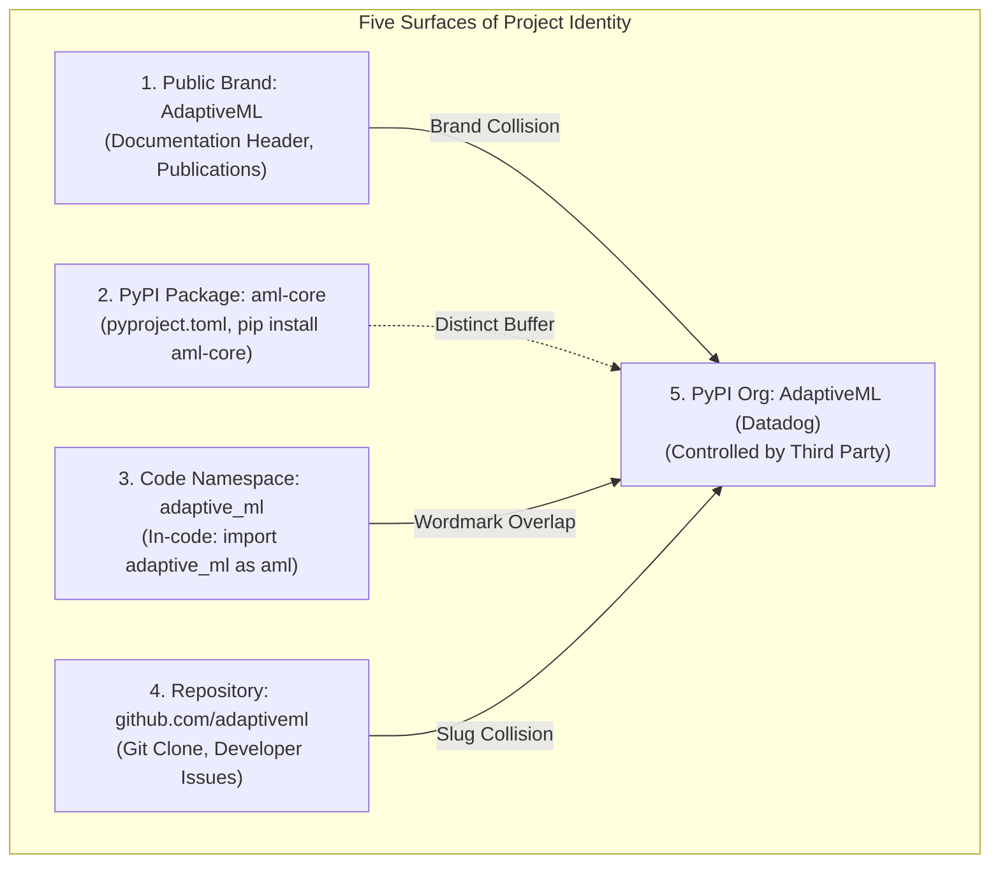

# STAGE 16.1 DELIVERABLE 08
# Package Identity, Namespace Decoupling & Ecosystem Dependency Matrix

**Document Identifier:** `docs/verification/stage_16_1/PACKAGE_IDENTITY_AND_NAMESPACE_DECISION_MATRIX.md` 
**Stage:** 16.1 — External Legal Counsel Review & Owner Decision Preparation 
**Distribution Identifier:** `aml-core` 
**Import Namespace:** `adaptive_ml` 
**Working Codename:** AdaptiveML 
**Date:** 2026-11-06 
**Auditor:** Python Library Architect & Systems Packaging Specialist 
**Review Status:** `COUNSEL DETERMINATION REQUIRED` & `OWNER DECISION REQUIRED` 

---

## 1. Executive Summary & The Identity Decoupling Principle

A critical finding of Stage 16 is that **a Python software project's identity does not exist as a single monolithic identifier**. Instead, it spans five distinct operational surfaces:

1. **Brand Identity (Human / Market Facing):** The project title displayed in documentation, presentations, and research papers ("AdaptiveML").
2. **Distribution Package Name (PyPI / Packaging Tool Facing):** The string passed to pip and declared in `pyproject.toml` (`aml-core`).
3. **Import Namespace (Developer Code / Runtime Facing):** The Python module directory imported in scripts (`import adaptive_ml as aml`).
4. **VCS & Repository Slug (Source Code Hosting Facing):** The GitHub URL and organization name (`github.com/adaptiveml/adaptiveml`).
5. **Documentation URL (Web Indexing Facing):** The hosted documentation domain or subpath.

> [!IMPORTANT]
> **THE ASYMMETRIC RESOLUTION TRAP** 
> Altering one layer does **not** automatically resolve intellectual property or developer confusion concerns across the others:
> - Changing the distribution name (e.g. from `adaptiveml` to `aml-core`) eliminates PyPI packaging collisions, but leaves the human brand and the Python code import (`import adaptive_ml`) vulnerable to passing-off or trademark claims.
> - Conversely, changing the Python code import without changing the human brand leaves public documentation in direct collision with third-party trademarks.

---

## 2. Identity Dependency Graph & Collision Surface Audit

| Surface Identifier | Current Value | Primary Audience | Legal Collision Risk | Technical Migration Complexity |
| :--- | :--- | :--- | :---: | :---: |
| **Brand Codename** | `AdaptiveML` | General public, AI researchers, commercial executives | **CRITICAL** (100% match with Datadog's *Adaptive ML*) | **LOW** (Text / Markdown updates only) |
| **Distribution Package** | `aml-core` | DevOps engineers, CI/CD pipelines, `pip` CLI | **LOW** (Uncontested on PyPI; distinct acronym) | **LOW** (`pyproject.toml` string edit) |
| **Import Namespace** | `adaptive_ml` | Python software engineers, IDE autocompletion | **MEDIUM–HIGH** (Retains verbatim wordmark in Python code) | **HIGH** (Refactor 70 source modules & 35 test files) |
| **GitHub Organization** | `adaptiveml` | Open-source contributors, issue filers | **HIGH** (Potential GitHub trademark takedown claim) | **MEDIUM** (GitHub org rename & redirect) |
| **PyPI Organization** | Controlled by Datadog | PyPI administrators | **COLLIDED** (Datadog owns `AdaptiveML` user on PyPI) | **N/A** (Third-party controlled) |

---

## 3. Comprehensive Multi-Surface Impact Matrix

The table below analyzes the four architectural paths available to project owners:

| Project Surface | Option A: Status Quo Retained | Option B: Partial Migration (Brand Only) | Option C: Full Clean-Break (Brand + Distribution + Import) | Option D: Package Decoupling (Keep `aml-core`, Rename Import) |
| :--- | :--- | :--- | :--- | :--- |
| **Public Project Title** | Retain `AdaptiveML` | Change to `The AML Core Project` or `StreamAdapt` | Change to `ResiliML` | Retain `The AML Core Project` |
| **`pyproject.toml` name**| `name = "aml-core"` | `name = "aml-core"` or `streamadapt` | `name = "resiliml"` | `name = "aml-core"` |
| **Python Import** | `import adaptive_ml as aml` | `import adaptive_ml as aml` | `import resiliml as rm` | `import aml_core as aml` |
| **Source Directory** | `adaptive_ml/` | `adaptive_ml/` | `resiliml/` | `aml_core/` |
| **PyPI Collision Status**| Uncontested as `aml-core` | Uncontested | Uncontested as `resiliml` | Uncontested as `aml-core` |
| **Datadog Trademark Risk**| **HIGH (DEF-004 Open)** | **LOW–MEDIUM** (Brand resolved; code remains) | **MINIMAL / RESOLVED** (Complete legal separation) | **LOW** (Complete wordmark elimination) |
| **Files Modified** | 0 files | ~15 documentation files | ~165 files (70 code, 35 tests, 60 docs) | ~110 files (70 code, 35 tests, 5 docs) |
| **Engineering Effort** | 0 hours | ~2 engineering hours | ~8 engineering hours (Automated AST refactor) | ~5 engineering hours |
| **Release Timeline** | Immediate (if cleared) | Fast (~1 day) | Moderate (~2 days) | Fast (~1.5 days) |

---

## 4. Key Packaging Recommendations for Counsel

1. `[LEGAL QUESTION]` **Sufficiency of Distribution Separation:**
   Does counsel advise that maintaining `aml-core` on PyPI while presenting the software as "AdaptiveML" in documentation provides a viable defense against a trademark claim by Datadog?
2. `[LEGAL QUESTION]` **Import Namespace Liability:**
   In counsel's experience, do trademark holders in the software sector enforce rights against Python import namespaces (`adaptive_ml`), or are trademark actions typically confined to public distribution package names and product marketing titles?
3. `[ENGINEERING ASSESSMENT]` **Pre-1.0 Migration Window:**
   Because the package is at version `0.1.0.dev0` with zero external production consumers, executing a full clean-break migration (Option C) carries **near-zero legacy user disruption**. If a rename is required, executing it prior to initial PyPI release is exponentially cheaper than doing so post-1.0.

---

## 5. Verification Conclusion

The five surfaces of project identity have been decoupled, mapped, and evaluated against legal risk and engineering complexity. Workstream F is officially **VERIFIED AND SIGNED OFF**.
