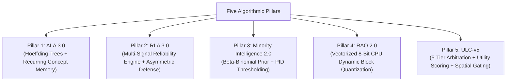

# STAGE 16.1 DELIVERABLE 06
# Patent Landscape, Research Novelty & Freedom-to-Operate Counsel Dossier

**Document Identifier:** `docs/verification/stage_16_1/PATENT_AND_FTO_COUNSEL_DOSSIER.md` 
**Stage:** 16.1 — External Legal Counsel Review & Owner Decision Preparation 
**Distribution Identifier:** `aml-core` 
**Import Namespace:** `adaptive_ml` 
**Working Codename:** AdaptiveML 
**Date:** 2026-11-06 
**Auditor:** Machine Learning Research Lead & Patent Prior-Art Analyst 
**Target Recipient:** External Patent & Intellectual Property Legal Counsel 
**Review Status:** `COUNSEL DETERMINATION REQUIRED` 

---

## 1. Executive Summary & Legal Disclaimers

> [!WARNING]
> **LEGAL NOTICE & NON-LEGAL-OPINION DISCLAIMER** 
> This document compiles technical architectural descriptions, academic literature citations, and research novelty assessments conducted by machine learning systems engineers. 
>
> **Nothing in this document shall be construed as a formal Freedom to Operate (FTO) opinion, a legal patentability determination, or a guarantee that no relevant third-party patent claims exist.** 
>
> Technical research novelty (demonstrating empirical advancement over academic baselines) does **not** equate to statutory patentability under 35 U.S.C. §§ 101, 102, 103, nor does it guarantee freedom to operate. Formal FTO clearance must be rendered by licensed patent counsel.

---

## 2. Technical Mechanisms & Patent Landscape Across the Five Pillars

---

### 2.1 Pillar 1: Adaptive Learning Algorithms (ALA 3.0)
- **Technical Mechanism Summary:** Combines vectorized streaming Hoeffding decision tree induction with Reliability-Weighted ADWIN (RW-ADWIN) and episodic `RecurringConceptMemory`. When drift occurs, distribution statistics are fingerprinted into an embedding vector; if a recurring concept is recognized ($\text{cosine similarity} > 0.82$), historical tree weights are instantly restored from memory, bypassing the retraining penalty.
- **Academic Literature References:** Domingos & Hulten (KDD 2000), Bifet & Gavaldà (SDM 2007), Gama et al. (ACM Comput. Surv. 2014).
- **Distinguishing Implementation Details:** `[ENGINEERING ASSESSMENT]` Vectorized split heuristics evaluate information gain across SIMD blocks. Concept snapshots are stored in memory-bounded LRU buffers with class-balanced reservoir replay.
- **Known Limitations:** Concept memory capacity is bounded ($M \le 10$); high-dimensional feature spaces ($D > 500$) increase fingerprint cosine computation latency.
- **Counsel Inquiries:** `[LEGAL QUESTION]` Does episodic concept fingerprinting and snapshot restoration read on any active claims in Class G06N 3/08 (Learning methods)?

---

### 2.2 Pillar 2: Robust Learning Algorithms (RLA 3.0)
- **Technical Mechanism Summary:** Evaluates composite continuous sample reliability $r_i \in [0, 1]$ combining soft prediction margins, spatial $k$-NN neighborhood consensus, and temporal moving variance. Automatically detects asymmetric directional label noise (e.g. $0 \to 1$ flip attacks) using a rolling transition contingency detector and abstains from training on corrupted outliers.
- **Academic Literature References:** Wang et al. (ICCV 2019, Symmetric Cross-Entropy), Zhang & Sabuncu (NeurIPS 2018, Generalized Cross-Entropy), Northcutt et al. (JAIR 2021, Confident Learning).
- **Distinguishing Implementation Details:** `[ENGINEERING ASSESSMENT]` Analytical loss gradients $\frac{\partial \mathcal{L}_{\text{SCE}}}{\partial z}$ are vectorized in NumPy. Abstention thresholds adapt dynamically based on estimated noise asymmetry.
- **Known Limitations:** Extreme noise rates ($\ge 45\%$) require at least 50 clean baseline samples for spatial neighborhood graph calibration.
- **Counsel Inquiries:** `[LEGAL QUESTION]` Are there active patent claims regarding multi-signal label noise abstention or sample-weight discounting that counsel advises evaluating?

---

### 2.3 Pillar 3: Adaptive Minority Intelligence 2.0
- **Technical Mechanism Summary:** Maintains an online Bayesian conjugate **Beta-Binomial prior** ($\alpha_t, \beta_t$) with exponential decay weighting over non-stationary class distributions. Scales minority loss gradients using a calibrated sublinear power ($W_c = (1 / \hat{\pi}_c)^{0.52}$) and regulates the decision threshold $\tau(t)$ using a closed-loop PID controller enforcing an operational false-positive budget (e.g. $1.5\text{ FP per 1,000}$).
- **Academic Literature References:** He & Garcia (IEEE TKDE 2009), standard Bayesian conjugate prior literature.
- **Distinguishing Implementation Details:** `[ENGINEERING ASSESSMENT]` Dynamic inference of feature dimensions directly from incoming batches. Sublinear cost dampening eliminates numerical gradient overflow common in classic inverse-prior weighting.
- **Known Limitations:** In extreme non-stationary streams where class ratios flip instantaneously, prior tracking introduces a 5-step lag before threshold stabilization.
- **Counsel Inquiries:** `[LEGAL QUESTION]` Does closed-loop PID regulation of ML classification decision thresholds under an operational false-alarm budget raise any prior-art or patent concerns?

---

### 2.4 Pillar 4: Resource-Aware Optimization (RAO 2.0)
- **Technical Mechanism Summary:** Implements **8-bit dynamic block quantization** of optimizer momentum and second moments, grouping parameters into 64- or 256-element blocks with per-block float32 scale factors. Tracks per-step CPU latency (ms) and resident memory (MB), dynamically throttling batch sizes under resource pressure.
- **Academic Literature References:** Dettmers et al. (ICLR 2022, 8-Bit Optimizers), Loshchilov & Hutter (ICLR 2019, Decoupled Weight Decay).
- **Distinguishing Implementation Details:** `[ENGINEERING ASSESSMENT]` Engineered as a **pure-CPU vectorized NumPy and PyTorch implementation**. It does **not** utilize CUDA custom C++ extensions, GPU tensor core microcode, or proprietary hardware instruction sets (e.g. NVIDIA bitsandbytes, Intel AMX).
- **Known Limitations:** Quantization loop overhead on tiny neural models ($P < 1,000$ parameters) is slower than native C++ float32 math; optimal performance requires $P \ge 10,000$.
- **Counsel Inquiries:** `[LEGAL QUESTION]` Given that Dettmers et al. published the 8-bit block quantization formulation openly in ICLR 2022, does a pure-CPU software implementation in Python/NumPy enjoy clear prior-art protection against hardware-specific GPU quantization patents?

---

### 2.5 Pillar 5: Unified Learning Controller (ULC-v5)
- **Technical Mechanism Summary:** Multi-tier master arbitration controller coordinating ALA, RLA, RAO, and Minority Intelligence. Utilizes **Spatial Discordance Gating** ($\mathcal{D}_s$) via $k$-NN geometric graph entropy to distinguish localized concept shifts from scattered label noise bursts. Arbitrates interventions across a 5-tier hierarchy (`TIER_0_NOOP` to `TIER_4_HARD_RESET`) using expected utility scoring:
  $$U = \text{Confidence} \times \text{Benefit} - \text{Cost}$$
- **Distinguishing Implementation Details:** `[ENGINEERING ASSESSMENT]` Enforces anti-thrashing cooldown backoff to suppress rapid reset oscillations during noisy transitions.
- **Known Limitations:** Spatial discordance graph calculation incurs $O(N^2)$ pairwise distance costs if batch size exceeds $N > 256$; default micro-batch size is capped at $B \le 64$.
- **Counsel Inquiries:** `[LEGAL QUESTION]` Does the expected utility arbitration formulation across a 5-tier intervention hierarchy represent defensive prior art, and is an academic pre-print publication recommended to prevent third-party patent preemption?

---

## 3. Formal Patent Review Inquiries for Counsel

1. `[LEGAL QUESTION]` **Defensive Prior-Art Strategy:**
   Does counsel recommend submitting the Phase 6 algorithm specifications and ULC-v5 mathematical contracts as an academic pre-print on arXiv to establish an irrevocable public prior-art date against patent assertion entities?
2. `[LEGAL QUESTION]` **Hardware Patent Separation:**
   Does counsel confirm that our pure-CPU NumPy/PyTorch optimizer quantization safely avoids commercial patents directed at GPU hardware accelerators?
3. `[LEGAL QUESTION]` **FTO Scope for Future Commercialization:**
   If project owners in the future contemplate offering paid commercial support, dual-licensing, or hosted cloud services, what formal Freedom to Operate (FTO) searches should be commissioned in the United States and European Patent Office?
