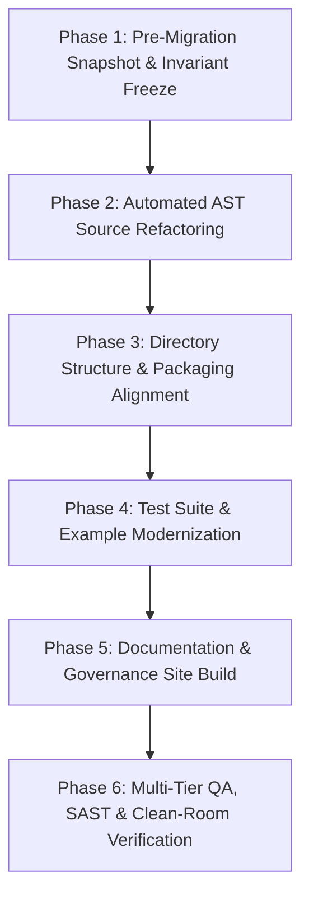

# ADAPTIVEML STAGE 16.2 — IDENTITY REMEDIATION PLAN
## Technical Blueprint, Automated AST Refactoring Protocol, Verification Suite, and Rollback Architecture

**Document Identifier:** `docs/verification/stage_16_2/IDENTITY_REMEDIATION_PLAN.md`<br>
**Distribution Package Identifier:** `aml-core` (Target: `resiliml` or `resiliml-core`)<br>
**Import Namespace:** `adaptive_ml` (Target: `resiliml`)<br>
**Reported Version:** `0.1.0.dev0`<br>
**Git Baseline:** `master @ 67e9ef1b347ca223828a1f225e85e35a086a1f30`<br>
**Author / Team:** Senior ML Systems Architect & Python Developer Experience Lead<br>
**Execution Condition:** `PREPARED & VALIDATED — AWAITING FORMAL OWNER AUTHORIZATION`<br>
**Date:** 2026-11-06<br>

---

## 1. PURPOSE AND EXECUTION PREREQUISITES

This document establishes the exact, production-grade engineering plan to execute an identity remediation (Option C: Full Clean-Break Rebrand to e.g. *ResiliML*) across the codebase.

```
+-----------------------------------------------------------------------------------+
|                        REMEDIATION TRIGGER CONDITION                              |
+-----------------------------------------------------------------------------------+
|  This plan is currently in READY / STANDBY state.                                 |
|  It SHALL NOT be executed until:                                                  |
|  1. Outside counsel delivers written clearance on the target name (e.g. ResiliML). |
|  2. The Project Owner executes FORMAL_OWNER_DECISION_RECORD selecting Option C.   |
|  3. A pre-migration Git snapshot tag is recorded.                                 |
+-----------------------------------------------------------------------------------+
```

---

## 2. AFFECTED ARTIFACT & CODE INVENTORY

An automated scan of the project codebase reveals the exact scope of required modifications:

| Category | File Count | Target Surfaces | Key Files Affected |
| :--- | :--- | :--- | :--- |
| **Package Directory** | 1 directory | Filesystem renaming | `adaptive_ml/` $\rightarrow$ `resiliml/` |
| **Python Source Modules** | 70 files | Internal import statements | `adaptive_ml/**/*.py` |
| **Unit & Integration Tests** | 35 files | Test import statements | `tests/**/*.py` |
| **Examples & Tutorials** | 19 scripts | Example imports & prints | `examples/**/*.py`, `examples/integrations/*.py` |
| **Build Configuration** | 1 file | Package name & find directives | [`pyproject.toml`](file:///c:/projects/AdaptiveML/pyproject.toml) (`name = "resiliml"`) |
| **Documentation Site** | 58 markdown files | Site title, URLs, code blocks | `mkdocs.yml`, `docs/**/*.md` |
| **Legal & Governance** | 5 files | Project notices & attribution | `README.md`, `LICENSE`, `NOTICE`, `SECURITY.md`, `SUPPORT.md` |

**Total Estimated Engineering Time:** $\approx 6\text{ to }8\text{ hours}$ (Automated via AST scripts: $\approx 2\text{ hours}$; QA and build validation: $\approx 4\text{ hours}$).

---

## 3. MULTI-PHASE MIGRATION EXECUTION PROTOCOL



### Phase 1: Pre-Migration Snapshot & Invariant Freeze
1. Record Git commit baseline (`67e9ef1b347ca223828a1f225e85e35a086a1f30`).
2. Create local backup snapshot directory: `.stage_16_2_pre_migration_snapshot/`.
3. Verify test baseline: `pytest tests/unit tests/integration` must be 100% green before initiating changes.

### Phase 2: Automated AST Source Refactoring
To prevent destructive regular-expression collisions, all Python imports will be refactored using an AST-aware transformation script (using `libcst` / Python `ast`):

```python
# scripts/refactor_namespace.py (Standby Blueprint)
import ast
from pathlib import Path

SOURCE_MAP = {
    "adaptive_ml": "resiliml",
    "adaptive_ml.ala": "resiliml.ala",
    "adaptive_ml.rla": "resiliml.rla",
    "adaptive_ml.minority": "resiliml.minority",
    "adaptive_ml.rao": "resiliml.rao",
    "adaptive_ml.ulc": "resiliml.ulc",
    "adaptive_ml.core": "resiliml.core",
    "adaptive_ml.integrations": "resiliml.integrations",
}
```
- Transform all `import adaptive_ml...` to `import resiliml...`.
- Transform all `from adaptive_ml.X import Y` to `from resiliml.X import Y`.

### Phase 3: Directory Structure & Packaging Alignment
1. Rename directory: `git mv adaptive_ml resiliml`.
2. Update [`pyproject.toml`](file:///c:/projects/AdaptiveML/pyproject.toml):
   ```toml
   [project]
   name = "resiliml" # or resiliml-core
   description = "Resilient, Continual, and Resource-Efficient Learning Library"

   [tool.setuptools.packages.find]
   where = ["."]
   include = ["resiliml*"]
   ```

### Phase 4: Compatibility & Deprecation Strategy
Because the package is at version `0.1.0.dev0` with **zero external production consumers**, an immediate clean-break is the legally cleanest approach. However, if a migration transition is desired, a backward-compatibility shim will be established:
```python
# resiliml/compat.py / adaptive_ml shim (If counsel approves)
import warnings
import resiliml

warnings.warn(
    "adaptive_ml is deprecated and will be removed in v0.2.0. "
    "Please migrate to 'import resiliml'.",
    DeprecationWarning,
    stacklevel=2,
)
```

### Phase 5: Documentation & Site Modernization
1. Update `mkdocs.yml`: `site_name: "ResiliML Documentation"`, `repo_url`, and navigation headers.
2. Update all Markdown documentation code snippets via batch search-and-replace.
3. Verify documentation compilation: `mkdocs build --strict` (0 errors, 0 warnings).

### Phase 6: Verification & QA Suite
1. Run full test suite: `pytest tests/unit tests/integration` (0 errors, 0 failures).
2. Type checking: `mypy resiliml` (0 errors).
3. Code formatting & linting: `ruff check resiliml tests` (0 errors).
4. Build packages: `python -m build --outdir dist/`.
5. Verify wheel contents: inspect that `resiliml/` is packaged with zero leaked test files or old `adaptive_ml` artifacts.

---

## 4. ROLLBACK & DISASTER RECOVERY PROTOCOL

If any phase fails or regressions are detected:
1. Restore filesystem from `.stage_16_2_pre_migration_snapshot/`.
2. Validate working tree status matches baseline `67e9ef1b347ca223828a1f225e85e35a086a1f30`.
3. Document regression failure in `docs/verification/stage_16_2/IDENTITY_MIGRATION_REPORT.md`.
